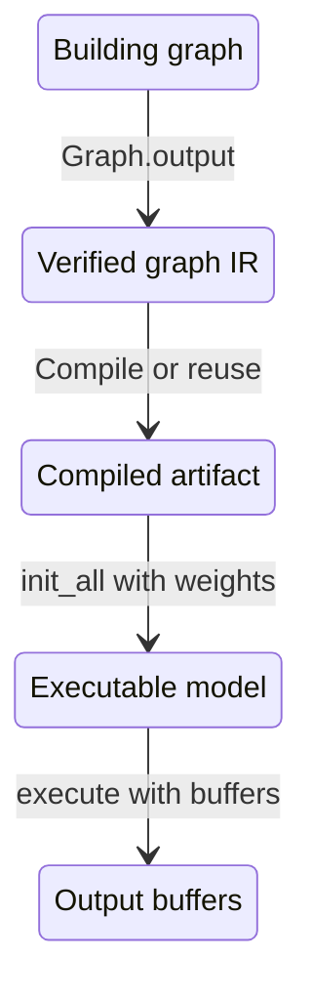

# Source map: Llama 2 7B graph finalization and compilation

For complete expandable implementations, open the [interactive guide](index.html)
or its [Markdown companion](WALKTHROUGH.md).

Evidence: **`SOURCE`**, except the explicitly marked test references.
Revision: `610f7111836d9a950d45ba52ec9b3e0ed589fe3f`.
Scope: built-in Graph API decoder on one device. Llama 2 7B is the confirmed
model family; checkpoint-specific execution remains an experiment.

**Graph finalization completes the graph's interface and verifies its IR.
Compilation transforms the graph into a compiled artifact. Initialization
binds weights and creates an executable model.** These are distinct operations.

## 1. Find the Llama graph builder

Read the symbols in this order. The serving entry establishes context; the
central model-loading method is `LlamaModelBase.load_graphs()`.

| Stop | Code | What to inspect |
|---|---|---|
| Serving entry | [`serve_api_server_and_model_worker()`](../../../../max/python/max/_entrypoints/cli/serve/serve_api_and_model_worker.py#L60) | `PipelineConfig.from_args()` and `PIPELINE_REGISTRY.retrieve_factory()`; the factory is passed to the serving lifecycle |
| Architecture | [`llama_arch`](../../../../max/python/max/pipelines/architectures/llama3/arch.py#L28) | `LlamaForCausalLM` maps to `Llama3Model`; the directory name alone does not specify checkpoint dimensions |
| API default | [`prefer_module_v3`](../../../../max/python/max/pipelines/lib/pipeline_runtime_config.py#L509) | Defaults to `False`; this walkthrough follows the Graph API branch |
| Model/session setup | [`TextGenerationPipeline` initialization](../../../../max/python/max/pipelines/lib/pipeline_variants/text_generation.py#L274) | Creates the session, configures it, then constructs the pipeline model with loaded weights |
| Load orchestration | [`LlamaModelBase.load_graphs()`](../../../../max/python/max/pipelines/architectures/llama3/model.py#L255) | Load state dict → resolve model config → choose specs → compile and initialize |
| Dimensions | [`Llama3Config.initialize_from_config()`](../../../../max/python/max/pipelines/architectures/llama3/model_config.py#L344) | Hidden size, attention/KV heads, layer count, and intermediate size come from the HF config |
| Graph selection | [`graph_specs()`](../../../../max/python/max/pipelines/architectures/llama3/model.py#L287) | Data parallel, tensor parallel, or the single-device branch |
| Single-device spec | [`_single_device_spec()`](../../../../max/python/max/pipelines/architectures/llama3/model.py#L316) | Instantiate `Llama3`, load weights, bind the input tree, retain the weight registry |
| Trace dispatch | [`GraphSpec.trace()`](../../../../max/python/max/pipelines/lib/graph_specs.py#L114) | Flatten the input-type tree and call the model's `trace()` |
| Llama trace | [`Llama3.trace()`](../../../../max/python/max/pipelines/architectures/llama3/llama3.py#L273) | Rebuild the KV structure inside `forward`, then pass that callable into `Graph` |
| Symbolic inputs | [`ragged_kv_symbolic_input_tree()`](../../../../max/python/max/pipelines/lib/interfaces/batch_processor.py#L649) | Batch tokens, row offsets, logit count, and symbolic KV inputs |
| Graph construction | [`Graph.__init__()`](../../../../max/python/max/graph/graph.py#L820) | Create MLIR module/`mo.graph`, input arguments, device metadata, and kernel library |
| Automatic output | [`forward` invocation](../../../../max/python/max/graph/graph.py#L918) | Run the Python callable on symbolic graph inputs and pass its result to `self.output()` |

The model body can be expanded from
[`Transformer.__call__()`](../../../../max/python/max/nn/transformer/transformer.py#L657)
and [`TransformerBlock.__call__()`](../../../../max/python/max/nn/transformer/transformer.py#L293).
Their tensor operations record the symbolic computation during tracing.
Concrete token/KV buffers arrive later at execution.

## 2. Disambiguate finalization

| Operation | Object changed | Result |
|---|---|---|
| [`Llama3Config.finalize()`](../../../../max/python/max/pipelines/architectures/llama3/model_config.py#L397) | Python model configuration | Resolve weight-dependent metadata, quantization configuration, normalization, projection stacking, and output policy |
| [`Graph.output()`](../../../../max/python/max/graph/graph.py#L1396) | Symbolic `mo.graph` and Python output structure | Complete outputs, signature, terminator, names, and graph verification |
| [`FinalizeDeviceGraphsPass::runOnOperation()`](../../../../GraphCompiler/lib/MGPDialect/Transforms/FinalizeDeviceGraphsPass.cpp#L379) | A native MGP model marked as a device graph | Finalize device-graph collectives after staging/partitioning; return immediately if the model lacks that marking |

The ordinary [`GraphSpec`](../../../../max/python/max/pipelines/lib/graph_specs.py#L111)
defaults `is_device_graph=False`. The compiler's device-graph pass is a later,
separate operation from Python graph construction.

### Walk through `Graph.output()`

| Step | Code location | Change |
|---|---|---|
| 1 | [`root` and `tree.flatten`](../../../../max/python/max/graph/graph.py#L1428) | Flatten returned values and retain the output tree structure |
| 2 | [Value conversion and chains](../../../../max/python/max/graph/graph.py#L1440) | Normalize output leaves; include chain results when the graph has chain inputs |
| 3 | [Function type and generator signature](../../../../max/python/max/graph/graph.py#L1459) | Set `functionType` and the `!kgen.generator` signature from argument/result types |
| 4 | [`_mo.OutputOp`](../../../../max/python/max/graph/graph.py#L1469) | Append the graph's `mo.output` terminator |
| 5 | [Argument/result metadata](../../../../max/python/max/graph/graph.py#L1476) | Write ordinal `input0`, `output0`, etc.; Python separately retains the named output tree |
| 6 | [Graph verification](../../../../max/python/max/graph/graph.py#L1488) | Clear temporary subgraph bookkeeping and call `_mlir_op.verify()`; report a failure if verification fails |

[`Graph.__exit__()`](../../../../max/python/max/graph/graph.py#L1138) restores
construction context. The signature/terminator work is in `output()`.
Verification here checks the completed graph IR; compiler legality checks,
initialization checks, and numerical correctness are later concerns.

`SOURCE` — lifecycle of the main objects; arrows compress multiple calls:

```text
BUILDING GRAPH
    | Graph.output(): output contract + terminator + verify
    v
VERIFIED GRAPH IR
    | session.compile*(): compile or reuse artifact
    v
COMPILED MODEL (MEF-backed artifact)
    | session.init_all(weights_registry=...)
    v
EXECUTABLE MODEL
    | Model.execute(concrete buffers)
    v
OUTPUT BUFFERS
```



## 3. Follow compilation through the native boundary

[`compile_and_init_graphs()`](../../../../max/python/max/pipelines/lib/graph_specs.py#L183)
traces first, calls `session.compile_reusing_mefs()`, gathers the weight
registry, then calls `session.init_all()`. Follow its compile branch below.

`SOURCE` — cold path, assuming the caches do not supply an artifact:

```text
compile_and_init_graphs
  -> GraphSpec.trace -> Llama3.trace -> Graph(...forward...) -> Graph.output
  -> InferenceSession.compile_reusing_mefs
     -> compile -> compile_async -> _compile_module
        -> _impl.compile(MLIR module capsule)                Python / C++
           -> Core::InferenceSession::compile
              -> Engine::Context::compileModel              schedule CPU task
                 -> compileModelSync
                    -> CompiledModels::create
                       -> MOFContext::compileToBinary
                          -> clone MLIR module; configure; check native cache
                          -> convertMOToMEF
                             -> runGCPipeline
                                -> gcPipelineImpl; PassManager.run
                             -> convertMGPToMEF
                       -> CompiledModels::read(MEF buffer)
     <- CompiledModel (synchronous compile waits for completion)
  -> init_all(compiled, weights_registry=...)
  <- initialized engine Model / role callable
```

| Boundary | Code | Observable contract in source |
|---|---|---|
| Pipeline orchestration | [`compile_and_init_graphs()` compile call](../../../../max/python/max/pipelines/lib/graph_specs.py#L253) | Compilation and weight initialization are explicit consecutive steps |
| Python MEF reuse | [`compile_reusing_mefs()`](../../../../max/python/max/engine/api.py#L897) | An import store may return an artifact path; otherwise use graph compilation |
| Python graph handoff | [`compile_async()` Graph branch](../../../../max/python/max/engine/api.py#L1020) | Obtain the MLIR module, capture expected weight-device metadata, seed kernel declarations |
| Python/C++ bridge | [`_compile_module()`](../../../../max/python/max/engine/api.py#L1276) | Hold the compilation lock and pass `module.mlir_module._CAPIPtr` to `_impl.compile()` |
| Synchronous API | [`compile()` wait](../../../../max/python/max/engine/api.py#L1103) | Await the native result; surface compilation errors before returning |
| C++ session | [`InferenceSession::compile(capsule, ...)`](../../../../max/python/max/_core/max_license/lib/Engine/InferenceSession.cpp#L654) | Build a `CompilationRequest` with the opaque graph source and options |
| Native scheduling | [`Engine::Context::compileModel()`](../../../../max/lib/max_license/API/c/EngineContext.cpp#L226) | Schedule compilation on a CPU worker; `compileModelSync()` calls `CompiledModels::create()` |
| Framework dispatch | [`CompiledModels::create()`](../../../../max/lib/max_license/API/c/CompiledModels.cpp#L101) | Create the `MOFContext`, compile the graph source, then read the returned MEF buffer |
| Compiler frontend | [`MOFContext::compileToBinary()`](../../../../GraphCompiler/lib/FrameworkFrontend/FrameworkFrontend.cpp#L377) | Clone the source module, configure lowering, and consult the native MEF cache |
| Pass execution / serialization | [`convertMOToMEF()`](../../../../GraphCompiler/lib/FrameworkFrontend/FrameworkFrontend.cpp#L355) | Call `runGCPipeline()` followed by `convertMGPToMEF()` |

The Python/C++ crossing is a language boundary whose implementation is
available here. It is unnecessary to treat the entire compiler as opaque.

## 4. Read the compiler pipeline by representation

The stage order is in
[`gcPipelineImpl()`](../../../../GraphCompiler/lib/GraphCompiler.cpp#L494).
[`runGCPipeline()`](../../../../GraphCompiler/lib/GraphCompiler.cpp#L638) builds
the pass manager and actually runs it. The following rows describe scheduled
compiler work; exact operation rewrites and fused kernels require a concrete
graph/target dump.

| Stage | Representative work | Code |
|---|---|---|
| MO | Legalize RMO ops; canonicalize; perform configured shape inference/constant folding; symbolic optimization, layouts, device validation | [`buildMoPipeline()`](../../../../GraphCompiler/lib/GraphCompiler.cpp#L219) |
| MO → MAP | Mark stable tensors and lower operations into MAP | [Stage boundary](../../../../GraphCompiler/lib/GraphCompiler.cpp#L576) |
| MAP | Fuse eligible kernels, handle accumulating buffers, outline structured bodies | [`buildMapPipeline()`](../../../../GraphCompiler/lib/GraphCompiler.cpp#L338) |
| MAP → MOGG | Lower structured kernels; legalize call operands and outline routines | [Lowering](../../../../GraphCompiler/lib/GraphCompiler.cpp#L595) and [`buildMoggPipeline()`](../../../../GraphCompiler/lib/GraphCompiler.cpp#L370) |
| MOGG → MGP | Convert to the runtime-model representation | [Conversion](../../../../GraphCompiler/lib/GraphCompiler.cpp#L611) |
| MGP | Buffer reuse, memory planning, argument checks, primitive lowering, conditional device-graph work, routine merging | [`buildMgpPipeline()`](../../../../GraphCompiler/lib/GraphCompiler.cpp#L382) |
| Mojo emission / JIT | Emit Mojo; compile kernels and finish JIT lowering unless compilation is intentionally stopped before JIT | [Mojo emission](../../../../GraphCompiler/lib/GraphCompiler.cpp#L478) and [JIT scheduling](../../../../GraphCompiler/lib/GraphCompiler.cpp#L614) |
| MEF | Serialize the lowered module, then read it into native compiled-model objects | [`convertMOToMEF()`](../../../../GraphCompiler/lib/FrameworkFrontend/FrameworkFrontend.cpp#L371) and [`CompiledModels::read()`](../../../../max/lib/max_license/API/c/CompiledModels.cpp#L80) |

Useful observation points for a later experiment:

- [`GraphCompiler` stage dumps](../../../../GraphCompiler/lib/GraphCompiler.cpp#L568): labels such as `mo-pre-map`, `map-pre-mogg`, and `mogg-to-mgp` identify the stage boundaries.
- [`DebugConfig.ir_output_dir`](../../../../max/python/max/_core/engine.pyi#L573): declared debug output location.
- [`pre_jit`](../../../../max/python/max/_core/engine.pyi#L541): intentionally stops after Mojo emission. The frontend returns the requested stop instead of serializing a runnable artifact; see [the stop handling](../../../../GraphCompiler/lib/FrameworkFrontend/FrameworkFrontend.cpp#L365).

## 5. Separate reuse, initialization, and execution

| Path | What happens | Code |
|---|---|---|
| Configured MEF import | The Python store supplies a MEF path; native code reads an already compiled artifact | [Store lookup](../../../../max/python/max/engine/api.py#L948) and [native MEF branch](../../../../max/lib/max_license/API/c/CompiledModels.cpp#L141) |
| Native MEF cache hit | Graph tracing has already occurred; the frontend returns a cached MEF before running compiler passes | [Native cache lookup and return](../../../../GraphCompiler/lib/FrameworkFrontend/FrameworkFrontend.cpp#L425) |
| Cold compilation | With no reusable artifact, run the compiler and serialize MEF | [Cache-miss branch](../../../../GraphCompiler/lib/FrameworkFrontend/FrameworkFrontend.cpp#L449) |
| Weight binding | The pipeline collects named weights; the session checks expected weights/devices and contiguity before native initialization | [Registry collection](../../../../max/python/max/pipelines/lib/graph_specs.py#L257) and [`init_all()` checks](../../../../max/python/max/engine/api.py#L1202) |
| Native initialization | Schedule creation of an executable model with its weight registry | [`Engine::Context::initModel()`](../../../../max/lib/max_license/API/c/EngineContext.cpp#L288) |
| Per-batch execution | Pass prepared buffers to the initialized model and process its outputs | [`LlamaModelBase.execute()`](../../../../max/python/max/pipelines/architectures/llama3/model.py#L201) |

The reuse rows describe this `GraphSpec` route. Importing an artifact here
still follows graph tracing in `compile_and_init_graphs()`. They do not claim
that every possible MAX artifact-loading API traces a graph first.

## 6. Existing tests to use as teaching evidence

**`TEST` — test definitions inspected, not executed in this session.**

| Contract | Repository test |
|---|---|
| `output()` installs argument/result metadata | [`test_add_op`](../../../../max/tests/tests/graph/test_graph.py#L135) |
| Constructor tracing produces operations and `mo.output` | [`test_add_op_closure`](../../../../max/tests/tests/graph/test_graph.py#L150) |
| Flattened output types retain their Python tree | [`test_forward_tree_names_the_outputs`](../../../../max/tests/tests/graph/test_graph.py#L167) |
| A compiled artifact has no `execute()` method | [`test_compile_returns_compiled_model`](../../../../max/tests/tests/graph/test_compile_init.py#L68) |
| Initialization produces a runnable model | [`test_init_produces_runnable_model`](../../../../max/tests/tests/graph/test_compile_init.py#L84) |
| Explicit compile/init agrees with convenience load | [`test_compile_init_matches_load`](../../../../max/tests/tests/graph/test_compile_init.py#L104) |
| One compiled artifact can initialize two model instances | [`test_compiled_model_can_be_initialized_twice`](../../../../max/tests/tests/graph/test_compile_init.py#L116) |

These small tests demonstrate API contracts. A source-matched Llama run is
needed for claims about a particular checkpoint's generated kernels,
numerical results, or GPU performance.
