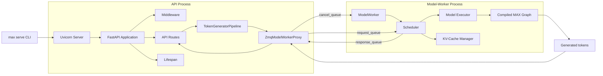
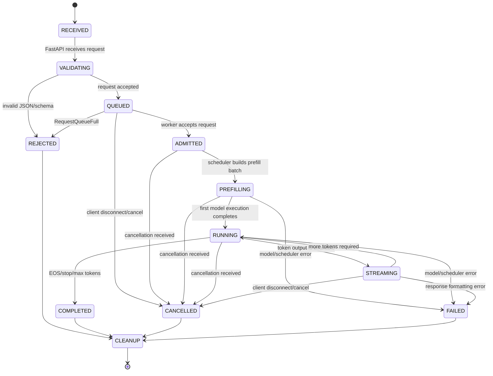
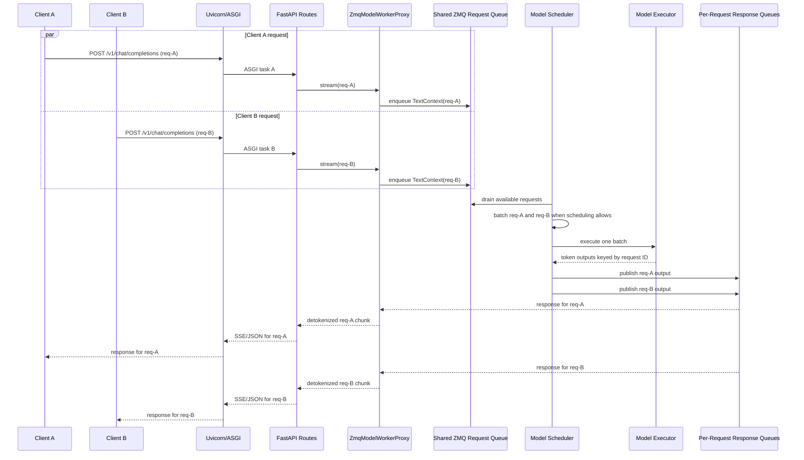

# End-to-End Function I/O Tree: OpenAI Chat Request To Llama And Back

This document supplements
[`0000_B_end_to_end_call_stack.md`](0000_B_end_to_end_call_stack.md) with one
annotated function I/O tree for each call-stack phase. Each tree keeps the
execution-order structure while adding concrete `EXAMPLE`, `IN`, `STRUCTURES`,
`LOGIC`, and `OUT` branches.

For the compact call stack without the function I/O branches, read
<strong><em><a href="0000_B_end_to_end_call_stack.md"><span style="color:#0b63ce">See end-to-end call stack: 0000_B_end_to_end_call_stack.md</span></a></em></strong>.

## Scope

The primary runtime path assumes:

- `POST /v1/chat/completions`
- `PipelineTask.TEXT_GENERATION`
- the normal combined `prefill_and_decode` scheduler
- `TextTokenizer`
- `ZmqModelWorkerProxy`
- `TextGenerationPipeline`
- the Llama 3 graph model and `Llama3BatchProcessor`
- one successfully admitted request

Configuration-dependent alternatives are called out separately. In
particular, disaggregated prefill/decode, speculative decoding, overlap
scheduling, multimodal architectures, and non-Llama models replace parts of
the worker-side tree.

The recursion expands repository-owned code on this path. FastAPI, Starlette,
asyncio, Pydantic internals, ZeroMQ transport internals, and compiled graph or
device-kernel internals are named at their boundary but are not expanded as if
they were ordinary Python calls in this repository.

## Legend

```text
[CALL]       ordinary Python call
[AWAIT]      coroutine call suspended until its awaited work completes
[ITERATE]    async generator is being consumed
[FRAMEWORK]  FastAPI, Starlette, SSE, or asyncio invokes user code
[IPC]        process/queue handoff; not a nested Python call
[BACKGROUND] independently running task or worker loop
[COMPILED]   execution crosses into a compiled MAX graph/runtime
[BRANCH]     only one runtime branch is selected
```

Inline links use the form `[Name:Lnn]`: `Name` is a shortened walkthrough
name, and `Lnn` is the exact line where that function is explained.

## Concrete Example Fixture

The annotated trees use these exact values. Token IDs and decoded token
boundaries are complete illustrative values for the named Llama tokenizer
because those values are model-version specific.

<details>
<summary><strong>Expand: Concrete values referenced by every function example</strong></summary>

<pre>
FIXTURE.http_request
  method = "POST"
  path = "/v1/chat/completions"
  headers = {
    "content-type": "application/json",
    "x-request-id": "req-chat-001"
  }
  body = {
    "model": "meta-llama/Llama-3.1-8B-Instruct",
    "messages": [
      {"role": "system", "content": "You are a concise assistant."},
      {"role": "user", "content": "Explain KV cache in one sentence."}
    ],
    "temperature": 0.2,
    "top_k": 50,
    "top_p": 0.9,
    "max_completion_tokens": 32,
    "seed": 42,
    "stop": "\nUser:",
    "stream": true,
    "stream_options": {"include_usage": true}
  }

FIXTURE.raw_body
  b'{"model":"meta-llama/Llama-3.1-8B-Instruct","messages":[{"role":"system","content":"You are a concise assistant."},{"role":"user","content":"Explain KV cache in one sentence."}],"temperature":0.2,"top_k":50,"top_p":0.9,"max_completion_tokens":32,"seed":42,"stop":"\\nUser:","stream":true,"stream_options":{"include_usage":true}}'

FIXTURE.parsed_body
  {
    "model": "meta-llama/Llama-3.1-8B-Instruct",
    "messages": [
      {"role": "system", "content": "You are a concise assistant."},
      {"role": "user", "content": "Explain KV cache in one sentence."}
    ],
    "temperature": 0.2,
    "top_k": 50,
    "top_p": 0.9,
    "max_completion_tokens": 32,
    "seed": 42,
    "stop": "\nUser:",
    "stream": True,
    "stream_options": {"include_usage": True}
  }

FIXTURE.completion_request
  CreateChatCompletionRequest.model_dump(exclude_none=True) =
  FIXTURE.parsed_body

FIXTURE.sampling_params
  SamplingParams(
    top_k=50,
    top_p=0.9,
    min_p=0.0,
    temperature=0.2,
    thinking_temperature=None,
    frequency_penalty=0.0,
    presence_penalty=0.0,
    repetition_penalty=1.0,
    max_new_tokens=32,
    min_new_tokens=0,
    ignore_eos=False,
    stop=["\nUser:"],
    stop_token_ids=None,
    detokenize=True,
    seed=42,
    logits_processors=None
  )

FIXTURE.token_request
  TextGenerationRequest(
    request_id=RequestID("req-chat-001"),
    model_name="meta-llama/Llama-3.1-8B-Instruct",
    prompt=None,
    messages=[
      TextGenerationRequestMessage(
        role="system", content="You are a concise assistant."
      ),
      TextGenerationRequestMessage(
        role="user", content="Explain KV cache in one sentence."
      )
    ],
    images=[], videos=[], decoded_images=[], tools=None,
    response_format=None,
    timestamp_ns=1730000000000000000,
    request_path="/v1/chat/completions",
    logprobs=0,
    echo=False,
    chat_template_options=None,
    sampling_params=FIXTURE.sampling_params,
    target_endpoint=None,
    dkv_cache_hint=None,
    cache_salt=None
  )

FIXTURE.rendered_prompt
  &lt;|begin_of_text|&gt;&lt;|start_header_id|&gt;system&lt;|end_header_id|&gt;

  Cutting Knowledge Date: December 2023
  Today Date: 26 Jul 2024

  You are a concise assistant.&lt;|eot_id|&gt;&lt;|start_header_id|&gt;user&lt;|end_header_id|&gt;

  Explain KV cache in one sentence.&lt;|eot_id|&gt;&lt;|start_header_id|&gt;assistant&lt;|end_header_id|&gt;


FIXTURE.prompt_token_ids
  [128000,128006,9125,128007,271,38766,1303,33025,2696,25,6790,220,
   2366,18,198,15724,2696,25,220,1627,10263,220,2366,19,271,2675,527,
   264,64694,18328,13,128009,128006,882,128007,271,849,21435,85748,
   6636,304,832,11914,13,128009,128006,78191,128007,271]

FIXTURE.text_context
  TextContext(
    request_id=RequestID("req-chat-001"),
    max_length=81,
    tokens=TokenBuffer(
      array=np.array(FIXTURE.prompt_token_ids, dtype=np.int64)
    ),
    eos_tracker=EOSTracker(
      eos_token_ids={128001,128008,128009},
      eos_sequences=[[198,1502,25]],
      eos_stop_strings=["\nUser:"]
    ),
    vocab_size=128256,
    log_probabilities=0,
    log_probabilities_echo=False,
    ignore_eos=False,
    json_schema=None,
    grammar=None,
    grammar_state=GrammarEnforcementState(grammar_enforced=False),
    sampling_params=FIXTURE.sampling_params,
    model_name="meta-llama/Llama-3.1-8B-Instruct",
    status=GenerationStatus.ACTIVE,
    target_endpoint=None,
    dkv_cache_hint=None,
    cache_salt=None,
    cached_prefix_length=None
  )
  derived token-buffer state immediately after construction:
    prompt_length=49
    generated=[]
    processed_length=0
    active=FIXTURE.prompt_token_ids

FIXTURE.text_generation_inputs
  constructor call:
    TextGenerationInputs(batches=[[FIXTURE.text_context]])
  fields derived by TextGenerationInputs.__post_init__():
    batches=[[FIXTURE.text_context]]
    input_tokens=49
    context_tokens=0
    batch_type=BatchType.CE
    per_replica_input_tokens=[49]
    per_replica_context_tokens=[0]

FIXTURE.llama_inputs
  Llama3Inputs(
    tokens=Buffer(shape=[49], dtype=int64, values=FIXTURE.prompt_token_ids),
    input_row_offsets=Buffer(shape=[2], dtype=uint32, values=[0,49]),
    signal_buffers=[],
    return_n_logits=Buffer(shape=[1], dtype=int64, values=[1]),
    data_parallel_splits=None,
    kv_cache_inputs=KVCacheInputsPerDevice(
      kv_blocks=Buffer(name="kv_blocks_gpu0", device="gpu:0"),
      cache_lengths=Buffer(values=[0]),
      lookup_table=Buffer(values=[[7]]),
      max_prompt_length=Buffer(values=[49]),
      max_cache_length=Buffer(values=[49]),
      page_stride=Buffer(shape=[1], dtype=int64, values=[-1]),
      kv_scales=None,
      scales_page_stride=None,
      scales_lookup_table=None,
      attention_dispatch_metadata=Buffer(
        name="attention_dispatch_metadata_gpu0", device="gpu:0"
      ),
      draft_attention_dispatch_metadata=None,
      mla_num_partitions=None,
      draft_mla_num_partitions=None,
      kv_blocks_per_layer=None,
      kv_scales_per_layer=None
    )
  )
  `kv_blocks` and attention-dispatch buffers are preallocated runtime buffers;
  the request supplies their handles and per-request indexing metadata, not a
  JSON or Python list containing every device-resident KV value.

FIXTURE.first_model_output
  TextGenerationOutput(
    request_id=RequestID("req-chat-001"),
    tokens=[83807],
    final_status=GenerationStatus.ACTIVE,
    log_probabilities=None,
    num_cached_tokens=0
  )
  token 83807 -> "KV"

FIXTURE.model_outputs
  ModelOutputs(
    logits=Buffer(shape=[1,128256], dtype=float32, device="gpu:0"),
    next_token_logits=Buffer(shape=[1,128256], dtype=float32, device="gpu:0"),
    logit_offsets=None,
    hidden_states=None
  )
  illustrative selected values from the one 128256-value logit row:
    token_id=83807  logit=12.40  decoded_token="KV"
    token_id=6636   logit=11.82  decoded_token=" cache"
    token_id=14463  logit=10.91  decoded_token="The"
  The complete logit row remains in the device Buffer. Python receives the
  Buffer handle and shape rather than copying 128256 floats into a list.

FIXTURE.first_token_generator_output
  TokenGeneratorOutput(
    status=GenerationStatus.ACTIVE,
    decoded_tokens="KV",
    decoded_reasoning_tokens=None,
    token_count=1,
    token_log_probabilities=None,
    top_log_probabilities=None,
    sampled_tokens=None,
    prompt_token_count=49,
    cached_token_count=0,
    reasoning_token_count=0,
    stop_sequence=None,
    batch_id=1,
    token_ids=[83807],
    prompt_token_ids=FIXTURE.prompt_token_ids
  )

FIXTURE.complete_generation
  token_ids =
    [83807,6636,10756,62671,6666,7039,323,2819,505,6931,11460,13,128009]
  decoded_text =
    "KV cache stores reusable attention keys and values from earlier tokens."
  usage = {
    "prompt_tokens": 49,
    "completion_tokens": 13,
    "total_tokens": 62
  }

FIXTURE.first_sse_payload
  {
    "id": "req-chat-001",
    "object": "chat.completion.chunk",
    "created": 1730000000,
    "model": "meta-llama/Llama-3.1-8B-Instruct",
    "choices": [
      {
        "index": 0,
        "delta": {"role": "assistant", "content": "KV"},
        "finish_reason": null
      }
    ]
  }

FIXTURE.non_streaming_response
  {
    "id": "req-chat-001",
    "object": "chat.completion",
    "created": 1730000000,
    "model": "meta-llama/Llama-3.1-8B-Instruct",
    "choices": [
      {
        "index": 0,
        "message": {
          "role": "assistant",
          "content": "KV cache stores reusable attention keys and values from earlier tokens."
        },
        "finish_reason": "stop"
      }
    ],
    "usage": {
      "prompt_tokens": 49,
      "completion_tokens": 13,
      "total_tokens": 62,
      "prompt_tokens_details": {"cached_tokens": 0},
      "completion_tokens_details": {"reasoning_tokens": 0}
    }
  }

FIXTURE.tool_definition
  {
    "type": "function",
    "function": {
      "name": "get_weather",
      "description": "Return the current weather for a city.",
      "parameters": {
        "type": "object",
        "properties": {
          "city": {"type": "string"},
          "unit": {"type": "string", "enum": ["celsius", "fahrenheit"]}
        },
        "required": ["city"],
        "additionalProperties": false
      },
      "strict": true
    }
  }
  model tool output =
    {"name":"get_weather","parameters":{"city":"Colombo","unit":"celsius"}}

FIXTURE.json_schema_response_format
  {
    "type": "json_schema",
    "json_schema": {
      "name": "kv_cache_answer",
      "strict": true,
      "schema": {
        "type": "object",
        "properties": {
          "answer": {"type": "string"},
          "benefit": {"type": "string"}
        },
        "required": ["answer", "benefit"],
        "additionalProperties": false
      }
    }
  }
</pre>

</details>

## 1. One-Time Startup Wiring

The request path depends on objects and background loops created before the
first HTTP request arrives.

<details>
<summary><strong>Expand: API server startup and API-worker wiring</strong></summary>

<strong>MAX CLI path that starts the API server</strong>

<pre>
max serve --model &lt;model&gt;
    |
    +-- EXAMPLE: max serve --model meta-llama/Llama-3.1-8B-Instruct
    +-- IN: CLI arguments, environment variables, model identifier
    +-- STRUCTURES: Click command context; Settings; PipelineArgs
    +-- LOGIC: parse CLI options and select the standard serving path
    +-- OUT: running API server or headless worker process
    |
    +-- max._entrypoints.pipelines.main()  <a href="../../../max/python/max/_entrypoints/pipelines.py#L197">[CLI:L197]</a>
          |
          +-- EXAMPLE: ctx.invoked_subcommand="serve", log_level="INFO"
          +-- IN: process argv and Click context
          +-- STRUCTURES: Click Group command registry; logging configuration
          +-- LOGIC: initialize CLI logging/telemetry and dispatch the subcommand
          +-- OUT: cli_serve(...) is selected
          |
          +-- Click is a command-line dispatcher which invokes cli_serve(...)
          |     |
          |     +-- EXAMPLE: command name="serve" with --model argument
          |     +-- IN: registered Click command and parsed parameters
          |     +-- STRUCTURES: Click command callback
          |     +-- LOGIC: invoke the callback after option validation
          |     +-- OUT: cli_serve(...) receives typed options
          |
          |
          +-- cli_serve(...)  <a href="../../../max/python/max/_entrypoints/pipelines.py#L434">[Serve:L434]</a>
                |
                +-- EXAMPLE: headless=False (normal API + model-worker mode), model_path="meta-llama/Llama-3.1-8B-Instruct"
                +-- IN: port/host flags; model and task options; headless flag
                +-- STRUCTURES: Settings; PipelineArgs; PipelineConfig
                +-- LOGIC: resolve configuration, load pipeline metadata, choose server mode
                +-- OUT: configured server startup request
                |
                +-- build Settings and PipelineArgs
                |     |
                |     +-- EXAMPLE: Settings(port=8000) + PipelineArgs(model_path="meta-llama/Llama-3.1-8B-Instruct")
                |     +-- IN: CLI option values and environment configuration
                |     +-- STRUCTURES: Settings; PipelineArgs
                |     +-- LOGIC: normalize command-line values into typed configuration objects
                |     +-- OUT: settings and pipeline_args
                |
                +-- configure logging and pipeline configuration
                |     |
                |     +-- EXAMPLE: pipeline task=TEXT_GENERATION, log level=INFO
                |     +-- IN: settings and pipeline_args
                |     +-- STRUCTURES: logging handlers; PipelineConfig
                |     +-- LOGIC: install logging and resolve model/tokenizer configuration
                |     +-- OUT: configured runtime environment
                |
                |
                +-- [BRANCH] headless=True
                |     |
                |     +-- EXAMPLE: headless=True (--headless; dispatcher + model-worker only, no HTTP API)
                |     +-- IN: settings; pipeline_args; headless=True
                |     +-- STRUCTURES: worker-process startup configuration
                |     +-- LOGIC: skip HTTP application creation and launch workers directly
                |     +-- OUT: headless worker service
                |     |
                |     +-- start_workers(...)  <a href="../../../max/python/max/_entrypoints/pipelines.py#L560">[Headless:L560]</a>
                |           |
                |           +-- EXAMPLE: worker-only deployment with model_path configured
                |           +-- IN: settings and pipeline_args
                |           +-- STRUCTURES: model worker processes; IPC queues
                |           +-- LOGIC: start worker-side serving components without FastAPI
                |           +-- OUT: running headless workers
                |           |
                |           +-- no FastAPI app is created
                |
                +-- [BRANCH] headless=False
                      |
                      +-- EXAMPLE: normal `max serve` invocation
                      +-- IN: settings; pipeline_args; headless=False
                      +-- STRUCTURES: API process; model-worker process; ZMQ IPC
                      +-- LOGIC: start the API server and model worker together
                      +-- OUT: serving API startup path
                      |
                      +-- serve_api_server_and_model_worker(...)  <a href="../../../max/python/max/_entrypoints/pipelines.py#L565">[ServeAPI:L565]</a>
                            serve_api_and_model_worker.py:59
                              |
                              +-- EXAMPLE: model factory and tokenizer resolved for Llama 3.1
                              +-- IN: Settings; PipelineArgs; tokenizer; pipeline factory; memory plan
                              +-- STRUCTURES: ServingTokenGeneratorSettings; FastAPI app; Uvicorn Server
                              +-- LOGIC: prepare model serving dependencies, build app, then run HTTP server
                              +-- OUT: running Uvicorn API server
                              |
                              +-- ASGI boundary
                              |     HTTP client
                              |         |
                              |         | HTTP request to host:port
                              |         v
                              |     Uvicorn
                              |     Python ASGI web server
                              |         |
                              |         | await fastapi_app(scope, receive, send)
                              |         v
                              |     FastAPI application
                              |     Python ASGI web app
                              |         |
                              |         +-- middleware
                              |         +-- route matching
                              |         +-- request handlers
                              |         |
                              |         | send(response events)
                              |         v
                              |     Uvicorn writes the HTTP response
                              |
                              +-- fastapi_app(settings, pipeline_settings)  <a href="../../../max/python/max/_entrypoints/cli/serve/serve_api_and_model_worker.py#L117">[AppFactory:L117]</a>
                              |     |
                              |     +-- EXAMPLE: pipeline_settings.task=TEXT_GENERATION
                              |     +-- IN: Settings and ServingTokenGeneratorSettings
                              |     +-- STRUCTURES: application factory call; ZMQ endpoint path
                              |     +-- LOGIC: create the API application before Uvicorn starts
                              |     +-- OUT: app: FastAPI
                              |     |
                              |     +-- fastapi_app(settings, serving_settings)  <a href="../../../max/python/max/serve/api_server.py#L330">[FastAPI:L330]</a>
                              |           |
                              |           +-- EXAMPLE: settings.port=8000, API type="openai"
                              |           +-- IN: Settings; ServingTokenGeneratorSettings
                              |           +-- STRUCTURES: FastAPI app; middleware; app.state
                              |           +-- LOGIC: register routes/middleware and attach startup state
                              |           +-- OUT: configured FastAPI app
                              |           |
                              |           +-- create FastAPI app and register middleware
                              |           +-- store app.state.zmq_endpoint_base
                              |           +-- return app
                              |
                              +-- fastapi_config(app, server_settings)
                              |     |
                              |     +-- EXAMPLE: app plus host/port/TLS settings -> Uvicorn Config
                              |     +-- IN: FastAPI app and server Settings
                              |     +-- STRUCTURES: uvicorn.Config
                              |     +-- LOGIC: translate server settings into Uvicorn configuration
                              |     +-- OUT: config: uvicorn.Config
                              |
                              +-- validate_port_is_free(settings.port)
                              |     |
                              |     +-- EXAMPLE: port=8000 is available
                              |     +-- IN: integer TCP port
                              |     +-- STRUCTURES: local socket probe
                              |     +-- LOGIC: fail early if another process owns the port
                              |     +-- OUT: None, or startup exception
                              |
                              +-- Server(config)
                              |     |
                              |     +-- EXAMPLE: config.bind="0.0.0.0:8000"
                              |     +-- IN: uvicorn.Config
                              |     +-- STRUCTURES: uvicorn.Server
                              |     +-- LOGIC: create the asynchronous HTTP server controller
                              |     +-- OUT: server object
                              |
                              |
                              +-- uvloop.run(serve())  <a href="../../../max/python/max/_entrypoints/cli/serve/serve_api_and_model_worker.py#L163">[Run:L163]</a>
                                    |
                                    +-- EXAMPLE: server event loop starts on port 8000
                                    +-- IN: serve() coroutine
                                    +-- STRUCTURES: uvloop event loop; async context manager
                                    +-- LOGIC: run the API server lifecycle to completion
                                    +-- OUT: process remains serving until shutdown
                                    |
                                    +-- async with lifespan(...)
                                    |     |
                                    |     +-- EXAMPLE: app + settings + pipeline settings + ZMQ endpoint
                                    |     +-- IN: API app and model-worker startup dependencies
                                    |     +-- STRUCTURES: async context manager; worker TaskGroup; telemetry
                                    |     +-- LOGIC: start model worker/pipeline before accepting requests
                                    |     +-- OUT: active serving context
                                    |
                                    +-- await server.serve()
                                          |
                                          +-- EXAMPLE: HTTP listener accepts POST /v1/chat/completions
                                          +-- IN: configured Uvicorn Server
                                          +-- STRUCTURES: ASGI server; FastAPI application
                                          +-- LOGIC: accept connections and dispatch requests to FastAPI
                                          +-- OUT: HTTP responses/SSE streams until shutdown
</pre>

<details>
<summary><strong>Expand: Complete inputs passed to fastapi_app(settings, pipeline_settings)</strong></summary>

<pre>
fastapi_app(
  # Default snapshot; CLI flags and MAX_SERVE_* environment variables can
  # replace these values before fastapi_app(...) is called.
  settings = Settings(
    api_types=[APIType.OPENAI, APIType.SAGEMAKER],  # enabled API routers
    offline_inference=False,                       # workers without HTTP
    headless=False,                                # API + worker mode
    host="0.0.0.0",                               # network bind address
    port=8000,                                     # HTTP API port
    metrics_port=8001,                             # metrics endpoint port
    http_keepalive_timeout_s=120,                  # idle connection timeout
    max_queue_size=None,                           # worker queue capacity
    max_pending_requests=None,                     # scheduler pending limit
    max_request_bytes=104857600,                   # maximum HTTP body bytes
    allowed_image_roots=[],                        # permitted file URI roots
    max_local_image_bytes=20971520,                # local image size limit
    max_media_bytes=104857600,                     # total media size limit
    media_kind="image",                            # default media error label
    media_url_ssrf_protection_enabled=True,        # protect remote media fetches
    media_url_allowed_hosts=[],                    # SSRF host allowlist
    generated_media_storage_mb=512,                # generated media disk budget
    use_client_cache_salt=False,                   # honor client cache salts
    logs_console_level="INFO",                    # console logging level
    logs_otlp_level=None,                          # OTLP logging level
    logs_file_level=None,                          # file logging level
    logs_file_path=None,                            # log file destination
    structured_logging=False,                      # structured log output
    logs_enable_components=None,                    # extra log components
    disable_telemetry=False,                       # disable remote telemetry
    otlp_metrics_endpoint=None,                    # OTLP metrics destination
    kernel_trace_level=KernelTraceLevel.OFF,       # GPU trace depth
    use_heartbeat=False,                            # worker heartbeat checks
    mw_timeout_s=None,                              # worker startup timeout
    mw_health_fail_s=60.0,                          # worker health timeout
    eplb_profile=False,                             # expert load-balance profiling
    gc_debug=False,                                 # garbage-collection metrics
    gc_debug_top_objects=0,                         # object types to report
    telemetry_worker_spawn_timeout=None,            # telemetry startup timeout
    graceful_shutdown_timeout_s=5,                 # shutdown grace period
    metric_recording=MetricRecordingMethod.PROCESS, # metrics recording mode
    stream_min_chunk_tokens=1,                      # tokens per SSE chunk minimum
    transaction_recording_file=None,                # HTTP recording file
    transaction_recording_include_responses=False,  # include response bodies
    di_bind_address="tcp://127.0.0.1:5555",       # disaggregated inference IPC
    log_prefix=None,                                # log message prefix
  ),

  pipeline_settings = ServingTokenGeneratorSettings( # API-to-worker settings
    model_factory=&lt;resolved pipeline factory callable&gt;, # constructs pipeline
    pipeline_config=PipelineConfig(                 # resolved model config
      debug_verify_replay=&lt;resolved bool&gt;,       # verify captured graphs
      tokenizer_impl=&lt;resolved str | None&gt;,      # alternate tokenizer class
      models=ModelManifest(
        main=&lt;complete resolved MAXModelConfig for the selected model&gt;, # main model
        component_models=&lt;resolved role-to-MAXModelConfig mapping&gt;, # model roles
      ),
      model_override=&lt;resolved list[str], default []&gt;, # per-component overrides
      sampling=&lt;complete resolved SamplingConfig&gt;,   # sampling graph options
      profiling=&lt;complete resolved ProfilingConfig&gt;,   # GPU profiling options
      lora=&lt;resolved LoRAConfig | None&gt;,              # LoRA adapter settings
      speculative=&lt;resolved SpeculativeConfig | None&gt;, # draft-model settings
      runtime=&lt;complete resolved PipelineRuntimeConfig; role is
               "prefill_and_decode" for the normal server path&gt;,
      task=PipelineTask.TEXT_GENERATION,              # pipeline workload
    ),
    tokenizer=&lt;resolved PipelineTokenizer&gt;,           # text/token ID conversion
    task=PipelineTask.TEXT_GENERATION,                 # serving task
    reasoning_parser_name=&lt;runtime reasoning parser or None&gt;, # reasoning parser
    temperature=&lt;runtime temperature or None; request temperature is
                 applied later by SamplingParams&gt;,
    thinking_temperature=&lt;runtime thinking temperature or None&gt;, # thinking sampling
    memory_plan=MemoryPlan(                          # device-memory plan
      planned_max_batch_size=&lt;resolved batch limit&gt;,  # requests per batch
      footprint=&lt;resolved device-memory estimate in bytes&gt;, # memory estimate
      planned_max_length=&lt;resolved sequence-length limit&gt;, # sequence bound
      available_cache_memory=&lt;resolved KV-cache bytes or None&gt;, # KV budget
      device_specs=&lt;resolved device specifications&gt;, # target devices
      planned_max_batch_total_tokens=&lt;resolved token budget or None&gt;, # token cap
      vision_cache_plan=&lt;resolved vision plan or None&gt;, # vision cache budget
    ),
  ),
)

Value source:
  Settings = CLI options + MAX_SERVE_* environment variables + defaults.
  pipeline_settings = PipelineConfig.from_args(...) + registry-resolved
                       tokenizer, model factory, and memory plan.

Output:
  app: FastAPI
</pre>

</details>

<strong>API application factory and API-worker wiring</strong>

<pre>
fastapi_app(settings, serving_settings)  <a href="0000_A_folder_structure.md#expandable-root-level-map">[Map]</a>
  api_server.py:330
    |
    +-- EXAMPLE
    |     api_type="openai", pipeline_role="prefill_and_decode" -> initialized serving component
    +-- IN
    |     settings: Settings
    |     serving_settings: ServingTokenGeneratorSettings
    +-- STRUCTURES
    |     FastAPI; ROUTES; app.state; ZMQ endpoint path
    +-- LOGIC
    |     create app -> register routes/middleware -> bind lifespan
    +-- OUT
    |     app: FastAPI
    |
    +-- [CALL] FastAPI(title="MAX Serve", ...)
    |
    |     +-- EXAMPLE: api_type="openai", pipeline_role="prefill_and_decode" -> initialized serving component
    |     +-- IN: title + lifespan callback
    |     +-- STRUCTURES: FastAPI application object
    |     +-- LOGIC: initialize ASGI app and state container
    |     +-- OUT: app
    |
    +-- [CALL] app.include_router(ROUTES[api_type].router)
    |     api_server.py:438
    |       |
    |       +-- EXAMPLE: api_type="openai", pipeline_role="prefill_and_decode" -> initialized serving component
    |       +-- IN: OpenAI router with prefix "/v1"
    |       +-- STRUCTURES: APIRouter + route table
    |       +-- LOGIC: attach /v1/chat/completions and related endpoints
    |       +-- OUT: None; app route table mutated
    |       |
    |       +-- OpenAI router prefix = "/v1"
    |             openai_routes.py:235
    |
    +-- [FRAMEWORK] lifespan(...)
          api_server.py:111
            |
            +-- EXAMPLE: api_type="openai", pipeline_role="prefill_and_decode" -> initialized serving component
            +-- IN: app + server/model settings + IPC endpoint base
            +-- STRUCTURES: AsyncExitStack; app.state; model worker interface
            +-- LOGIC: create long-lived serving dependencies; yield while live
            +-- OUT: async context; initialized app state
            |
            +-- [CALL] ZmqModelWorkerInterface(...)
            |
            |     +-- EXAMPLE: api_type="openai", pipeline_role="prefill_and_decode" -> initialized serving component
            |     +-- IN: task; context type; request_queue_size
            |     +-- STRUCTURES: ZMQ request/response/cancel queue factories
            |     +-- LOGIC: configure typed process boundary
            |     +-- OUT: model_worker_interface
            |
            +-- [AWAIT] start_model_worker(...)
            |     model_worker.py:613
            |       |
            |       +-- EXAMPLE: api_type="openai", pipeline_role="prefill_and_decode" -> initialized serving component
            |       +-- IN: model_factory; configs; interface; endpoint; memory_plan
            |       +-- STRUCTURES: ProcessMonitor; Event; spawned ModelWorker process
            |       +-- LOGIC: spawn worker -> wait ready -> create API proxy
            |       +-- OUT: model_worker: ZmqModelWorkerProxy
            |       |
            |       +-- proc.start(ModelWorker(), ...)
            |       |
            |       |     +-- EXAMPLE: api_type="openai", pipeline_role="prefill_and_decode" -> initialized serving component
            |       |     +-- IN: callable ModelWorker + startup arguments
            |       |     +-- STRUCTURES: child process + alive/ready event
            |       |     +-- LOGIC: invoke ModelWorker.__call__ in child
            |       |     +-- OUT: running child process handle
            |       |
            |       +-- [FRAMEWORK] spawned child invokes
            |       |     ModelWorker.__call__(...)
            |       |       model_worker.py:564
            |       |         |
            |       |         +-- EXAMPLE: api_type="openai", pipeline_role="prefill_and_decode" -> initialized serving component
            |       |         +-- IN: same startup arguments in child process
            |       |         +-- STRUCTURES: uvloop event loop
            |       |         +-- LOGIC: run ModelWorker.run coroutine; suppress Ctrl-C noise
            |       |         +-- OUT: None when worker exits
            |       |         |
            |       |         +-- [CALL] uvloop.run(ModelWorker.run(...))
            |       |
            |       |         |     +-- EXAMPLE: api_type="openai", pipeline_role="prefill_and_decode" -> initialized serving component
            |       |         |     +-- IN: ModelWorker.run coroutine object
            |       |         |     +-- STRUCTURES: uvloop runtime
            |       |         |     +-- LOGIC: own child-process event loop
            |       |         |     +-- OUT: coroutine completion value None
            |       |         |
            |       +-- [AWAIT] proc.ready(...)
            |       |
            |       |     +-- EXAMPLE: api_type="openai", pipeline_role="prefill_and_decode" -> initialized serving component
            |       |     +-- IN: worker heartbeat/readiness event
            |       |     +-- STRUCTURES: ProcessMonitor state
            |       |     +-- LOGIC: block startup until child signals alive
            |       |     +-- OUT: None or startup exception
            |       |
            |       +-- [AWAIT] model_worker_interface.model_worker_proxy()
            |             zmq_interface.py:331
            |               |
            |               +-- EXAMPLE: api_type="openai", pipeline_role="prefill_and_decode" -> initialized serving component
            |               +-- IN: API-side interface configuration
            |               +-- STRUCTURES: ZmqModelWorkerProxy; ZMQ queues; task set
            |               +-- LOGIC: create proxy -> start background consumers -> connect
            |               +-- OUT: connected proxy
            |               |
            |               +-- create ZmqModelWorkerProxy
            |               |
            |               +-- [BACKGROUND] asyncio.create_task(
            |               |     proxy.response_worker()  <a href="0009_A_1_model_worker_stream_admission_and_response_drain.md#L100">[Route:L100]</a>
            |               |   )
            |               |     zmq_interface.py:247
            |               |
            |               |     +-- EXAMPLE: worker response map -> pending out_queue for req-chat-001
            |               |     +-- IN: response_worker coroutine
            |               |     +-- STRUCTURES: asyncio.Task
            |               |     +-- LOGIC: route worker results continuously
            |               |     +-- OUT: background task handle
            |               |
            |               +-- [BACKGROUND] asyncio.create_task(
            |               |     proxy._metrics_worker()
            |               |   )
            |               |
            |               |     +-- EXAMPLE: api_type="openai", pipeline_role="prefill_and_decode" -> initialized serving component
            |               |     +-- IN: metrics coroutine
            |               |     +-- STRUCTURES: asyncio.Task
            |               |     +-- LOGIC: consume worker metrics continuously
            |               |     +-- OUT: background task handle
            |               |
            |               +-- [AWAIT] proxy.wait_until_connected(...)
            |
            |               |     +-- EXAMPLE: api_type="openai", pipeline_role="prefill_and_decode" -> initialized serving component
            |               |     +-- IN: optional connection timeout
            |               |     +-- STRUCTURES: request/response/cancel MAX queues
            |               |     +-- LOGIC: wait until IPC sockets are connected
            |               |     +-- OUT: None; queues ready or timeout error
            |               |
            +-- [CALL] TokenGeneratorPipeline(...)
            |
            |     +-- EXAMPLE: api_type="openai", pipeline_role="prefill_and_decode" -> initialized serving component
            |     +-- IN: model_name; tokenizer; proxy; LoRA/reasoning options
            |     +-- STRUCTURES: TokenGeneratorPipeline
            |     +-- LOGIC: bind API tokenization/detokenization to worker proxy
            |     +-- OUT: pipeline
            |
            +-- app.state.pipeline = TokenGeneratorPipeline
            +-- app.state.pipeline_config = PipelineConfig
    |
    +-- app.state.settings = settings
    +-- [CALL] register_request(app, ...)
          |
          +-- EXAMPLE: api_type="openai", pipeline_role="prefill_and_decode" -> initialized serving component
          +-- IN: FastAPI app + logging mode
          +-- STRUCTURES: HTTP middleware closure request_session
          +-- LOGIC: register request identity/timing/trace middleware
          +-- OUT: None; middleware installed
          |
          +-- installs request_session HTTP middleware
</pre>
</details>

## Server Runtime Architecture Diagrams

### Component and Process Architecture



### Per-Request Runtime State Machine



### Multiple Clients and Async Concurrency



Each client has its own request ID and response path, while the scheduler and
model executor can share batches and device work. Async API tasks wait on their
own output stream instead of blocking other clients at the HTTP layer.

The spawned model-worker process builds the model pipeline and then runs the
scheduler forever:

<details>
<summary><strong>Expand: Model-worker startup and scheduler loop</strong></summary>

<pre>
[BACKGROUND] uvloop executes ModelWorker.run(...)
  model_worker.py:232
    |
    +-- EXAMPLE
    |     api_type="openai", pipeline_role="prefill_and_decode" -> initialized serving component
    +-- IN
    |     model_factory; pipeline_config; settings; worker interface; memory_plan
    +-- STRUCTURES
    |     metric client; model pipeline; WorkerQueues; Scheduler; KV manager
    +-- LOGIC
    |     configure process -> build model -> create queues/scheduler -> loop
    +-- OUT
    |     None; long-running worker coroutine
    |
    +-- [CALL] model_factory()
    |     |
    |     +-- EXAMPLE: api_type="openai", pipeline_role="prefill_and_decode" -> initialized serving component
    |     +-- IN: captured architecture/config/session/weights
    |     +-- STRUCTURES: TextGenerationPipeline + compiled Llama model
    |     +-- LOGIC: build/compile/load graph once during startup
    |     +-- OUT: pipeline
    |     |
    |     +-- build TextGenerationPipeline
    |     +-- build/load Llama graph model
    |     +-- compile graph and sampler once
    |
    +-- [AWAIT] model_worker_interface.model_worker_queues()
    |     |
    |     +-- EXAMPLE: api_type="openai", pipeline_role="prefill_and_decode" -> initialized serving component
    |     +-- IN: worker-side interface configuration
    |     +-- STRUCTURES: WorkerQueues(request_queue,response_queue,cancel_queue)
    |     +-- LOGIC: bind worker PULL/PUSH/PULL sockets
    |     +-- OUT: async context yielding WorkerQueues
    |     |
    |     +-- request_queue: worker-side ZMQ PULL
    |     +-- response_queue: worker-side ZMQ PUSH
    |     +-- cancel_queue: worker-side ZMQ PULL
    |
    +-- [CALL] load_scheduler(...)
    |     scheduler/__init__.py
    |       |
    |       +-- EXAMPLE: FIXTURE.text_generation_inputs -> response map for req-chat-001
    |       +-- IN: pipeline + configs + WorkerQueues + memory_plan
    |       +-- STRUCTURES: Scheduler implementation + batch constructor
    |       +-- LOGIC: select scheduler from task and pipeline role
    |       +-- OUT: TokenGenerationScheduler for prefill_and_decode
    |       |
    |       +-- pipeline_role == "prefill_and_decode"
    |             |
    |             +-- load_text_generation_scheduler(...)
    |                   |
    |                   +-- EXAMPLE: FIXTURE.text_generation_inputs -> response map for req-chat-001
    |                   +-- IN: text pipeline + scheduler settings + worker queues
    |                   +-- STRUCTURES: TextBatchConstructor + TokenGenerationScheduler
    |                   +-- LOGIC: construct combined prefill/decode scheduler
    |                   +-- OUT: TokenGenerationScheduler
    |                   |
    |                   +-- TokenGenerationScheduler
    |
    +-- [BACKGROUND] while True
          |
          +-- EXAMPLE: api_type="openai", pipeline_role="prefill_and_decode" -> initialized serving component
          +-- IN: scheduler + live queues
          +-- STRUCTURES: SchedulerProgress + backoff counter
          +-- LOGIC: execute one iteration; heartbeat; back off when idle
          +-- OUT: repeated request progress
          |
          +-- scheduler.run_iteration()  <a href="0010_A_1_scheduler_iteration_queue_batch_execute.md#L64">[Iter:L64]</a>
          |     +-- EXAMPLE: request_queue=[FIXTURE.text_context] -> MADE_PROGRESS
          |     +-- IN: live request/cancel queues + batch constructor + pipeline
          |     +-- STRUCTURES: SchedulerProgress; TextGenerationInputs; SchedulerResult
          |     +-- LOGIC: drain requests -> build batch -> execute -> publish responses
          |     +-- OUT: MADE_PROGRESS for this request; NO_PROGRESS when idle
          |
          +-- sleep_with_backoff(...) when no progress

          |     +-- EXAMPLE: api_type="openai", pipeline_role="prefill_and_decode" -> initialized serving component
          |     +-- IN: consecutive idle count
          |     +-- STRUCTURES: asyncio timer
          |     +-- LOGIC: avoid busy-spinning when no work exists
          |     +-- OUT: None after delay
          |</pre>
</details>

## 2. Complete Request Call Tree

This is the continuous source-level tree for the normal OpenAI ingress path.

Immediately before route dispatch, MAX Serve's HTTP middleware creates the
request ID and timer consumed by the route:

<details>
<summary><strong>Expand: Request middleware prelude</strong></summary>

<pre>
[FRAMEWORK] request_session(request, call_next)
  request.py:52
    |
    +-- EXAMPLE
    |     req-chat-001, model="meta-llama/Llama-3.1-8B-Instruct", stream=True
    +-- IN
    |     request=Request(POST /v1/chat/completions, body=&lt;concrete JSON&gt;)
    |     call_next=&lt;Starlette route dispatcher&gt;
    +-- STRUCTURES
    |     UUID string; StopWatch; optional server span; Response
    +-- LOGIC
    |     set request state -> invoke route -> add header -> record status/trace
    +-- OUT
    |     Response with X-Request-ID="req-chat-001"
    |
    +-- request_id = uuid.uuid4().hex
    |     +-- EXAMPLE: req-chat-001, model="meta-llama/Llama-3.1-8B-Instruct", stream=True
    |     +-- IN: operating-system/random UUID source
    |     +-- STRUCTURES: UUID -> 32-character hex string
    |     +-- LOGIC: create collision-resistant request identity
    |     +-- OUT: illustrative "req-chat-001" used by this document
    |
    +-- request.state.request_id = request_id
    |     +-- OUT: route-visible request identity
    |
    +-- request.state.request_timer = StopWatch()
    |
    |     +-- EXAMPLE: StopWatch() -> timer starting at request ingress
    |     +-- IN: monotonic clock source; no explicit constructor arguments
    |     +-- STRUCTURES: StopWatch(start_ns: int)
    |     +-- LOGIC: capture the request start time for later latency measurements
    |     +-- OUT: timestamp source for TextGenerationRequest
    |
    +-- [AWAIT] call_next(request)
          |
          +-- EXAMPLE: req-chat-001, model="meta-llama/Llama-3.1-8B-Instruct", stream=True
          +-- IN: mutated Request
          +-- STRUCTURES: Starlette middleware chain
          +-- LOGIC: dispatch matching endpoint
          +-- OUT: route Response
          |
          +-- enters the route tree below
</pre>
</details>

<details>
<summary><strong>Expand: Complete HTTP route call tree</strong></summary>

<pre>
POST /v1/chat/completions
    |
    +-- [FRAMEWORK] FastAPI/Starlette route dispatch
          |
          +-- EXAMPLE: req-chat-001, model="meta-llama/Llama-3.1-8B-Instruct", stream=True
          +-- IN: Request + registered route table
          +-- STRUCTURES: ASGI scope; dependency/middleware stack
          +-- LOGIC: match POST path to openai_create_chat_completion
          +-- OUT: awaited route result
          |
          +-- [AWAIT] openai_create_chat_completion(request)  <a href="0001_A_1_parse_openai_request_body_http_ingress_and_parser.md#L20">[Ingress:L20]</a>
                openai_routes.py:2218
                  |
                  +-- EXAMPLE
                  |     FIXTURE.http_request -> SSE or JSON response
                  +-- IN
                  |     request with concrete body/state values
                  +-- STRUCTURES
                  |     CreateChatCompletionRequest; _ParsedChatRequest;
                  |     SamplingParams; TextGenerationRequest; response generator
                  +-- LOGIC
                  |     parse -> select -> normalize -> construct -> dispatch response mode
                  +-- OUT
                  |     EventSourceResponse because stream=true
                  |
                  +-- request_id = request.state.request_id
                  |
                  |     +-- EXAMPLE: req-chat-001, model="meta-llama/Llama-3.1-8B-Instruct", stream=True
                  |     +-- IN: request.state
                  |     +-- STRUCTURES: str
                  |     +-- LOGIC: read middleware-created identifier
                  |     +-- OUT: "req-chat-001"
                  |
                  +-- [AWAIT] _parse_openai_request_body(  <a href="0001_A_1_parse_openai_request_body_http_ingress_and_parser.md#L99">[Parse:L99]</a>
                  |             request,
                  |             request_id,
                  |             CreateChatCompletionRequest,
                  |           )
                  |     openai_routes.py:3070
                  |       |
                  |       +-- EXAMPLE: req-chat-001, model="meta-llama/Llama-3.1-8B-Instruct", stream=True
                  |       +-- IN: Request; "req-chat-001"; schema class
                  |       +-- STRUCTURES: bytes; JSON value; Pydantic model class
                  |       +-- LOGIC: read -> decode JSON -> normalize tools/extras -> validate
                  |       +-- OUT: completion_request: CreateChatCompletionRequest
                  |       |
                  |       +-- [AWAIT] request.body()
                  |       |
                  |       |     +-- EXAMPLE: request.body() -> FIXTURE.raw_body
                  |       |     +-- IN: Starlette Request receive channel
                  |       |     +-- STRUCTURES: cached body bytes
                  |       |     +-- LOGIC: consume/cache complete HTTP request body
                  |       |     +-- OUT: FIXTURE.raw_body
                  |       |
                  |       +-- [CALL] json.loads(raw)
                  |       |     |
                  |       |     +-- EXAMPLE: json.loads(FIXTURE.raw_body) -> FIXTURE.parsed_body
                  |       |     +-- IN: raw body bytes
                  |       |     +-- STRUCTURES: Python dict/list/scalar JSON values
                  |       |     +-- LOGIC: JSON decode
                  |       |     +-- OUT: parsed dict matching the concrete body
                  |       |     |
                  |       |     +-- parsed: dict/list/str/number/bool/None
                  |       |
                  |       +-- [BRANCH] parsed is not dict
                  |       |     |
                  |       |     +-- EXAMPLE: req-chat-001, model="meta-llama/Llama-3.1-8B-Instruct", stream=True
                  |       |     +-- IN: list/str/number/bool/None
                  |       |     +-- STRUCTURES: Pydantic validation error details
                  |       |     +-- LOGIC: pass directly to model_validate
                  |       |     +-- OUT: normally ValidationError for chat schema
                  |       |     |
                  |       |     +-- model_cls.model_validate(parsed)  <a href="0001_B_1_parse_openai_request_body_pydantic_schema_validation.md#L9">[Validate:L9]</a>
                  |       |           |
                  |       |           +-- EXAMPLE: req-chat-001, model="meta-llama/Llama-3.1-8B-Instruct", stream=True
                  |       |           +-- IN: parsed dict + CreateChatCompletionRequest class
                  |       |           +-- STRUCTURES: field validators; before/after model validators
                  |       |           +-- LOGIC: coerce/validate fields; reject forbidden extras
                  |       |           +-- OUT: completion_request
                  |       |           |
                  |       |           +-- usually ValidationError for chat schema
                  |       |
                  |       +-- [BRANCH] parsed is dict
                  |             |
                  |             +-- EXAMPLE: req-chat-001, model="meta-llama/Llama-3.1-8B-Instruct", stream=True
                  |             +-- IN: concrete body dict
                  |             +-- STRUCTURES: tools value; known model fields; extras set
                  |             +-- LOGIC: normalize optional tool definitions and extra fields
                  |             +-- OUT: validation-ready dict
                  |             |
                  |             +-- tools = parsed.get("tools")
                  |             |
                  |             |     +-- EXAMPLE: req-chat-001, model="meta-llama/Llama-3.1-8B-Instruct", stream=True
                  |             |     +-- IN: parsed request dict
                  |             |     +-- STRUCTURES: list[tool] | None | other JSON value
                  |             |     +-- LOGIC: inspect optional tools without requiring key presence
                  |             |     +-- OUT: None for concrete request
                  |             |
                  |             +-- [BRANCH] tools is list
                  |             |     |
                  |             |     +-- [CALL] _normalize_tools_parameters(tools)  <a href="0001_A_2_parse_openai_request_body_tool_parameter_normalization.md#L43">[Tools:L43]</a>
                  |             |           tool_call_normalization.py:62
                  |             |             |
                  |             |             +-- EXAMPLE: [FIXTURE.tool_definition] -> normalized tool dictionaries
                  |             |             +-- IN: list[tool dict] when tools is a list
                  |             |             +-- STRUCTURES: copied tool/function/parameters dicts
                  |             |             +-- LOGIC: replace missing/None function.parameters with {}
                  |             |             +-- OUT: normalized list; concrete request skips this
                  |             |             |
                  |             |             +-- copy each tool dict
                  |             |             +-- copy function dict
                  |             |             +-- parameters None/missing -> {}
                  |             |
                  |             +-- [CALL] get_app_pipeline_config(request.app)  <a href="0001_A_1_parse_openai_request_body_http_ingress_and_parser.md#L63">[Config:L63]</a>
                  |             |
                  |             |     +-- EXAMPLE: request.app.state.pipeline_config -> PipelineConfig
                  |             |     +-- IN: FastAPI app
                  |             |     +-- STRUCTURES: app.state.pipeline_config
                  |             |     +-- LOGIC: typed state lookup
                  |             |     +-- OUT: PipelineConfig
                  |             |
                  |             +-- [BRANCH] allow_extra_request_fields
                  |             |     |
                  |             |     +-- EXAMPLE: req-chat-001, model="meta-llama/Llama-3.1-8B-Instruct", stream=True
                  |             |     +-- IN: parsed keys + model_cls.model_fields
                  |             |     +-- STRUCTURES: known/extras sets
                  |             |     +-- LOGIC: optionally remove unknown top-level keys
                  |             |     +-- OUT: unchanged or filtered parsed dict
                  |             |     |
                  |             |     +-- known = set(model_cls.model_fields)
                  |             |     |     +-- EXAMPLE: req-chat-001, model="meta-llama/Llama-3.1-8B-Instruct", stream=True
                  |             |     |     +-- IN: Pydantic field-name mapping
                  |             |     |     +-- STRUCTURES: set[str]
                  |             |     |     +-- LOGIC: enable O(1) known-key membership tests
                  |             |     |     +-- OUT: known request-field names
                  |             |     |
                  |             |     +-- calculate unknown keys
                  |             |     +-- rebuild parsed without unknown keys
                  |             |
                  |             +-- [CALL] model_cls.model_validate(parsed)  <a href="0001_B_1_parse_openai_request_body_pydantic_schema_validation.md#L9">[Validate:L9]</a>
                  |                   inherited BaseModel.model_validate
                  |                     |
                  |                     +-- EXAMPLE: req-chat-001, model="meta-llama/Llama-3.1-8B-Instruct", stream=True
                  |                     +-- IN: parsed dict + CreateChatCompletionRequest class
                  |                     +-- STRUCTURES: field validators; before/after model validators
                  |                     +-- LOGIC: coerce/validate fields; reject forbidden extras
                  |                     +-- OUT: completion_request
                  |                     |
                  |                     +-- CreateChatCompletionRequest
                  |                     |     schemas/openai.py:448
                  |                     |
                  |                     +-- [CALL] before model validators
                  |                     |     |
                  |                     |     +-- _translate_thinking_to_standard(...)  <a href="0001_B_1_parse_openai_request_body_pydantic_schema_validation.md#L346">[Before:L346]</a>
                  |                     |
                  |                     |     |     +-- EXAMPLE: req-chat-001, model="meta-llama/Llama-3.1-8B-Instruct", stream=True
                  |                     |     |     +-- IN: raw request mapping
                  |                     |     |     +-- STRUCTURES: reasoning/thinking compatibility fields
                  |                     |     |     +-- LOGIC: translate vendor thinking fields before validation
                  |                     |     |     +-- OUT: normalized mapping
                  |                     |     |
                  |                     +-- validate inherited OpenAI fields
                  |                     +-- validate MAX extension fields
                  |                     +-- validate model and messages
                  |                     +-- reject forbidden extra fields
                  |                     |
                  |                     +-- [CALL] after model validators
                  |                           |
                  |                           +-- _reconcile_max_completion_tokens(...)  <a href="0001_B_1_parse_openai_request_body_pydantic_schema_validation.md#L376">[After:L376]</a>
                  |                           |
                  |                           |     +-- EXAMPLE: req-chat-001, model="meta-llama/Llama-3.1-8B-Instruct", stream=True
                  |                           |     +-- IN: validated max_tokens/max_completion_tokens
                  |                           |     +-- STRUCTURES: mutable Pydantic model during validation
                  |                           |     +-- LOGIC: max_completion_tokens wins when both differ
                  |                           |     +-- OUT: validated CreateChatCompletionRequest
                  |                           |
                  |                           +-- completion_request:
                  |                               CreateChatCompletionRequest
                  |
                  +-- [CALL] get_pipeline(  <a href="0002_A_1_get_pipeline_model_selection.md#L33">[Select:L33]</a>
                  |             request,
                  |             completion_request.model,
                  |           )
                  |     openai_routes.py:458
                  |       |
                  |       +-- EXAMPLE: model="meta-llama/Llama-3.1-8B-Instruct" -> existing TokenGeneratorPipeline
                  |       +-- IN: Request; "meta-llama/Llama-3.1-8B-Instruct"
                  |       +-- STRUCTURES: app.state.pipeline; base/LoRA model names; PipelineTokenizer protocol
                  |       +-- LOGIC: validate model name and tokenizer capability
                  |       +-- OUT: existing TokenGeneratorPipeline
                  |       |
                  |       +-- app_state = request.app.state
                  |       +-- pipeline = app_state.pipeline
                  |       +-- models = base model + LoRA names
                  |       +-- validate requested model name
                  |       +-- isinstance(pipeline.tokenizer, PipelineTokenizer)  <a href="0002_B_1_get_pipeline_pipeline_tokenizer_protocol.md#L16">[Protocol:L16]</a>
                  |       |     +-- EXAMPLE: req-chat-001, model="meta-llama/Llama-3.1-8B-Instruct", stream=True
                  |       |     +-- IN: selected pipeline tokenizer object
                  |       |     +-- STRUCTURES: runtime-checkable protocol
                  |       |     +-- LOGIC: verify required tokenizer methods/properties exist
                  |       |     +-- OUT: true or route configuration error
                  |       |
                  |       +-- return existing TokenGeneratorPipeline
                  |
                  +-- [CALL] get_tool_parser(request.app)
                  |
                  |     +-- EXAMPLE: configured parser name "llama" -> LlamaToolParser
                  |     +-- IN: FastAPI app
                  |     +-- STRUCTURES: PipelineConfig runtime parser name; parser registry
                  |     +-- LOGIC: resolve optional architecture tool parser
                  |     +-- OUT: ToolParser | None; None for this example
                  |
                  +-- tokenizer = pipeline.tokenizer
                  |
                  |     +-- EXAMPLE: req-chat-001, model="meta-llama/Llama-3.1-8B-Instruct", stream=True
                  |     +-- IN: selected pipeline
                  |     +-- STRUCTURES: PipelineTokenizer implementation
                  |     +-- LOGIC: read tokenizer dependency
                  |     +-- OUT: TextTokenizer-compatible object
                  |
                  +-- [AWAIT] openai_parse_chat_completion_request(...)  <a href="0003_A_1_openai_parse_chat_completion_request_messages.md#L122">[Chat:L122]</a>
                  |     openai_routes.py:1719
                  |       |
                  |       +-- EXAMPLE
                  |       |     FIXTURE.completion_request.messages -> two TextGenerationRequestMessage objects
                  |       +-- IN
                  |       |     completion_request; expects_content_wrapping; media/role limits
                  |       +-- STRUCTURES
                  |       |     TextGenerationRequestMessage; content parts; MediaRef; _ParsedChatRequest
                  |       +-- LOGIC
                  |       |     validate history -> normalize messages -> resolve media
                  |       +-- OUT
                  |       |     _ParsedChatRequest with two typed messages and empty media lists
                  |       |
                  |       +-- [CALL] _validate_tool_message_consistency(...)  <a href="0003_A_1_openai_parse_chat_completion_request_messages.md#L136">[MsgCheck:L136]</a>
                  |       |
                  |       |     +-- EXAMPLE: system/user history -> accepted with no pending tool IDs
                  |       |     +-- IN: two OpenAI message dicts
                  |       |     +-- STRUCTURES: pending tool_call IDs set
                  |       |     +-- LOGIC: ensure tool responses match earlier assistant tool calls
                  |       |     +-- OUT: None; concrete text-only messages accepted
                  |       |
                  |       +-- validate every message role
                  |       |
                  |       +-- for each completion_request.messages entry
                  |       |     |
                  |       |     +-- content = message.get("content")
                  |       |     |     +-- EXAMPLE: req-chat-001, model="meta-llama/Llama-3.1-8B-Instruct", stream=True
                  |       |     |     +-- IN: each OpenAI message mapping
                  |       |     |     +-- STRUCTURES: scalar/multipart content + optional tool-call list
                  |       |     |     +-- LOGIC: read optional keys without raising KeyError
                  |       |     |     +-- OUT: concrete content strings and tool_calls=None
                  |       |     |
                  |       |     +-- raw_tool_calls = message.get("tool_calls")
                  |       |     |
                  |       |     |     +-- EXAMPLE: req-chat-001, model="meta-llama/Llama-3.1-8B-Instruct", stream=True
                  |       |     |     +-- IN: each OpenAI message mapping
                  |       |     |     +-- STRUCTURES: scalar/multipart content + optional tool-call list
                  |       |     |     +-- LOGIC: read optional keys without raising KeyError
                  |       |     |     +-- OUT: concrete content strings and tool_calls=None
                  |       |     |
                  |       |     +-- [CALL] normalize_tool_call_arguments(...)  <a href="0003_A_1_openai_parse_chat_completion_request_messages.md#L189">[ToolArgs:L189]</a>
                  |       |     |     when tool calls are present
                  |       |     |
                  |       |     |     +-- EXAMPLE: arguments={"city":"Colombo"} -> JSON argument string
                  |       |     |     +-- IN: assistant tool_calls | None
                  |       |     |     +-- STRUCTURES: copied tool-call dictionaries
                  |       |     |     +-- LOGIC: normalize function arguments representation
                  |       |     |     +-- OUT: normalized calls | None; None here
                  |       |     |
                  |       |     +-- [BRANCH] content is list
                  |       |     |     |
                  |       |     |     +-- EXAMPLE: req-chat-001, model="meta-llama/Llama-3.1-8B-Instruct", stream=True
                  |       |     |     +-- IN: multipart text/image/video content
                  |       |     |     +-- STRUCTURES: TextContentPart/ImageContentPart/VideoContentPart
                  |       |     |     +-- LOGIC: convert every OpenAI part and collect media refs
                  |       |     |     +-- OUT: typed part list + media tasks
                  |       |     |     |
                  |       |     |     +-- for each content_part
                  |       |     |           |
                  |       |     |           +-- text -> TextContentPart  <a href="0003_A_1_openai_parse_chat_completion_request_messages.md#L263">[Text:L263]</a>
                  |       |     |           |
                  |       |     |           |     +-- EXAMPLE: {"type":"text","text":"Explain KV cache"} -> TextContentPart
                  |       |     |           |     +-- IN: {"type":"text","text":"Explain KV cache in one sentence."}
                  |       |     |           |     +-- STRUCTURES: typed text content part
                  |       |     |           |     +-- LOGIC: preserve text for chat-template rendering
                  |       |     |           |     +-- OUT: TextContentPart
                  |       |     |           |
                  |       |     |           +-- image_url
                  |       |     |           |     +-- make_media_ref(...)  <a href="0003_A_1_openai_parse_chat_completion_request_messages.md#L217">[MediaRef:L217]</a>
                  |       |     |           |     |     +-- EXAMPLE: "https://example.com/cat.png" -> URL-backed MediaRef
                  |       |     |           |     |     +-- IN: image/video URL string
                  |       |     |           |     |     +-- STRUCTURES: MediaRef implementation
                  |       |     |           |     |     +-- LOGIC: preserve parsed or raw media URL form
                  |       |     |           |     |     +-- OUT: MediaRef
                  |       |     |           |     |
                  |       |     |           |     +-- ImageContentPart(...)  <a href="0003_A_1_openai_parse_chat_completion_request_messages.md#L220">[Image:L220]</a>
                  |       |     |           |
                  |       |     |           |     |     +-- EXAMPLE: image_url="https://example.com/cat.png" -> ImageContentPart
                  |       |     |           |     |     +-- IN: normalized image metadata/placeholder
                  |       |     |           |     |     +-- STRUCTURES: typed image content part
                  |       |     |           |     |     +-- LOGIC: replace URL content with internal image placeholder
                  |       |     |           |     |     +-- OUT: ImageContentPart
                  |       |     |           |     |
                  |       |     |           +-- video_url
                  |       |     |                 +-- make_media_ref(...)  <a href="0003_A_1_openai_parse_chat_completion_request_messages.md#L234">[MediaRef:L234]</a>
                  |       |     |                 |     +-- EXAMPLE: "https://example.com/cat.png" -> URL-backed MediaRef
                  |       |     |                 |     +-- IN: image/video URL string
                  |       |     |                 |     +-- STRUCTURES: MediaRef implementation
                  |       |     |                 |     +-- LOGIC: preserve parsed or raw media URL form
                  |       |     |                 |     +-- OUT: MediaRef
                  |       |     |                 |
                  |       |     |                 +-- VideoContentPart(...)  <a href="0003_A_1_openai_parse_chat_completion_request_messages.md#L237">[Video:L237]</a>
                  |       |     |
                  |       |     |                 |     +-- EXAMPLE: video_url="https://example.com/demo.mp4" -> VideoContentPart
                  |       |     |                 |     +-- IN: normalized video metadata/placeholder
                  |       |     |                 |     +-- STRUCTURES: typed video content part
                  |       |     |                 |     +-- LOGIC: replace URL content with internal video placeholder
                  |       |     |                 |     +-- OUT: VideoContentPart
                  |       |     |                 |
                  |       |     +-- [BRANCH] content is scalar/None
                  |       |     |     |
                  |       |     |     +-- EXAMPLE: req-chat-001, model="meta-llama/Llama-3.1-8B-Instruct", stream=True
                  |       |     |     +-- IN: concrete message content strings
                  |       |     |     +-- STRUCTURES: str
                  |       |     |     +-- LOGIC: use string; map None to empty string
                  |       |     |     +-- OUT: normalized strings unchanged
                  |       |     |     |
                  |       |     |     +-- use content or ""
                  |       |     |
                  |       |     +-- [CALL] _normalize_openai_role(...)  <a href="0003_A_1_openai_parse_chat_completion_request_messages.md#L269">[Role:L269]</a>
                  |       |     |     +-- EXAMPLE: "user" -> "user"
                  |       |     |     +-- IN: "system" then "user"
                  |       |     |     +-- STRUCTURES: allowed role set
                  |       |     |     +-- LOGIC: validate and normalize role spelling
                  |       |     |     +-- OUT: "system" then "user"
                  |       |     |
                  |       |     +-- [CALL] TextGenerationRequestMessage(...)  <a href="0003_A_1_openai_parse_chat_completion_request_messages.md#L268">[Message:L268]</a>
                  |       |
                  |       |     |     +-- EXAMPLE: role="user", content="Explain KV cache in one sentence." -> typed message
                  |       |     |     +-- IN: role/content/tool metadata
                  |       |     |     +-- STRUCTURES: frozen Pydantic message model
                  |       |     |     +-- LOGIC: validate content shape and preserve tool metadata
                  |       |     |     +-- OUT: two typed internal messages
                  |       |     |
                  |       +-- record image/video count metrics
                  |       |     +-- EXAMPLE: req-chat-001, model="meta-llama/Llama-3.1-8B-Instruct", stream=True
                  |       |     +-- IN: image_count=0; video_count=0; model limits
                  |       |     +-- STRUCTURES: telemetry counters + validation errors
                  |       |     +-- LOGIC: emit metrics; reject counts above limits
                  |       |     +-- OUT: accepted request
                  |       |
                  |       +-- enforce model-specific media count limits
                  |       |
                  |       |     +-- EXAMPLE: req-chat-001, model="meta-llama/Llama-3.1-8B-Instruct", stream=True
                  |       |     +-- IN: image_count=0; video_count=0; model limits
                  |       |     +-- STRUCTURES: telemetry counters + validation errors
                  |       |     +-- LOGIC: emit metrics; reject counts above limits
                  |       |     +-- OUT: accepted request
                  |       |
                  |       +-- [CALL] _request_media_budget(settings)  <a href="0003_A_2_openai_parse_chat_completion_request_media.md#L59">[Media:L59]</a>
                  |       |     _image_resolution.py:582
                  |       |
                  |       |     +-- EXAMPLE: max_media_bytes setting -> _MediaByteBudget(limit)
                  |       |     +-- IN: Settings
                  |       |     +-- STRUCTURES: _MediaByteBudget(limit)
                  |       |     +-- LOGIC: derive per-request decoded-media byte budget
                  |       |     +-- OUT: budget object; unused for zero media
                  |       |
                  |       +-- [OPTIONAL MEDIA BRANCH]
                  |       |     |
                  |       |     +-- create resolve_image_from_url(...) tasks  <a href="0003_A_2_openai_parse_chat_completion_request_media.md#L61">[Resolve:L61]</a>
                  |       |     |     _image_resolution.py:839
                  |       |     |       |
                  |       |     |       +-- EXAMPLE: https://example.com/cat.png -> validated PNG bytes
                  |       |     |       +-- IN: MediaRef + security/size settings + budget
                  |       |     |       +-- STRUCTURES: URL/data/file bytes; media facts
                  |       |     |       +-- LOGIC: fetch/decode source; enforce host/root/byte policy
                  |       |     |       +-- OUT: validated image bytes
                  |       |     |       |
                  |       |     |       +-- http/https -> _fetch_url_bytes(...)
                  |       |     |       |     +-- EXAMPLE: HTTPS media URL -> bounded response bytes
                  |       |     |       |     +-- IN: validated HTTP(S) URL
                  |       |     |       |     +-- STRUCTURES: streamed HTTP response
                  |       |     |       |     +-- LOGIC: fetch within redirect/host/byte limits
                  |       |     |       |     +-- OUT: image bytes
                  |       |     |       |
                  |       |     |       +-- data URI -> _decode_data_uri_base64(...)
                  |       |     |       |     +-- EXAMPLE: data:image/png;base64,
                  |       |     |       |     |     iVBORw0KGgoAAAANSUhEUgAAAAEAAAABCAQAAAC1HAwCAAAAC0lEQVR42mP8
                  |       |     |       |     |     /x8AAusB9Wl2nE8AAAAASUVORK5CYII= -> 1x1 PNG bytes
                  |       |     |       |     +-- IN: data URI
                  |       |     |       |     +-- STRUCTURES: base64 payload
                  |       |     |       |     +-- LOGIC: clean and decode payload
                  |       |     |       |     +-- OUT: image bytes
                  |       |     |       |
                  |       |     |       +-- file URI -> validate root + read bytes
                  |       |     |
                  |       |     +-- [AWAIT] asyncio.gather(image tasks)
                  |       |     |
                  |       |     |     +-- EXAMPLE: [] image tasks -> [] request_images
                  |       |     |     +-- IN: zero or more image coroutines
                  |       |     |     +-- STRUCTURES: ordered result list
                  |       |     |     +-- LOGIC: resolve images concurrently
                  |       |     |     +-- OUT: request_images
                  |       |     |
                  |       |     +-- [AWAIT] asyncio.to_thread(
                  |       |     |             _resolve_and_decode_images,  <a href="0003_A_2_openai_parse_chat_completion_request_media.md#L74">[Decode:L74]</a>
                  |       |     |           )
                  |       |     |
                  |       |     |     +-- EXAMPLE: [] resolved images -> [] decoded_images
                  |       |     |     +-- IN: resolved image bytes
                  |       |     |     +-- STRUCTURES: worker thread + PIL images
                  |       |     |     +-- LOGIC: keep CPU-heavy image decode off event loop
                  |       |     |     +-- OUT: decoded_images
                  |       |     |
                  |       |     +-- create/await video resolution tasks
                  |       |
                  |       |     |     +-- EXAMPLE: req-chat-001, model="meta-llama/Llama-3.1-8B-Instruct", stream=True
                  |       |     |     +-- IN: video MediaRef values + media budget/settings
                  |       |     |     +-- STRUCTURES: asynchronous video byte/frame results
                  |       |     |     +-- LOGIC: resolve and validate every requested video
                  |       |     |     +-- OUT: request_videos; skipped for concrete request
                  |       |     |
                  |       +-- return _ParsedChatRequest(
                  |             messages,
                  |             request_images,
                  |             request_videos,
                  |             decoded_images,
                  |           )
                  |
                  |       |     +-- EXAMPLE: req-chat-001, model="meta-llama/Llama-3.1-8B-Instruct", stream=True
                  |       |     +-- IN: normalized messages and media lists
                  |       |     +-- STRUCTURES: NamedTuple
                  |       |     +-- LOGIC: package parser products
                  |       |     +-- OUT: two messages, [], [], []
                  |       |
                  +-- [CALL] get_app_pipeline_config(request.app)  <a href="0001_A_1_parse_openai_request_body_http_ingress_and_parser.md#L63">[Config:L63]</a>
                  |
                  |     +-- EXAMPLE: request.app.state.pipeline_config -> configured PipelineConfig
                  |     +-- IN: request.app with pipeline_config in Starlette state
                  |     +-- STRUCTURES: PipelineConfig
                  |     +-- LOGIC: retrieve the shared serving configuration with its declared type
                  |     +-- OUT: PipelineConfig used by tools/sampling/runtime
                  |
                  +-- [CALL]
                  |     _convert_chat_completion_tools_to_token_generator_tools(...)  <a href="0003_B_1_openai_parse_chat_completion_request_tool_conversion.md#L85">[Tools:L85]</a>
                  |
                  |     +-- EXAMPLE: FIXTURE.tool_definition -> TextGenerationRequestTool
                  |     +-- IN: tools=None; valid name regex; tool-call policy
                  |     +-- STRUCTURES: TextGenerationRequestTool dictionaries
                  |     +-- LOGIC: validate names/types/functions; copy descriptions/parameters
                  |     +-- OUT: None for this request
                  |
                  +-- [CALL] _create_response_format(...)
                  |
                  |     +-- EXAMPLE: FIXTURE.json_schema_response_format -> TextGenerationResponseFormat
                  |     +-- IN: response_format=None; structured-output feature flag
                  |     +-- STRUCTURES: TextGenerationResponseFormat
                  |     +-- LOGIC: translate text/json_object/json_schema request
                  |     +-- OUT: None for this request
                  |
                  +-- [OPTIONAL GRAMMAR BRANCH]
                  |     |
                  |     +-- _resolve_grammar_constraints(...)
                  |     |     +-- EXAMPLE: tool_choice="auto" -> tools_forced=False, enforce_from_start=False
                  |     |     +-- IN: tools; tool_choice; response_format
                  |     |     +-- STRUCTURES: grammar tools/schema/flags tuple
                  |     |     +-- LOGIC: decide tool/schema grammar and start-enforcement mode
                  |     |     +-- OUT: grammar inputs; branch skipped here
                  |     |
                  |     +-- parser.generate_tool_call_grammar(...)
                  |     |     +-- EXAMPLE: get_weather schema -> parser-specific grammar string
                  |     |     +-- IN: tools/schema/tokenizer/backend/tool choice
                  |     |     +-- STRUCTURES: architecture-specific grammar string
                  |     |     +-- LOGIC: encode valid tool-call output language
                  |     |     +-- OUT: grammar text
                  |     |
                  |     +-- TextGenerationResponseFormat(type="grammar", ...)
                  |
                  |     |     +-- EXAMPLE: req-chat-001, model="meta-llama/Llama-3.1-8B-Instruct", stream=True
                  |     |     +-- IN: generated grammar + enforcement flags
                  |     |     +-- STRUCTURES: response-format dataclass/model
                  |     |     +-- LOGIC: carry grammar to tokenizer/scheduler
                  |     |     +-- OUT: constrained response_format
                  |     |
                  +-- [CALL] OpenAIChatResponseGenerator(...)
                  |
                  |     +-- EXAMPLE: stream_options.include_usage=True -> configured response generator
                  |     +-- IN: pipeline; stream options; parser/tools/format options
                  |     +-- STRUCTURES: response generator state
                  |     +-- LOGIC: bind MAX token outputs to OpenAI response formatting
                  |     +-- OUT: response_generator
                  |
                  +-- [CALL] SamplingParams.from_input_and_generation_config(...)  <a href="0004_B_1_TextGenerationRequest_sampling_params_resolution.md#L287">[Sampling:L287]</a>
                  |
                  |     +-- EXAMPLE
                  |     |     req-chat-001, model="meta-llama/Llama-3.1-8B-Instruct", stream=True
                  |     +-- IN
                  |     |     SamplingParamsInput(top_k=50,temperature=0.2,top_p=0.9,
                  |     |       max_new_tokens=32,seed=42,others=None)
                  |     |     model generation defaults
                  |     +-- STRUCTURES
                  |     |     request/server/model/built-in precedence map
                  |     +-- LOGIC
                  |     |     merge defaults -> normalize greedy/top-k behavior -> validate ranges
                  |     +-- OUT
                  |           sampling_params shown in section 0
                  |
                  +-- [CALL] TextGenerationRequest(...)  <a href="0004_A_1_TextGenerationRequest_construction_and_validation.md#L17">[Request:L17]</a>
                  |     text_generation.py:336
                  |       |
                  |       +-- EXAMPLE
                  |       |     FIXTURE.completion_request -> FIXTURE.token_request
                  |       +-- IN
                  |       |     request ID/model/messages/media/tools/format/sampling/routing fields
                  |       +-- STRUCTURES
                  |       |     frozen TextGenerationRequest dataclass
                  |       +-- LOGIC
                  |       |     construct object then run __post_init__
                  |       +-- OUT
                  |       |     token_request shown in section 0
                  |       |
                  |       +-- [CALL] TextGenerationRequest.__post_init__()  <a href="0004_A_1_TextGenerationRequest_construction_and_validation.md#L101">[Validate:L101]</a>
                  |             text_generation.py:479
                  |               |
                  |               +-- EXAMPLE: prompt=None plus two messages -> accepted internal request
                  |               +-- IN: newly constructed request fields
                  |               +-- STRUCTURES: typed message list + media counts
                  |               +-- LOGIC: convert dict messages; reject invalid prompt/media combinations
                  |               +-- OUT: validated immutable token_request
                  |               |
                  |               +-- convert dict messages to typed messages
                  |               +-- reject prompt + messages together
                  |               +-- reject string prompt with media
                  |               +-- verify media placeholder counts
                  |
                  +-- [BRANCH] completion_request.stream
                        |
                        +-- EXAMPLE: req-chat-001, model="meta-llama/Llama-3.1-8B-Instruct", stream=True
                        +-- IN: true
                        +-- STRUCTURES: streaming/non-streaming response paths
                        +-- LOGIC: choose SSE path before tokens are visible
                        +-- OUT: streaming path below
                        |
                        +-- True  -> streaming path in section 3
                        |
                        +-- False -> non-streaming path in section 4
</pre>
</details>

## 3. Streaming Path: Admission, First Token, And SSE

The streaming branch deliberately submits the request and resolves the first
item before returning the SSE response. This allows admission and early
generation failures to become a real non-200 HTTP response.

<details>
<summary><strong>Expand: Streaming admission and first SSE chunk</strong></summary>

<pre>
openai_create_chat_completion(...)  <a href="0005_A_1_streaming_vs_non_streaming_response_dispatch.md#L12">[Dispatch:L12]</a>
    |
    +-- EXAMPLE: FIXTURE.http_request with stream=true -> EventSourceResponse
    +-- IN: Starlette Request containing FIXTURE.raw_body and request ID "req-chat-001"
    +-- STRUCTURES: CreateChatCompletionRequest; TextGenerationRequest; EventSourceResponse
    +-- LOGIC: use the already parsed token request and select the streaming response path
    +-- OUT: HTTP 200 text/event-stream response
    |
    +-- [AWAIT] response_generator.stream(token_request)  <a href="0005_A_1_streaming_vs_non_streaming_response_dispatch.md#L57">[Stream:L57]</a>
    |     OpenAIChatResponseGenerator.stream
    |     openai_routes.py:687
    |       |
    |       +-- EXAMPLE: stream_options.include_usage=True -> configured response generator
    |       +-- IN: token_request from section 0
    |       +-- STRUCTURES: TokenGeneratorOutput async generator; OpenAI stream generator
    |       +-- LOGIC: acquire MAX token generator; wrap it in OpenAI SSE formatter
    |       +-- OUT: AsyncGenerator[str | JSONResponse, None]
    |       |
    |       +-- [AWAIT] pipeline.next_token_chunk(token_request)  <a href="0005_A_1_streaming_vs_non_streaming_response_dispatch.md#L65">[Next:L65]</a>
    |       |     llm.py:294
    |       |       |
    |       |       +-- EXAMPLE: FIXTURE.token_request -> TokenGeneratorOutput async generator
    |       |       +-- IN: TextGenerationRequest
    |       |       +-- STRUCTURES: timers; TextContext; detokenizers; worker stream
    |       |       +-- LOGIC: tokenize -> admit -> return API-side output generator
    |       |       +-- OUT: AsyncGenerator[TokenGeneratorOutput, None]
    |       |       |
    |       |       +-- initialize TTFT/ITL/decode timers
    |       |       |     +-- EXAMPLE: req-chat-001, model="meta-llama/Llama-3.1-8B-Instruct", stream=True
    |       |       |     +-- IN: request timestamp and pipeline metrics
    |       |       |     +-- STRUCTURES: StopWatch/metric state
    |       |       |     +-- LOGIC: start latency accounting
    |       |       |     +-- OUT: initialized timer state
    |       |       |
    |       |       +-- optionally create/reset reasoning parser
    |       |       |
    |       |       |     +-- EXAMPLE: req-chat-001, model="meta-llama/Llama-3.1-8B-Instruct", stream=True
    |       |       |     +-- IN: configured parser name
    |       |       |     +-- STRUCTURES: ReasoningParser | None
    |       |       |     +-- LOGIC: prepare parser-specific streaming state
    |       |       |     +-- OUT: parser | None; None in concrete example
    |       |       |
    |       |       +-- model_worker.note_awaiting_admission(+1)  <a href="0008_A_1_note_awaiting_admission_counter_lifecycle.md#L64">[Await:L64]</a>
    |       |       |
    |       |       |     +-- EXAMPLE: awaiting_admission 0 -> 1
    |       |       |     +-- IN: delta=+1
    |       |       |     +-- STRUCTURES: API-side admission gauge/counter
    |       |       |     +-- LOGIC: count request before tokenization and worker handoff
    |       |       |     +-- OUT: None; gauge incremented
    |       |       |
    |       |       +-- [AWAIT] tokenizer.new_context(request)  <a href="0006_A_1_tokenizer_new_context_prompt_and_tokens.md#L189">[Context:L189]</a>
    |       |       |     tokenizer.py:819
    |       |       |       |
    |       |       |       +-- EXAMPLE: FIXTURE.token_request -> FIXTURE.text_context
    |       |       |       +-- IN: TextGenerationRequest
    |       |       |       +-- STRUCTURES: prompt text/IDs; grammar state; TokenBuffer; EOS tracker
    |       |       |       +-- LOGIC: create all scheduler-visible request state
    |       |       |       +-- OUT: TextContext shown in section 0
    |       |       |       |
    |       |       |       +-- [AWAIT] _generate_prompt_and_token_ids(...)  <a href="0006_A_1_tokenizer_new_context_prompt_and_tokens.md#L95">[Prompt:L95]</a>
    |       |       |       |     tokenizer.py:718
    |       |       |       |       |
    |       |       |       |       +-- EXAMPLE: two chat messages -> FIXTURE.rendered_prompt + 49 token IDs
    |       |       |       |       +-- IN: prompt=None; two typed messages
    |       |       |       |       +-- STRUCTURES: rendered prompt string + np.ndarray token IDs
    |       |       |       |       +-- LOGIC: choose prompt branch or messages/chat-template branch
    |       |       |       |       +-- OUT: prompt text + concrete 49 token IDs
    |       |       |       |       |
    |       |       |       |       +-- [BRANCH] prompt str/list exists
    |       |       |       |       |     +-- [AWAIT] encode(prompt, ...)  <a href="0006_A_1_tokenizer_new_context_prompt_and_tokens.md#L103">[Encode:L103]</a>
    |       |       |       |       |
    |       |       |       |       |     |     +-- EXAMPLE: rendered prompt text -> FIXTURE.prompt_token_ids
    |       |       |       |       |     |     +-- IN: prompt string; add_special_tokens setting
    |       |       |       |       |     |     +-- STRUCTURES: tokenizer vocabulary and integer token array
    |       |       |       |       |     |     +-- LOGIC: encode the selected prompt text into model token IDs
    |       |       |       |       |     |     +-- OUT: complete token ID array used by TokenBuffer
    |       |       |       |       |     |
    |       |       |       |       +-- [BRANCH] use messages
    |       |       |       |             +-- apply_chat_template(...)  <a href="0006_A_1_tokenizer_new_context_prompt_and_tokens.md#L105">[Template:L105]</a>
    |       |       |       |             |     +-- EXAMPLE: system/user messages -> FIXTURE.rendered_prompt
    |       |       |       |             |     +-- IN: flattened messages + template options
    |       |       |       |             |     +-- STRUCTURES: Jinja/chat template
    |       |       |       |             |     +-- LOGIC: insert model control/header tokens
    |       |       |       |             |     +-- OUT: rendered prompt string
    |       |       |       |             |
    |       |       |       |             +-- [AWAIT] _encode_chat_prompt(...)  <a href="0006_A_1_tokenizer_new_context_prompt_and_tokens.md#L139">[Encode:L139]</a>
    |       |       |       |                   +-- EXAMPLE: FIXTURE.rendered_prompt -> FIXTURE.prompt_token_ids
    |       |       |       |                   +-- IN: rendered prompt/messages and media
    |       |       |       |                   +-- STRUCTURES: custom encoder or base tokenizer
    |       |       |       |                   +-- LOGIC: architecture-specific encode when available
    |       |       |       |                   +-- OUT: np.ndarray token IDs
    |       |       |       |                   |
    |       |       |       |                   +-- custom encoder or encode(...)
    |       |       |       |
    |       |       |       |                   |     +-- EXAMPLE: rendered prompt text -> FIXTURE.prompt_token_ids
    |       |       |       |                   |     +-- IN: prompt string; add_special_tokens setting
    |       |       |       |                   |     +-- STRUCTURES: tokenizer vocabulary and integer token array
    |       |       |       |                   |     +-- LOGIC: encode the selected prompt text into model token IDs
    |       |       |       |                   |     +-- OUT: complete token ID array used by TokenBuffer
    |       |       |       |                   |
    |       |       |       +-- derive json_schema and grammar
    |       |       |       +-- GrammarEnforcementState.from_response_format(...)  <a href="0006_A_2_tokenizer_new_context_metadata_and_state.md#L55">[Grammar:L55]</a>
    |       |       |       |     +-- EXAMPLE: response_format=None -> grammar_enforced=False
    |       |       |       |     +-- IN: response_format=None + tokenizer metadata
    |       |       |       |     +-- STRUCTURES: grammar matcher/build state
    |       |       |       |     +-- LOGIC: create constrained-decoding state only when requested
    |       |       |       |     +-- OUT: None
    |       |       |       |
    |       |       |       +-- max_tokens_to_generate(...)  <a href="0006_A_1_tokenizer_new_context_prompt_and_tokens.md#L219">[MaxTokens:L219]</a>
    |       |       |       |     +-- EXAMPLE: prompt_size=49, max_new_tokens=32 -> 32
    |       |       |       |     +-- IN: prompt_size=49; requested=32; model limit
    |       |       |       |     +-- STRUCTURES: integer length limits
    |       |       |       |     +-- LOGIC: clamp requested generation to remaining context window
    |       |       |       |     +-- OUT: 32
    |       |       |       |
    |       |       |       +-- TokenBuffer(token_ids)  <a href="0006_A_2_tokenizer_new_context_metadata_and_state.md#L126">[Buffer:L126]</a>
    |       |       |       |     +-- EXAMPLE: FIXTURE.prompt_token_ids -> prompt_length=49, generated=[]
    |       |       |       |     +-- IN: concrete 49 prompt IDs
    |       |       |       |     +-- STRUCTURES: prompt/active/generated token windows
    |       |       |       |     +-- LOGIC: initialize mutable token lifecycle state
    |       |       |       |     +-- OUT: TokenBuffer(array=np.array(FIXTURE.prompt_token_ids,
    |       |       |       |             dtype=np.int64)); prompt_length=49; generated=[]
    |       |       |       |
    |       |       |       +-- [AWAIT] create_eos_tracker(request)  <a href="0006_A_2_tokenizer_new_context_metadata_and_state.md#L86">[EOS:L86]</a>
    |       |       |       |     +-- EXAMPLE: EOS IDs plus stop="\nUser:" -> EOSTracker
    |       |       |       |     +-- IN: stop strings/token IDs + tokenizer EOS IDs
    |       |       |       |     +-- STRUCTURES: EOSToken/stop-sequence tracker
    |       |       |       |     +-- LOGIC: combine model and request stop conditions
    |       |       |       |     +-- OUT: eos_tracker
    |       |       |       |
    |       |       |       +-- TextContext(...)  <a href="0006_A_2_tokenizer_new_context_metadata_and_state.md#L84">[TextCtx:L84]</a>
    |       |       |       |     +-- EXAMPLE: token buffer plus sampling metadata -> FIXTURE.text_context
    |       |       |       |     +-- IN: IDs/buffer/sampling/EOS/grammar/routing metadata
    |       |       |       |     +-- STRUCTURES: TextContext dataclass
    |       |       |       |     +-- LOGIC: package request state for scheduling and model execution
    |       |       |       |     +-- OUT: context
    |       |       |       |
    |       |       |       +-- return context
    |       |       |
    |       |       +-- inject_trace_carrier(context)
    |       |       |
    |       |       |     +-- EXAMPLE: request trace carrier -> context trace metadata
    |       |       |     +-- IN: current API trace + context
    |       |       |     +-- STRUCTURES: serialized trace carrier field
    |       |       |     +-- LOGIC: propagate tracing across IPC
    |       |       |     +-- OUT: None; context mutated
    |       |       |
    |       |       +-- [CALL] create_buffered_detokenizer(...)  <a href="0007_A_1_create_buffered_detokenizer_factory_and_decode.md#L47">[Detok:L47]</a>
    |       |       |     incremental_detokenizer.py:343
    |       |       |       +-- EXAMPLE: prompt IDs plus tokenizer -> BufferedDetokenizer
    |       |       |       +-- IN: tokenizer + EOS IDs + output mode
    |       |       |       +-- STRUCTURES: fast/token-healing/fallback detokenizer implementations
    |       |       |       +-- LOGIC: select incremental decoder that protects partial UTF-8
    |       |       |       +-- OUT: content and reasoning detokenizers
    |       |       |       |
    |       |       |       +-- content detokenizer
    |       |       |       +-- reasoning detokenizer
    |       |       |
    |       |       +-- [AWAIT] model_worker.stream(  <a href="0009_A_1_model_worker_stream_admission_and_response_drain.md#L34">[IPC:L34]</a>
    |       |       |             context.request_id,
    |       |       |             context,
    |       |       |           )
    |       |       |     ZmqModelWorkerProxy.stream
    |       |       |     zmq_interface.py:105
    |       |       |       |
    |       |       |       +-- EXAMPLE: req-chat-001, model="meta-llama/Llama-3.1-8B-Instruct", stream=True
    |       |       |       +-- IN: RequestID("req-chat-001") + TextContext
    |       |       |       +-- STRUCTURES: admission lock; bounded request queue;
    |       |       |       |               pending_out_queues; per-request asyncio.Queue
    |       |       |       +-- LOGIC: atomic writable check/register/push; expose drain generator
    |       |       |       +-- OUT: AsyncGenerator[(list[TextGenerationOutput],batch_id),None]
    |       |       |       |
    |       |       |       +-- reject duplicate request ID
    |       |       |       +-- [AWAIT] acquire _admission_lock
    |       |       |       +-- [AWAIT] request_queue.writable()
    |       |       |       |
    |       |       |       |     +-- EXAMPLE: connected queue with free slot -> True
    |       |       |       |     +-- IN: bounded ZMQ request queue state
    |       |       |       |     +-- STRUCTURES: queue capacity/backpressure signal
    |       |       |       |     +-- LOGIC: non-blocking admission decision
    |       |       |       |     +-- OUT: true for concrete request
    |       |       |       |
    |       |       |       +-- [BRANCH] queue full
    |       |       |       |     +-- EXAMPLE: req-chat-001, model="meta-llama/Llama-3.1-8B-Instruct", stream=True
    |       |       |       |     +-- IN: writable=false
    |       |       |       |     +-- STRUCTURES: RequestQueueFull
    |       |       |       |     +-- LOGIC: reject before response state is committed
    |       |       |       |     +-- OUT: HTTP 429 path
    |       |       |       |     |
    |       |       |       |     +-- raise RequestQueueFull
    |       |       |       |           +-- API exception handler -> HTTP 429
    |       |       |       |
    |       |       |       +-- create per-request asyncio out_queue
    |       |       |       +-- pending_out_queues[request_id] = out_queue
    |       |       |       +-- [AWAIT] request_queue.put(context)
    |       |       |       |     |
    |       |       |       |     +-- EXAMPLE: FIXTURE.text_context -> worker request queue
    |       |       |       |     +-- IN: TextContext
    |       |       |       |     +-- STRUCTURES: serialized ZMQ queue payload
    |       |       |       |     +-- LOGIC: transfer request API process -> worker process
    |       |       |       |     +-- OUT: None after successful enqueue
    |       |       |       |     |
    |       |       |       |     +-- [IPC] API process -> model worker process
    |       |       |       |     |
    |       |       |       |     +-- [BRANCH] put raises
    |       |       |       |           +-- EXAMPLE: req-chat-001, model="meta-llama/Llama-3.1-8B-Instruct", stream=True
    |       |       |       |           +-- IN: queue transport exception
    |       |       |       |           +-- STRUCTURES: pending map + cancel queue
    |       |       |       |           +-- LOGIC: remove orphan state; best-effort cancel; re-raise
    |       |       |       |           +-- OUT: exception
    |       |       |       |           |
    |       |       |       |           +-- delete pending_out_queues[request_id]
    |       |       |       |           +-- send best-effort cancellation
    |       |       |       |           +-- re-raise
    |       |       |       |
    |       |       |       +-- return _drain_responses(request_id, out_queue)  <a href="0009_A_1_model_worker_stream_admission_and_response_drain.md#L126">[Drain:L126]</a>
    |       |       |
    |       |       |       |     +-- EXAMPLE: req-chat-001 out_queue -> ([TextGenerationOutput], batch_id=1)
    |       |       |       |     +-- IN: request ID + registered queue
    |       |       |       |     +-- STRUCTURES: async generator
    |       |       |       |     +-- LOGIC: defer waiting until consumer iterates
    |       |       |       |     +-- OUT: response_stream
    |       |       |       |
    |       |       +-- [BRANCH] tokenization or worker handoff raises
    |       |       |     +-- model_worker.note_awaiting_admission(-1)  <a href="0008_A_1_note_awaiting_admission_counter_lifecycle.md#L64">[Await:L64]</a>
    |       |       |     |     +-- EXAMPLE: awaiting_admission 1 -> 0
    |       |       |     |     +-- IN: delta=-1 on success or exception
    |       |       |     |     +-- STRUCTURES: admission gauge
    |       |       |     |     +-- LOGIC: close API-side awaiting-admission interval
    |       |       |     |     +-- OUT: None; gauge decremented
    |       |       |     |
    |       |       |     +-- re-raise
    |       |       |
    |       |       +-- successful worker handoff
    |       |             +-- model_worker.note_awaiting_admission(-1)  <a href="0008_A_1_note_awaiting_admission_counter_lifecycle.md#L64">[Await:L64]</a>
    |       |             |     +-- EXAMPLE: awaiting_admission 1 -> 0
    |       |             |     +-- IN: delta=-1 on success or exception
    |       |             |     +-- STRUCTURES: admission gauge
    |       |             |     +-- LOGIC: close API-side awaiting-admission interval
    |       |             |     +-- OUT: None; gauge decremented
    |       |             |
    |       |             +-- return TokenGeneratorPipeline._generate async generator
    |       |
    |       |             |     +-- EXAMPLE: req-chat-001, model="meta-llama/Llama-3.1-8B-Instruct", stream=True
    |       |             |     +-- IN: context + response_stream + detokenizers/parsers
    |       |             |     +-- STRUCTURES: nested async generator closure
    |       |             |     +-- LOGIC: defer response processing until iteration
    |       |             |     +-- OUT: token_generator
    |       |             |
    |       +-- return OpenAIChatResponseGenerator._stream async generator
    |
    |       |     +-- EXAMPLE: stream_options.include_usage=True -> configured response generator
    |       |     +-- IN: token_generator
    |       |     +-- STRUCTURES: SSE JSON formatter generator
    |       |     +-- LOGIC: defer OpenAI chunk serialization until iteration
    |       |     +-- OUT: stream
    |       |
    +-- [AWAIT] _start_stream(stream)  <a href="0005_A_1_streaming_vs_non_streaming_response_dispatch.md#L87">[Gate:L87]</a>
    |     openai_routes.py:185
    |       |
    |       +-- EXAMPLE: first JSON payload available -> EventSourceResponse path
    |       +-- IN: OpenAI SSE async generator
    |       +-- STRUCTURES: first item + chained async generator
    |       +-- LOGIC: pull first result before committing HTTP 200/SSE headers
    |       +-- OUT: (error=None, token_stream including first item)
    |       |
    |       +-- [AWAIT] stream.__anext__()
    |             |
    |             +-- EXAMPLE: SSE generator -> first serialized chat chunk
    |             +-- IN: unstarted generator chain
    |             +-- STRUCTURES: OpenAI _stream -> pipeline _generate -> _drain_responses
    |             +-- LOGIC: start chain and wait for first worker result
    |             +-- OUT: first SSE payload or pre-header error response
    |             |
    |             +-- starts OpenAIChatResponseGenerator._stream(...)
    |             |     +-- EXAMPLE: TokenGeneratorOutput stream -> OpenAI SSE JSON chunks
    |             |     +-- IN: TextGenerationRequest; token generator
    |             |     +-- STRUCTURES: async generator; OpenAI streaming response models
    |             |     +-- LOGIC: convert each decoded MAX chunk to one OpenAI delta payload
    |             |     +-- OUT: JSON payloads, optional usage chunk, then [DONE]
    |             |
    |             +-- [ITERATE] token_generator
    |                   |
    |                   +-- starts TokenGeneratorPipeline._generate(...)
    |                   |     +-- EXAMPLE: worker token 83807 -> FIXTURE.first_token_generator_output
    |                   |     +-- IN: TextContext; worker response stream; buffered detokenizers
    |                   |     +-- STRUCTURES: TextGenerationOutput; TokenGeneratorOutput
    |                   |     +-- LOGIC: merge worker results, decode tokens, enforce stops, and yield chunks
    |                   |     +-- OUT: TokenGeneratorOutput async stream
    |                   |
    |                   +-- [ITERATE] response_stream
    |                         |
    |                         +-- starts ZmqModelWorkerProxy._drain_responses(...)  <a href="0009_A_1_model_worker_stream_admission_and_response_drain.md#L126">[Drain:L126]</a>
    |                         |     +-- EXAMPLE: req-chat-001 out_queue -> ([FIXTURE.first_model_output], batch_id=1)
    |                         |     +-- IN: RequestID; per-request asyncio.Queue
    |                         |     +-- STRUCTURES: SchedulerResult accumulator; async generator
    |                         |     +-- LOGIC: wait, coalesce, yield, and clean up per-request response state
    |                         |     +-- OUT: worker response tuples until terminal status
    |                         |
    |                         +-- [AWAIT] per-request out_queue.get()
    |                               |
    |                               +-- EXAMPLE: req-chat-001 queue -> SchedulerResult(batch_id=1)
    |                               +-- IN: per-request asyncio.Queue
    |                               +-- STRUCTURES: SchedulerResult
    |                               +-- LOGIC: suspend until the worker response router publishes this request result
    |                               +-- OUT: next SchedulerResult for req-chat-001
    |                               |
    |                               +-- waits for worker path in section 5
    |
    +-- after first item succeeds:
          return EventSourceResponse(token_stream, ...)
            |
            +-- request_session resumes
            |     +-- add X-Request-ID response header
            |     +-- wrap body iterator for stream-span cleanup
            |
            +-- [FRAMEWORK] ASGI starts the HTTP response
                  |
                  +-- EventSourceResponse iterates token_stream
</pre>
</details>

## 4. Non-Streaming Path

The non-streaming path uses the same admission, tokenization, worker,
scheduler, model, and detokenization path. The difference is that it consumes
the complete token generator before constructing one JSON response.

<details>
<summary><strong>Expand: Non-streaming aggregation path</strong></summary>

<pre>
openai_create_chat_completion(...)  <a href="0005_A_1_streaming_vs_non_streaming_response_dispatch.md#L24">[Dispatch:L24]</a>
    |
    +-- EXAMPLE: FIXTURE.http_request with stream=false -> FIXTURE.non_streaming_response
    +-- IN: Starlette Request containing the same body with "stream": false
    +-- STRUCTURES: TextGenerationRequest; list[TokenGeneratorOutput];
    |               CreateChatCompletionResponse
    +-- LOGIC: consume all generated chunks before returning one JSON response
    +-- OUT: HTTP 200 application/json response containing FIXTURE.non_streaming_response
    |
    +-- [AWAIT] response_generator.complete([token_request])  <a href="0005_A_1_streaming_vs_non_streaming_response_dispatch.md#L130">[Complete:L130]</a>
          OpenAIChatResponseGenerator.complete
          openai_routes.py:1159
            |
            +-- EXAMPLE: stream_options.include_usage=True -> configured response generator
            +-- IN: one-item request list
            +-- STRUCTURES: outputs list; choices; usage; tool parser
            +-- LOGIC: collect -> concatenate -> format final choices/usage
            +-- OUT: CreateChatCompletionResponse
            |
            +-- [AWAIT] pipeline.all_tokens(token_request)  <a href="0005_A_1_streaming_vs_non_streaming_response_dispatch.md#L156">[All:L156]</a>
            |     llm.py:678
            |       |
            |       +-- EXAMPLE: FIXTURE.token_request -> complete list[TokenGeneratorOutput]
            |       +-- IN: TextGenerationRequest
            |       +-- STRUCTURES: next_token_chunk async generator + output list
            |       +-- LOGIC: iterate until terminal output
            |       +-- OUT: list[TokenGeneratorOutput]
            |       |
            |       +-- [AWAIT] pipeline.next_token_chunk(token_request)  <a href="0005_A_1_streaming_vs_non_streaming_response_dispatch.md#L65">[Next:L65]</a>
            |       |     +-- EXAMPLE: FIXTURE.token_request -> complete-generation async iterator
            |       |     +-- IN: FIXTURE.token_request
            |       |     +-- STRUCTURES: TextContext; worker response stream; detokenizers
            |       |     +-- LOGIC: tokenize, admit, decode each worker result, and yield chunks
            |       |     +-- OUT: same admitted generator as streaming path
            |       |     |
            |       |     +-- same admission path as section 3
            |       |
            |       +-- [ITERATE] generator until request completes
            |       +-- return list[TokenGeneratorOutput]
            |
            +-- concatenate decoded content/reasoning
            +-- process log probabilities
            |     +-- EXAMPLE: req-chat-001, model="meta-llama/Llama-3.1-8B-Instruct", stream=True
            |     +-- IN: per-token logprob records or None
            |     +-- STRUCTURES: internal token logprobs; OpenAI chat logprobs model
            |     +-- LOGIC: convert token probabilities and ranks to the OpenAI response shape
            |     +-- OUT: OpenAI logprobs object or None
            |
            +-- derive finish_reason
            |     +-- EXAMPLE: req-chat-001, model="meta-llama/Llama-3.1-8B-Instruct", stream=True
            |     +-- IN: terminal generation status
            |     +-- STRUCTURES: GenerationStatus enum; OpenAI finish-reason string
            |     +-- LOGIC: map MAX completion state to the OpenAI finish-reason vocabulary
            |     +-- OUT: "stop", "length", "tool_calls", or error mapping
            |
            +-- optionally parse complete tool calls
            |     +-- EXAMPLE: req-chat-001, model="meta-llama/Llama-3.1-8B-Instruct", stream=True
            |     +-- IN: full generated text + parser/tools
            |     +-- STRUCTURES: ToolParser state; ChatCompletionMessageToolCall list
            |     +-- LOGIC: parse a complete tool-call payload when tool parsing is enabled
            |     +-- OUT: parsed tool calls or plain content
            |
            +-- build ChatCompletionResponseChoice objects
            +-- build CompletionUsage
            +-- CreateChatCompletionResponse(...)
            |     +-- EXAMPLE: decoded sentence plus usage -> OpenAI JSON response
            |     +-- IN: ID/model/choices/usage
            |     +-- STRUCTURES: OpenAI Pydantic response model
            |     +-- LOGIC: validate final response shape
            |     +-- OUT: FastAPI-serializable JSON response
            |
            +-- return response to FastAPI
</pre>
</details>

## 5. Worker-Side Recursive Execution

The worker-side path is not called directly by the API coroutine. It is
activated by the `TextContext` arriving on the worker's ZMQ request queue.

<details>
<summary><strong>Expand: Worker scheduler through Llama execution</strong></summary>

<pre>
[IPC] TextContext arrives on worker request_queue
    |
    +-- EXAMPLE: token buffer plus sampling metadata -> FIXTURE.text_context
    +-- IN: serialized context from API process
    +-- STRUCTURES: worker-side MAXPullQueue[TextContext]
    +-- LOGIC: queue delivery activates independent worker loop
    +-- OUT: context available to scheduler drain
    |
    +-- [BACKGROUND] ModelWorker.run(...) loop
          model_worker.py:232
            |
            +-- EXAMPLE: req-chat-001, model="meta-llama/Llama-3.1-8B-Instruct", stream=True
            +-- IN: live scheduler and WorkerQueues
            +-- STRUCTURES: heartbeat + idle backoff state
            +-- LOGIC: repeatedly call run_iteration
            +-- OUT: scheduler progress and worker responses
            |
            +-- [CALL] scheduler.run_iteration()  <a href="0010_A_1_scheduler_iteration_queue_batch_execute.md#L64">[Iter:L64]</a>
                  TokenGenerationScheduler.run_iteration
                  text_generation_scheduler.py:205
                    |
                    +-- EXAMPLE: queued TextContext -> one scheduler progress result
                    +-- IN: request/cancel/response queues + batch constructor + pipeline
                    +-- STRUCTURES: TextGenerationInputs; SchedulerResult; SchedulerProgress
                    +-- LOGIC: retrieve -> batch -> execute -> advance/release -> publish
                    +-- OUT: MADE_PROGRESS for the concrete request
                    |
                    +-- [CALL] _retrieve_pending_requests()  <a href="0010_A_1_scheduler_iteration_queue_batch_execute.md#L10">[Retrieve:L10]</a>
                    |     text_generation_scheduler.py:161
                    |       |
                    |       +-- EXAMPLE: worker request queue -> [FIXTURE.text_context]
                    |       +-- IN: worker request_queue
                    |       +-- STRUCTURES: list[TextContext] + batch constructor queues
                    |       +-- LOGIC: bounded drain; enqueue every context
                    |       +-- OUT: None; constructor owns pending request
                    |       |
                    |       +-- drain_queue(request_queue, max_items)  <a href="0010_A_1_scheduler_iteration_queue_batch_execute.md#L24">[Drain:L24]</a>
                    |       |
                    |       |     +-- EXAMPLE: request_queue, max_items -> [FIXTURE.text_context]
                    |       |     +-- IN: queue + retrieval cap
                    |       |     +-- STRUCTURES: drained context list
                    |       |     +-- LOGIC: take currently available items without blocking loop
                    |       |     +-- OUT: [context]
                    |       |
                    |       +-- for each TextContext
                    |             |
                    |             +-- batch_constructor.enqueue_new_request(ctx)  <a href="0011_A_1_text_batch_constructor_request_admission.md#L113">[Enqueue:L113]</a>
                    |                   text_batch_constructor.py:677
                    |                     |
                    |                     +-- EXAMPLE: fresh TextContext generated_length=0 -> replica.ce_reqs
                    |                     +-- IN: TextContext
                    |                     +-- STRUCTURES: grammar pending map; CE pending pool; replica queues
                    |                     +-- LOGIC: grammar gate then scheduler admission
                    |                     +-- OUT: None; context stored in pending/replica queue
                    |                     |
                    |                     +-- optional grammar gate submit/install
                    |                     |
                    |                     +-- _admit_request(ctx, replica_idx)  <a href="0011_A_1_text_batch_constructor_request_admission.md#L158">[Admit:L158]</a>
                    |                           |
                    |                           +-- EXAMPLE: req-chat-001 -> selected replica 0
                    |                           +-- IN: context + optional caller replica
                    |                           +-- STRUCTURES: DP CE pending pool; round-robin selector
                    |                           +-- LOGIC: defer fresh prefill for DP balance or choose replica
                    |                           +-- OUT: pooled request or bound request
                    |                           |
                    |                           +-- optional DP CE pending pool
                    |                           |
                    |                           +-- _bind_request(...)  <a href="0011_A_1_text_batch_constructor_request_admission.md#L195">[Bind:L195]</a>
                    |                                 |
                    |                                 +-- EXAMPLE: fresh request -> replica_0.ce_reqs
                    |                                 +-- IN: context + selected replica 0
                    |                                 +-- STRUCTURES: replica.ce_reqs; replica.tg_reqs
                    |                                 +-- LOGIC: generated_length==0 -> CE; otherwise TG
                    |                                 +-- OUT: replica.ce_reqs["req-chat-001"] = context
                    |                                 |
                    |                                 +-- generated_length == 0
                    |                                 |     -> replica.ce_reqs
                    |                                 |
                    |                                 +-- generated_length > 0
                    |                                       -> replica.tg_reqs
                    |
                    +-- [CALL] batch_constructor.construct_batch()  <a href="0011_A_2_text_batch_constructor_batch_packing.md#L84">[Batch:L84]</a>
                    |     text_batch_constructor.py:1845
                    |       |
                    |       +-- EXAMPLE: replica_0.ce_reqs -> FIXTURE.text_generation_inputs
                    |       +-- IN: all pending CE/TG/grammar/onload state
                    |       +-- STRUCTURES: ReplicaBatch; token budgets; TextGenerationInputs
                    |       +-- LOGIC: settle state -> choose priorities -> pack each replica
                    |       +-- OUT: TextGenerationInputs(batches=[[context]], batch_type=CE)
                    |       |
                    |       +-- kv_cache.poll_transfers()  <a href="0011_A_2_text_batch_constructor_batch_packing.md#L87">[KV:L87]</a>
                    |       |     +-- EXAMPLE: no outstanding KV transfers -> no completed transfers
                    |       |     +-- IN: pending KV onload/offload transfers
                    |       |     +-- STRUCTURES: KV transfer events
                    |       |     +-- LOGIC: settle completed asynchronous transfers
                    |       |     +-- OUT: None; cache transfer state updated
                    |       |
                    |       +-- _readmit_completed_onloads()  <a href="0011_A_2_text_batch_constructor_batch_packing.md#L89">[Onload:L89]</a>
                    |       |     +-- EXAMPLE: no completed onloads -> no queue changes
                    |       |     +-- IN: _onloading_reqs
                    |       |     +-- STRUCTURES: transfer events + replica CE queues
                    |       |     +-- LOGIC: move settled requests to front of CE queue
                    |       |     +-- OUT: None
                    |       |
                    |       +-- _promote_grammar_ready_requests()  <a href="0011_A_2_text_batch_constructor_batch_packing.md#L90">[Grammar:L90]</a>
                    |       |     +-- EXAMPLE: no grammar pending -> no promoted requests
                    |       |     +-- IN: _grammar_pending map
                    |       |     +-- STRUCTURES: grammar matcher build results
                    |       |     +-- LOGIC: install ready matcher; admit request or record failure
                    |       |     +-- OUT: promoted requests + failure list
                    |       |
                    |       +-- _plan_ce_step()  <a href="0011_A_2_text_batch_constructor_batch_packing.md#L97">[CEPlan:L97]</a>
                    |       |     +-- EXAMPLE: 49 prompt tokens -> one CE prefill plan
                    |       |     +-- IN: per-replica CE loads and DP balancing settings
                    |       |     +-- STRUCTURES: CE weights; quotas; deferred replica set
                    |       |     +-- LOGIC: choose balanced prefill work and late-bind pooled requests
                    |       |     +-- OUT: _ce_step_quota/_ce_deferred_replicas
                    |       |
                    |       +-- _should_backfill_ce()  <a href="0011_A_2_text_batch_constructor_batch_packing.md#L98">[Backfill:L98]</a>
                    |       |     +-- EXAMPLE: CE work available -> scheduler policy decision
                    |       |     +-- IN: pending CE/TG work + coalescing/cadence settings
                    |       |     +-- STRUCTURES: held-step counter
                    |       |     +-- LOGIC: decide whether decode batch may absorb prefill
                    |       |     +-- OUT: bool _ce_backfill_open
                    |       |
                    |       +-- _identify_priority(...) for CE/TG priority  <a href="0011_A_2_text_batch_constructor_batch_packing.md#L105">[Priority:L105]</a>
                    |       |
                    |       |     +-- EXAMPLE: CE/TG queue state -> selected priority class
                    |       |     +-- IN: replica 0 CE/TG queues + scheduling strategy
                    |       |     +-- STRUCTURES: RequestType.CE/TG/None
                    |       |     +-- LOGIC: choose work class for next batch
                    |       |     +-- OUT: RequestType.CE for fresh request
                    |       |
                    |       +-- for each replica
                    |       |     |
                    |       |     +-- _construct_replica_batch(...)  <a href="0011_A_2_text_batch_constructor_batch_packing.md#L11">[Replica:L11]</a>
                    |       |           text_batch_constructor.py:1534
                    |       |             |
                    |       |             +-- EXAMPLE: replica 0 pending request -> ReplicaBatch(req-chat-001)
                    |       |             +-- IN: replica 0 + CE priority
                    |       |             +-- STRUCTURES: ReplicaBatch(batch={}, token_budget=...)
                    |       |             +-- LOGIC: create budget; add CE or TG; optional mixed backfill
                    |       |             +-- OUT: ReplicaBatch containing context
                    |       |             |
                    |       |             +-- create ReplicaBatch + _create_new_token_budget(...)  <a href="0011_A_2_text_batch_constructor_batch_packing.md#L25">[Budget:L25]</a>
                    |       |             |     +-- EXAMPLE: scheduler token limit -> remaining CE/TG budget
                    |       |             |     +-- IN: optional CE quota
                    |       |             |     +-- STRUCTURES: token/batch/chunk capacity counters
                    |       |             |     +-- LOGIC: initialize per-step admission budget
                    |       |             |     +-- OUT: token_budget
                    |       |             |
                    |       |             +-- _add_ce_requests(...), or  <a href="0011_A_2_text_batch_constructor_batch_packing.md#L36">[CE:L36]</a>
                    |       |             |     +-- EXAMPLE: req-chat-001 -> CE batch with 49 active tokens
                    |       |             |     +-- IN: empty ReplicaBatch + replica CE queue
                    |       |             |     +-- STRUCTURES: KV allocations; LoRA state; budget statuses
                    |       |             |     +-- LOGIC: oldest-first prefill admission within budgets/cache
                    |       |             |     +-- OUT: batch.batch contains req-chat-001
                    |       |             |
                    |       |             +-- _add_tg_requests(...)  <a href="0011_A_2_text_batch_constructor_batch_packing.md#L39">[TG:L39]</a>
                    |       |
                    |       |             |     +-- EXAMPLE: active decode request -> TG batch with one token slot
                    |       |             |     +-- IN: ReplicaBatch + replica TG queue
                    |       |             |     +-- STRUCTURES: decode candidates; KV blocks; budgets
                    |       |             |     +-- LOGIC: admit decode work; preempt under KV/LoRA pressure
                    |       |             |     +-- OUT: decode contexts added; not used on first prefill
                    |       |             |
                    |       +-- TextGenerationInputs(batches=...)
                    |       |     +-- EXAMPLE: [[FIXTURE.text_context]] -> input_tokens=49, batch_type=CE
                    |       |     +-- IN: list[list[TextContext]]
                    |       |     +-- STRUCTURES: input token counts + BatchType
                    |       |     +-- LOGIC: freeze this step's workload metadata
                    |       |     +-- OUT: inputs
                    |       |
                    |       +-- optional _dp_padder.pad_batch(inputs)  <a href="0011_A_2_text_batch_constructor_batch_packing.md#L144">[DPPad:L144]</a>
                    |       |     +-- EXAMPLE: single-replica batch -> unchanged unless DP capture requires padding
                    |       |     +-- IN: uneven DP replica batches
                    |       |     +-- STRUCTURES: padding contexts/batch metadata
                    |       |     +-- LOGIC: align replica shapes for lockstep execution
                    |       |     +-- OUT: padded inputs; skipped for one replica
                    |       |
                    |       +-- return inputs
                    |
                    +-- [CALL] batch_constructor.take_grammar_failed()  <a href="0010_A_1_scheduler_iteration_queue_batch_execute.md#L74">[Failed:L74]</a>
                    |     |
                    |     +-- EXAMPLE: no grammar failures -> {}
                    |     +-- IN: accumulated grammar failures
                    |     +-- STRUCTURES: list[(RequestID,error)]
                    |     +-- LOGIC: return-and-clear failures
                    |     +-- OUT: [] for concrete request
                    |     |
                    |     +-- failed grammar requests
                    |           -> SchedulerResult.failed(error)
                    |           -> response_queue.put_nowait(...)
                    |
                    +-- [BRANCH] no inputs, no required empty batch,
                    |            and no overlap output pending
                    |     |
                    |     +-- return SchedulerProgress.NO_PROGRESS
                    |
                    +-- [CALL] _schedule(inputs)  <a href="0010_A_1_scheduler_iteration_queue_batch_execute.md#L163">[Schedule:L163]</a>
                          text_generation_scheduler.py
                            |
                            +-- EXAMPLE: FIXTURE.text_generation_inputs -> response map for req-chat-001
                            +-- IN: TextGenerationInputs
                            +-- STRUCTURES: batch ID; pipeline responses; SchedulerResult map
                            +-- LOGIC: execute -> advance/release -> publish
                            +-- OUT: number of scheduled contexts
                            |
                            +-- batch_id = monotonic scheduler counter
                            |
                            +-- [CALL] pipeline.execute(inputs)  <a href="0012_A_1_pipeline_execution_prepare_forward_sample.md#L76">[Execute:L76]</a>
                            |     TextGenerationPipeline.execute
                            |     text_generation.py:515
                            |       |
                            |       +-- EXAMPLE: req-chat-001, model="meta-llama/Llama-3.1-8B-Instruct", stream=True
                            |       +-- IN: TextGenerationInputs
                            |       +-- STRUCTURES: request-validation context + pipeline metrics
                            |       +-- LOGIC: validate context lifecycle then call _execute
                            |       +-- OUT: dict[RequestID,TextGenerationOutput]
                            |       |
                            |       +-- request validator context
                            |       +-- [CALL] _execute(inputs)  <a href="0012_A_1_pipeline_execution_prepare_forward_sample.md#L88">[Step:L88]</a>
                            |             text_generation.py:527
                            |               |
                            |               +-- EXAMPLE: CE batch -> token 83807 and updated context
                            |               +-- IN: scheduled replica batches
                            |               +-- STRUCTURES: model inputs; flat batch; sampler; logits; tokens
                            |               +-- LOGIC: prepare -> forward -> process logits -> sample -> update
                            |               +-- OUT: {RequestID("req-chat-001"): FIXTURE.first_model_output}
                            |               |
                            |               +-- [CALL] prepare_batch(inputs.batches)  <a href="0012_A_1_pipeline_execution_prepare_forward_sample.md#L10">[Prepare:L10]</a>
                            |               |     text_generation.py:399
                            |               |       |
                            |               |       +-- EXAMPLE: [[FIXTURE.text_context]] -> FIXTURE.llama_inputs plus flat batch
                            |               |       +-- IN: [[context]]
                            |               |       +-- STRUCTURES: flat batch; grammar bitmask; KV inputs; Llama3Inputs
                            |               |       +-- LOGIC: convert scheduler contexts to architecture model buffers
                            |               |       +-- OUT: (model_inputs, flat_batch, bitmask)
                            |               |       |
                            |               |       +-- _maybe_sort_loras(...) if needed  <a href="0012_A_1_pipeline_execution_prepare_forward_sample.md#L19">[LoRA:L19]</a>
                            |               |       |     +-- EXAMPLE: no LoRA adapter -> batch order unchanged
                            |               |       |     +-- IN: batches with optional LoRA IDs
                            |               |       |     +-- STRUCTURES: reordered context lists
                            |               |       |     +-- LOGIC: group/sort only when LoRA execution needs it
                            |               |       |     +-- OUT: unchanged [[context]] here
                            |               |       |
                            |               |       +-- flatten2d(replica batches)  <a href="0012_A_1_pipeline_execution_prepare_forward_sample.md#L21">[Flatten:L21]</a>
                            |               |       |     +-- EXAMPLE: [[context]] -> [context]
                            |               |       |     +-- IN: [[context]]
                            |               |       |     +-- STRUCTURES: list[TextContext]
                            |               |       |     +-- LOGIC: concatenate replica lists
                            |               |       |     +-- OUT: [context]
                            |               |       |
                            |               |       +-- initialize_bitmask(flat_batch)  <a href="0012_A_1_pipeline_execution_prepare_forward_sample.md#L24">[Bitmask:L24]</a>
                            |               |       |     +-- EXAMPLE: no grammar -> no token bitmask
                            |               |       |     +-- IN: [context]
                            |               |       |     +-- STRUCTURES: grammar bitmask Buffer | None
                            |               |       |     +-- LOGIC: allocate mask storage only for constrained outputs
                            |               |       |     +-- OUT: None for concrete request
                            |               |       |
                            |               |       +-- update_for_structured_output(...)  <a href="0012_A_1_pipeline_execution_prepare_forward_sample.md#L28">[Grammar:L28]</a>
                            |               |       |     +-- EXAMPLE: grammar=None -> logits remain unconstrained
                            |               |       |     +-- IN: contexts + optional mask
                            |               |       |     +-- STRUCTURES: GrammarEnforcementState/matcher
                            |               |       |     +-- LOGIC: fill allowed-token masks for current FSM state
                            |               |       |     +-- OUT: unchanged None mask here
                            |               |       |
                            |               |       +-- kv_manager.runtime_inputs(...)  <a href="0012_A_1_pipeline_execution_prepare_forward_sample.md#L31">[KVInputs:L31]</a>
                            |               |       |
                            |               |       |     +-- EXAMPLE: fresh 49-token prefill -> KV lookup/cache-length buffers
                            |               |       |     +-- IN: scheduled contexts and cache block tables
                            |               |       |     +-- STRUCTURES: KVCacheInputs[Buffer,Buffer]
                            |               |       |     +-- LOGIC: stage cache metadata needed by graph
                            |               |       |     +-- OUT: kv_cache_inputs
                            |               |       |
                            |               |       +-- [CALL]
                            |               |           _pipeline_model.prepare_initial_token_inputs(...)  <a href="0013_A_1_llama_input_staging_ragged_buffers.md#L53">[Stage:L53]</a>
                            |               |             |
                            |               |             +-- EXAMPLE: one 49-token context -> FIXTURE.llama_inputs
                            |               |             +-- IN: replica batches + KV inputs + return_n_logits
                            |               |             +-- STRUCTURES: architecture batch processor
                            |               |             +-- LOGIC: delegate architecture-specific input staging
                            |               |             +-- OUT: Llama3Inputs
                            |               |             |
                            |               |             +-- LlamaModelBase.prepare_initial_token_inputs(...)  <a href="0013_A_1_llama_input_staging_ragged_buffers.md#L53">[Stage:L53]</a>
                            |               |             |     llama3/model.py:168
                            |               |             |       |
                            |               |             |       +-- EXAMPLE: one 49-token context -> FIXTURE.llama_inputs
                            |               |             |       +-- IN: same batches/KV/logit count
                            |               |             |       +-- STRUCTURES: GraphPipelineModelWithKVCache base method
                            |               |             |       +-- LOGIC: delegate and narrow result type
                            |               |             |       +-- OUT: asserted Llama3Inputs
                            |               |             |       |
                            |               |             |       +-- super().prepare_initial_token_inputs(...)  <a href="0013_A_1_llama_input_staging_ragged_buffers.md#L53">[Stage:L53]</a>
                            |               |             |             pipeline_model.py:623
                            |               |             |               |
                            |               |             |               +-- EXAMPLE: one 49-token context -> FIXTURE.llama_inputs
                            |               |             |               +-- IN: replica batches + KV inputs + logit count
                            |               |             |               +-- STRUCTURES: bound architecture batch_processor
                            |               |             |               +-- LOGIC: forward common model request to processor
                            |               |             |               +-- OUT: ModelInputs implemented as Llama3Inputs
                            |               |             |               |
                            |               |             |               +-- batch_processor.prepare_initial_token_inputs(...)  <a href="0013_A_1_llama_input_staging_ragged_buffers.md#L53">[Stage:L53]</a>
                            |               |             |                     llama3/batch_processor.py:99
                            |               |             |                       |
                            |               |             |                       +-- EXAMPLE: one 49-token context -> FIXTURE.llama_inputs
                            |               |             |                       +-- IN: [[context]], KV inputs, return_n_logits=1
                            |               |             |                       +-- STRUCTURES: stager buffers; DP split metadata
                            |               |             |                       +-- LOGIC: flatten -> stage ragged tokens -> package inputs
                            |               |             |                       +-- OUT: Llama3Inputs
                            |               |             |                       |
                            |               |             |                       +-- flatten contexts
                            |               |             |                       +-- _stage_ragged_token_inputs(...)  <a href="0013_A_1_llama_input_staging_ragged_buffers.md#L9">[Ragged:L9]</a>
                            |               |             |                       |     +-- EXAMPLE: 49 token IDs -> tokens Buffer[49], offsets [0,49]
                            |               |             |                       |     +-- IN: [context] with active_length=49
                            |               |             |                       |     +-- STRUCTURES: pinned host/device token and offset buffers
                            |               |             |                       |     +-- LOGIC: concatenate active tokens; cumulative row offsets
                            |               |             |                       |     +-- OUT: tokens Buffer(49); offsets Buffer([0,49]); host offsets
                            |               |             |                       |     |
                            |               |             |                       |     +-- pack active token IDs
                            |               |             |                       |     +-- build row offsets
                            |               |             |                       +-- build return_n_logits buffer
                            |               |             |                       +-- optional DP splits
                            |               |             |                       +-- _make_inputs(...)  <a href="0013_A_1_llama_input_staging_ragged_buffers.md#L115">[Inputs:L115]</a>
                            |               |             |                             llama3/batch_processor.py:166
                            |               |             |                               |
                            |               |             |                               +-- EXAMPLE: staged buffers -> Llama3Inputs
                            |               |             |                               +-- IN: tokens/offsets/logit/signal/KV/DP buffers
                            |               |             |                               +-- STRUCTURES: Llama3Inputs dataclass
                            |               |             |                               +-- LOGIC: assign exact graph-signature fields
                            |               |             |                               +-- OUT: Llama3Inputs shown in section 0
                            |               |             |                               |
                            |               |             |                               +-- Llama3Inputs(...)
                            |               |             |
                            |               |             |                               |     +-- EXAMPLE: packed 49-token batch -> FIXTURE.llama_inputs
                            |               |             |                               |     +-- IN: token, row-offset, return-logit, signal, and KV-cache buffers
                            |               |             |                               |     +-- STRUCTURES: Llama3Inputs dataclass and device Buffer handles
                            |               |             |                               |     +-- LOGIC: bind staged buffers to the compiled Llama graph input signature
                            |               |             |                               |     +-- OUT: FIXTURE.llama_inputs
                            |               |             |                               |
                            |               |             +-- return model_inputs
                            |               |
                            |               +-- FusedSamplingProcessor(...)  <a href="0012_A_1_pipeline_execution_prepare_forward_sample.md#L107">[Sampler:L107]</a>
                            |               |     sampling_logits_processor.py:97
                            |               |
                            |               |     +-- EXAMPLE: flat batch plus seed=42 -> sampling buffers/RNG state
                            |               |     +-- IN: flat_batch + devices + sampler + grammar bitmask
                            |               |     +-- STRUCTURES: sampling graph inputs and logit-offset metadata
                            |               |     +-- LOGIC: prepare fused per-request sampling controls
                            |               |     +-- OUT: sampling_processor
                            |               |
                            |               +-- [CALL] _launch_forward_pass(...)  <a href="0012_A_1_pipeline_execution_prepare_forward_sample.md#L245">[Forward:L245]</a>
                            |               |     text_generation.py:655
                            |               |       |
                            |               |       +-- EXAMPLE: FIXTURE.llama_inputs -> ModelOutputs(logits)
                            |               |       +-- IN: Llama3Inputs + [context]
                            |               |       +-- STRUCTURES: pipeline model + telemetry spans
                            |               |       +-- LOGIC: execute architecture model and record timing
                            |               |       +-- OUT: ModelOutputs
                            |               |       |
                            |               |       +-- _pipeline_model.execute(model_inputs)  <a href="0014_A_1_llama_model_execution_runtime_and_graph.md#L80">[Model:L80]</a>
                            |               |             |
                            |               |             +-- EXAMPLE: FIXTURE.llama_inputs -> ModelOutputs
                            |               |             +-- IN: Llama3Inputs
                            |               |             +-- STRUCTURES: LlamaModelBase wrapper
                            |               |             +-- LOGIC: architecture runtime dispatch
                            |               |             +-- OUT: ModelOutputs
                            |               |             |
                            |               |             +-- LlamaModelBase.execute(...)  <a href="0014_A_1_llama_model_execution_runtime_and_graph.md#L80">[Model:L80]</a>
                            |               |                   llama3/model.py:183
                            |               |                     |
                            |               |                     +-- EXAMPLE: FIXTURE.llama_inputs.buffers -> ModelOutputs
                            |               |                     +-- IN: asserted Llama3Inputs with non-None KV inputs
                            |               |                     +-- STRUCTURES: ordered buffer tuple + compiled Model
                            |               |                     +-- LOGIC: flatten input object -> run graph -> process outputs
                            |               |                     +-- OUT: ModelOutputs
                            |               |                     |
                            |               |                     +-- model_inputs.buffers
                            |               |                     |
                            |               |                     |     +-- EXAMPLE: req-chat-001, model="meta-llama/Llama-3.1-8B-Instruct", stream=True
                            |               |                     |     +-- IN: Llama3Inputs fields
                            |               |                     |     +-- STRUCTURES: tuple[Buffer,...]
                            |               |                     |     +-- LOGIC: order tokens/offsets/logit/DP-or-signal/KV buffers
                            |               |                     |     +-- OUT: exact compiled graph argument tuple
                            |               |                     |
                            |               |                     +-- [COMPILED]
                            |               |                     |     self.model.execute(*buffers)  <a href="0014_A_1_llama_model_execution_runtime_and_graph.md#L83">[Graph:L83]</a>
                            |               |                     |       |
                            |               |                     |       +-- EXAMPLE: compiled graph buffers -> logits Buffer[1,128256]
                            |               |                     |       +-- IN: ordered device buffers
                            |               |                     |       +-- STRUCTURES: compiled Llama graph; MAX runtime; kernels
                            |               |                     |       +-- LOGIC: embeddings -> transformer/KV/attention/MLP/norm/head
                            |               |                     |       +-- OUT: raw output Buffer sequence including logits
                            |               |                     |       |
                            |               |                     |       +-- compiled Llama graph
                            |               |                     |       +-- attention/KV/linear/norm ops
                            |               |                     |       +-- MAX runtime + device kernels
                            |               |                     |
                            |               |                     +-- batch_processor.process_outputs(...)  <a href="0013_A_1_llama_input_staging_ragged_buffers.md#L151">[Outputs:L151]</a>
                            |               |                           llama3/batch_processor.py:153
                            |               |                             |
                            |               |                             +-- EXAMPLE: raw graph buffers -> named ModelOutputs
                            |               |                             +-- IN: raw graph output buffers
                            |               |                             +-- STRUCTURES: ModelOutputs
                            |               |                             +-- LOGIC: map ragged KV graph outputs to named result fields
                            |               |                             +-- OUT: FIXTURE.model_outputs
                            |               |                             |
                            |               |                             +-- process_ragged_kv_outputs(...)  <a href="0013_A_1_llama_input_staging_ragged_buffers.md#L154">[RaggedOut:L154]</a>
                            |               |                             |     +-- EXAMPLE: one raw [1,128256] logits Buffer
                            |               |                             |         -> FIXTURE.model_outputs
                            |               |                             |     +-- IN: raw buffers + return flags
                            |               |                             |     +-- STRUCTURES: logits/offsets/hidden-state slots
                            |               |                             |     +-- LOGIC: interpret graph output ordering
                            |               |                             |     +-- OUT: ModelOutputs
                            |               |                             |
                            |               |                             +-- ModelOutputs
                            |               |
                            |               +-- sampling_processor.logits_for_sampling(...)  <a href="0012_A_1_pipeline_execution_prepare_forward_sample.md#L138">[Logits:L138]</a>
                            |               |
                            |               |     +-- EXAMPLE: logits[1,128256] -> final-row sample logits
                            |               |     +-- IN: ModelOutputs
                            |               |     +-- STRUCTURES: logits Buffer + optional offsets
                            |               |     +-- LOGIC: choose last-token or requested multi-token logits
                            |               |     +-- OUT: logits shape (1,128256) + offsets
                            |               |
                            |               +-- apply_logits_processors(...)  <a href="0012_A_1_pipeline_execution_prepare_forward_sample.md#L144">[LogitOps:L144]</a>
                            |               |     sampling/logits_processor.py:27
                            |               |       |
                            |               |       +-- EXAMPLE: sample logits plus request controls -> processed logits
                            |               |       +-- IN: [context] + batch logits + offsets + fused processor
                            |               |       +-- STRUCTURES: ProcessorInputs; BatchProcessorInputs
                            |               |       +-- LOGIC: mutate per-request logit slices then whole batch
                            |               |       +-- OUT: None; logits modified in place
                            |               |       |
                            |               |       +-- request-specific processors
                            |               |       |     +-- EXAMPLE: req-chat-001, model="meta-llama/Llama-3.1-8B-Instruct", stream=True
                            |               |       |     +-- IN: context sampling_params.logits_processors
                            |               |       |     +-- STRUCTURES: ordered logits-processor list; request logit slice
                            |               |       |     +-- LOGIC: invoke each configured processor on only this request's logits
                            |               |       |     +-- OUT: adjusted request logit slice
                            |               |       |
                            |               |       +-- FusedSamplingProcessor.__call__(...)
                            |               |             |
                            |               |             +-- EXAMPLE: flat batch plus seed=42 -> sampling buffers/RNG state
                            |               |             +-- IN: full logits/offsets/context batch
                            |               |             +-- STRUCTURES: temperature/top-k/top-p/min-p/penalty arrays
                            |               |             +-- LOGIC: apply batch sampling controls
                            |               |             +-- OUT: sampled token device buffer
                            |               |             |
                            |               |             +-- _sample_logits(...)
                            |               |                   |
                            |               |                   +-- EXAMPLE: top_k=50, top_p=0.9, temperature=0.2 -> [83807]
                            |               |                   +-- IN: processed logits + graph inputs
                            |               |                   +-- STRUCTURES: compiled sampler
                            |               |                   +-- LOGIC: select one token under sampling policy
                            |               |                   +-- OUT: illustrative token ID [83807]
                            |               |                   |
                            |               |                   +-- [COMPILED] sampler(*graph_inputs)
                            |               |                   |     +-- EXAMPLE: compiled sampler inputs -> generated token Buffer([83807])
                            |               |                   |     +-- IN: logits + sampling parameter buffers + RNG state
                            |               |                   |     +-- STRUCTURES: compiled sampling graph
                            |               |                   |     +-- LOGIC: normalize/filter/sample
                            |               |                   |     +-- OUT: generated token device Buffer([83807])
                            |               |                   |
                            |               |                   +-- new token IDs
                            |               |
                            |               +-- copy generated tokens device -> host
                            |               |
                            |               |     +-- EXAMPLE: req-chat-001, model="meta-llama/Llama-3.1-8B-Instruct", stream=True
                            |               |     +-- IN: generated token device buffer
                            |               |     +-- STRUCTURES: host numpy/int array
                            |               |     +-- LOGIC: make token IDs available to Python context update
                            |               |     +-- OUT: next_tokens=[83807]
                            |               |
                            |               +-- update_context_and_prepare_responses(...)  <a href="0012_A_1_pipeline_execution_prepare_forward_sample.md#L211">[Update:L211]</a>
                            |               |     pipeline_variants/utils.py:157
                            |               |       |
                            |               |       +-- EXAMPLE: token 83807 plus context -> TextGenerationOutput(tokens=[83807])
                            |               |       +-- IN: [context] + next_tokens + optional logprobs/steps
                            |               |       +-- STRUCTURES: mutable TextContext + TextGenerationOutput map
                            |               |       +-- LOGIC: append tokens -> advance grammar/status -> build outputs
                            |               |       +-- OUT: {req-chat-001: TextGenerationOutput(tokens=[83807],final_status=ACTIVE)}
                            |               |       |
                            |               |       +-- context.advance_token_buffer(...)
                            |               |       |     +-- EXAMPLE: generated=[] plus 83807 -> generated=[83807]
                            |               |       |     +-- IN: token 83807 + generated steps
                            |               |       |     +-- STRUCTURES: TokenBuffer
                            |               |       |     +-- LOGIC: append generated token and advance processed windows
                            |               |       |     +-- OUT: context.tokens.generated=[83807]
                            |               |       |
                            |               |       +-- context.advance_fsm(...)
                            |               |       |     +-- EXAMPLE: token 83807 with no grammar -> state remains unconstrained
                            |               |       |     +-- IN: generated token + grammar state
                            |               |       |     +-- STRUCTURES: grammar FSM | None
                            |               |       |     +-- LOGIC: consume token in constrained decoder
                            |               |       |     +-- OUT: unchanged None grammar here
                            |               |       |
                            |               |       +-- context.to_generation_output()
                            |               |       |     +-- EXAMPLE: updated context -> TextGenerationOutput
                            |               |       |     +-- IN: updated context delta/status/logprobs
                            |               |       |     +-- STRUCTURES: TextGenerationOutput
                            |               |       |     +-- LOGIC: expose only response-ready generation delta
                            |               |       |     +-- OUT: TextGenerationOutput(tokens=[83807],final_status=ACTIVE)
                            |               |       |
                            |               |       +-- dict[request_id, TextGenerationOutput]
                            |               |
                            |               +-- kv_manager.step(ctx)  <a href="0012_A_1_pipeline_execution_prepare_forward_sample.md#L219">[KVStep:L219]</a>
                            |               |     +-- EXAMPLE: processed prefill/decode step -> updated KV cache lengths
                            |               |     +-- IN: updated context and cache allocation
                            |               |     +-- STRUCTURES: paged KV cache state
                            |               |     +-- LOGIC: commit cache progress for this model step
                            |               |     +-- OUT: None
                            |               |
                            |               +-- return responses
                            |
                            +-- filter responses for released requests
                            |
                            |     +-- EXAMPLE: req-chat-001, model="meta-llama/Llama-3.1-8B-Instruct", stream=True
                            |     +-- IN: pipeline response map + cancellation/release state
                            |     +-- STRUCTURES: filtered dict
                            |     +-- LOGIC: suppress outputs for no-longer-owned requests
                            |     +-- OUT: response for req-chat-001 retained
                            |
                            +-- batch_constructor.advance_requests(inputs)  <a href="0010_A_1_scheduler_iteration_queue_batch_execute.md#L212">[Advance:L212]</a>
                            |     text_batch_constructor.py:808
                            |       |
                            |       +-- EXAMPLE: completed prefill -> move req-chat-001 CE -> TG
                            |       +-- IN: just-executed inputs
                            |       +-- STRUCTURES: CE/TG replica queues + token windows
                            |       +-- LOGIC: incomplete prefill -> CE; complete prefill/decode -> TG
                            |       +-- OUT: context moved/requeued for next iteration
                            |       |
                            |       +-- completed prefill: CE -> TG queue
                            |       +-- incomplete chunked prefill: back to CE queue
                            |
                            +-- release_request(...) when response.is_done  <a href="0010_A_1_scheduler_iteration_queue_batch_execute.md#L217">[Release:L217]</a>
                            |
                            |     +-- EXAMPLE: terminal status -> remove request and release KV blocks
                            |     +-- IN: terminal RequestID
                            |     +-- STRUCTURES: queue maps; grammar build; KV allocation
                            |     +-- LOGIC: remove all scheduler state and release cache
                            |     +-- OUT: None; skipped while ACTIVE
                            |
                            +-- response_queue.put_nowait(  <a href="0010_A_1_scheduler_iteration_queue_batch_execute.md#L223">[Publish:L223]</a>
                                  request_id -> SchedulerResult(response, batch_id)
                                )
                                  |
                                  +-- EXAMPLE: SchedulerResult(batch_id=1) -> API response queue
                                  +-- IN: request_id -> failed SchedulerResult
                                  +-- STRUCTURES: worker MAXPushQueue
                                  +-- LOGIC: publish failure without model execution
                                  +-- OUT: None
                                  |
                                  +-- [IPC] worker process -> API process
                    |
                    +-- scheduler_logger.log_metrics(...)  <a href="0010_A_1_scheduler_iteration_queue_batch_execute.md#L106">[Metrics:L106]</a>
                    |
                    |     +-- EXAMPLE: batch/KV/scheduler counters -> telemetry records
                    |     +-- IN: batch/latency/KV/scheduler state
                    |     +-- STRUCTURES: telemetry counters/histograms
                    |     +-- LOGIC: record iteration observability
                    |     +-- OUT: None
                    |
                    +-- [CALL] get_cancelled_reqs(cancel_queue)  <a href="0010_A_1_scheduler_iteration_queue_batch_execute.md#L128">[Cancel:L128]</a>
                    |     |
                    |     +-- EXAMPLE: empty cancel queue -> []
                    |     +-- IN: worker cancel queue
                    |     +-- STRUCTURES: set/list[RequestID]
                    |     +-- LOGIC: drain cancellation messages
                    |     +-- OUT: [] for concrete request
                    |     |
                    |     +-- release matching request
                    |     +-- SchedulerResult.cancelled()
                    |     |     +-- EXAMPLE: cancelled request -> is_done=True, result=None
                    |     |     +-- IN: cancelled request
                    |     |     +-- STRUCTURES: terminal cancelled result
                    |     |     +-- LOGIC: notify API consumer after cleanup
                    |     |     +-- OUT: cancellation response
                    |     |
                    |     +-- response_queue.put_nowait(...)
                    |
                    |     |     +-- EXAMPLE: SchedulerResult(batch_id=1) -> API response queue
                    |     |     +-- IN: TextGenerationOutput + batch_id=1
                    |     |     +-- STRUCTURES: SchedulerResult + worker MAXPushQueue
                    |     |     +-- LOGIC: publish result worker process -> API process
                    |     |     +-- OUT: None after enqueue
                    |     |
                    +-- return SchedulerProgress.MADE_PROGRESS

                    |     +-- EXAMPLE: req-chat-001, model="meta-llama/Llama-3.1-8B-Instruct", stream=True
                    |     +-- IN: successful retrieve/batch/execute/publish work
                    |     +-- STRUCTURES: enum value
                    |     +-- LOGIC: reset worker idle backoff
                    |     +-- OUT: MADE_PROGRESS
                    |</pre>
</details>

## 6. Response Path Back To The Client

The response follows the reverse queue path and resumes the suspended API-side
generators.

<details>
<summary><strong>Expand: Worker response back to the HTTP client</strong></summary>

<pre>
[IPC] SchedulerResult arrives on API response_queue
    |
    +-- EXAMPLE: req-chat-001, model="meta-llama/Llama-3.1-8B-Instruct", stream=True
    +-- IN: {RequestID("req-chat-001"): SchedulerResult(output,batch_id=1)}
    +-- STRUCTURES: API-side MAXPullQueue
    +-- LOGIC: transport worker result to proxy background task
    +-- OUT: response available to response_worker
    |
    +-- [BACKGROUND] ZmqModelWorkerProxy.response_worker()  <a href="0009_A_1_model_worker_stream_admission_and_response_drain.md#L100">[Route:L100]</a>
    |     zmq_interface.py:247
    |       |
    |       +-- EXAMPLE: worker response map -> pending out_queue for req-chat-001
    |       +-- IN: shared response_queue + pending_out_queues map
    |       +-- STRUCTURES: per-request asyncio.Queue objects
    |       +-- LOGIC: demultiplex response by request ID
    |       +-- OUT: None; per-request queue receives result
    |       |
    |       +-- [AWAIT] response_queue.get()
    |       |     +-- EXAMPLE: {req-chat-001: SchedulerResult} <- worker queue
    |       |     +-- IN: shared worker-response queue
    |       |     +-- STRUCTURES: MAXPullQueue[dict[RequestID, SchedulerResult]]
    |       |     +-- LOGIC: asynchronously wait without blocking the API event-loop thread
    |       |     +-- OUT: result map for req-chat-001
    |       |
    |       +-- locate pending_out_queues[request_id]
    |       +-- [AWAIT] per-request out_queue.put(response)
    |
    |       |     +-- EXAMPLE: SchedulerResult -> req-chat-001 asyncio queue
    |       |     +-- IN: SchedulerResult
    |       |     +-- STRUCTURES: asyncio.Queue
    |       |     +-- LOGIC: wake only this request's consumer
    |       |     +-- OUT: None
    |       |
    +-- ZmqModelWorkerProxy._drain_responses(...) resumes  <a href="0009_A_1_model_worker_stream_admission_and_response_drain.md#L126">[Drain:L126]</a>
    |     zmq_interface.py:167
    |       |
    |       +-- EXAMPLE: req-chat-001 out_queue -> ([TextGenerationOutput], batch_id=1)
    |       +-- IN: req-chat-001 + per-request queue
    |       +-- STRUCTURES: SchedulerResult accumulator + async generator
    |       +-- LOGIC: wait/coalesce/yield until terminal result; always clean map
    |       +-- OUT: yields ([TextGenerationOutput], batch_id)
    |       |
    |       +-- [AWAIT] out_queue.get()
    |       |     +-- EXAMPLE: req-chat-001 queue -> SchedulerResult(batch_id=1)
    |       |     +-- IN: routed queue
    |       |     +-- STRUCTURES: asyncio.Queue[SchedulerResult]
    |       |     +-- LOGIC: suspend this request generator until its next worker result arrives
    |       |     +-- OUT: SchedulerResult(is_done=False,result=&lt;token 83807 output&gt;,batch_id=1)
    |       |
    |       +-- coalesce already-buffered results
    |       |     +-- EXAMPLE: req-chat-001, model="meta-llama/Llama-3.1-8B-Instruct", stream=True
    |       |     +-- IN: first result + immediately available queue items
    |       |     +-- STRUCTURES: list[TextGenerationOutput]
    |       |     +-- LOGIC: reduce coroutine wakeups while preserving order
    |       |     +-- OUT: [output]
    |       |
    |       +-- yield (outputs, batch_id)
    |       |     +-- EXAMPLE: req-chat-001, model="meta-llama/Llama-3.1-8B-Instruct", stream=True
    |       |     +-- IN: [output], 1
    |       |     +-- STRUCTURES: tuple[list[TextGenerationOutput], int]
    |       |     +-- LOGIC: resume the API-side pipeline with the coalesced worker outputs
    |       |     +-- OUT: worker response tuple to pipeline generator
    |       |
    |       +-- stop when SchedulerResult.is_done
    |       +-- [BRANCH] consumer abandons/errors
    |       |     +-- EXAMPLE: req-chat-001, model="meta-llama/Llama-3.1-8B-Instruct", stream=True
    |       |     +-- IN: GeneratorExit/cancellation/exception
    |       |     +-- STRUCTURES: worker cancel queue
    |       |     +-- LOGIC: send best-effort cancel and re-raise
    |       |     +-- OUT: cancelled worker request
    |       |     |
    |       |     +-- send best-effort worker cancellation
    |       |     +-- re-raise
    |       +-- finally remove pending_out_queues[request_id]
    |
    |       |     +-- EXAMPLE: req-chat-001, model="meta-llama/Llama-3.1-8B-Instruct", stream=True
    |       |     +-- IN: terminal/abandoned generator
    |       |     +-- STRUCTURES: dict[RequestID, asyncio.Queue]
    |       |     +-- LOGIC: delete the request-to-output-queue routing entry in all exit paths
    |       |     +-- OUT: no orphan per-request queue
    |       |
    +-- TokenGeneratorPipeline._generate(...) resumes  <a href="0007_A_1_create_buffered_detokenizer_factory_and_decode.md#L288">[Detok:L288]</a>
    |     llm.py, nested in next_token_chunk
    |       |
    |       +-- EXAMPLE: req-chat-001, model="meta-llama/Llama-3.1-8B-Instruct", stream=True
    |       +-- IN: response tuples + context + detokenizers/parsers
    |       +-- STRUCTURES: TextGenerationOutput; TokenGeneratorOutput; timers
    |       +-- LOGIC: merge -> decode -> apply stop/reasoning/logprobs -> yield
    |       +-- OUT: TokenGeneratorOutput chunks
    |       |
    |       +-- TextGenerationOutput.merge(responses)
    |       |     +-- EXAMPLE: [tokens=[83807]] -> tokens=[83807]
    |       |     +-- IN: one or more output deltas
    |       |     +-- STRUCTURES: merged token/status/logprob output
    |       |     +-- LOGIC: preserve ordered deltas from coalesced scheduler results
    |       |     +-- OUT: merged output tokens=[83807]
    |       |
    |       +-- optional reasoning_parser.stream(...)
    |       |
    |       |     +-- EXAMPLE: non-reasoning Llama response -> content tokens unchanged
    |       |     +-- IN: generated token/text stream
    |       |     +-- STRUCTURES: reasoning/content token partitions
    |       |     +-- LOGIC: split model-specific thinking markers
    |       |     +-- OUT: content/reasoning tokens; skipped here
    |       |
    |       +-- [AWAIT] content_detokenizer.decode(tokens)  <a href="0007_A_1_create_buffered_detokenizer_factory_and_decode.md#L17">[Decode:L17]</a>
    |       |     +-- EXAMPLE: [83807] -> "KV"
    |       |     +-- IN: illustrative token IDs [83807]
    |       |     +-- STRUCTURES: incremental tokenizer byte/text buffer
    |       |     +-- LOGIC: decode only safe complete text suffix
    |       |     +-- OUT: illustrative "KV"
    |       |
    |       +-- [AWAIT] reasoning_detokenizer.decode(tokens)  <a href="0007_A_1_create_buffered_detokenizer_factory_and_decode.md#L17">[Decode:L17]</a>
    |       |
    |       |     +-- EXAMPLE: no reasoning tokens -> None
    |       |     +-- IN: reasoning token IDs; [] here
    |       |     +-- STRUCTURES: BufferedDetokenizer + incremental byte/text state
    |       |     +-- LOGIC: decode only the reasoning-token partition; this partition is empty
    |       |     +-- OUT: ""
    |       |
    |       +-- eos_tracker.is_eos_from_string(...)
    |       |     +-- EXAMPLE: "KV" against stop="\nUser:" -> no match
    |       |     +-- IN: decoded fragment + configured stop strings
    |       |     +-- STRUCTURES: incremental stop matcher
    |       |     +-- LOGIC: detect text stop boundary not visible as one token
    |       |     +-- OUT: false for "KV"
    |       |
    |       +-- optional logprob decoding
    |       |     +-- EXAMPLE: req-chat-001, model="meta-llama/Llama-3.1-8B-Instruct", stream=True
    |       |     +-- IN: token/logprob arrays when requested
    |       |     +-- STRUCTURES: token IDs; probability/rank arrays; decoded logprob records
    |       |     +-- LOGIC: decode candidate token IDs and package their scores for the API layer
    |       |     +-- OUT: decoded top-logprob records; skipped because logprobs=0
    |       |
    |       +-- yield TokenGeneratorOutput(...)
    |
    |       |     +-- EXAMPLE: token 83807 -> decoded_tokens="KV", token_count=1
    |       |     +-- IN: decoded content/reasoning/status/token counts/logprobs
    |       |     +-- STRUCTURES: TokenGeneratorOutput dataclass
    |       |     +-- LOGIC: expose API-facing generation delta
    |       |     +-- OUT: FIXTURE.first_token_generator_output
    |       |
    +-- [BRANCH] streaming
    |     |
    |     +-- OpenAIChatResponseGenerator._stream(...) resumes
    |           |
    |           +-- EXAMPLE: stream_options.include_usage=True -> configured response generator
    |           +-- IN: TokenGeneratorOutput stream
    |           +-- STRUCTURES: OpenAI delta/choice/response models
    |           +-- LOGIC: transform each MAX chunk to SSE JSON
    |           +-- OUT: JSON payload strings then "[DONE]"
    |           |
    |           +-- optional parser.parse_delta(...) for tool calls
    |           |     +-- EXAMPLE: normal text delta "KV" -> no tool-call delta
    |           |     +-- IN: decoded fragment + parser state
    |           |     +-- STRUCTURES: ToolParser incremental state + optional tool-call delta
    |           |     +-- LOGIC: detect and normalize partial tool-call syntax when tools are enabled
    |           |     +-- OUT: incremental tool-call delta or plain content
    |           |
    |           +-- get_finish_reason_from_status(...)
    |           |     +-- EXAMPLE: GenerationStatus.ACTIVE -> None
    |           |     +-- IN: ACTIVE/END_OF_SEQUENCE/MAXIMUM_LENGTH/etc.
    |           |     +-- STRUCTURES: GenerationStatus enum + OpenAI finish-reason string
    |           |     +-- LOGIC: map MAX terminal states to the OpenAI response vocabulary
    |           |     +-- OUT: None while active; OpenAI finish_reason when terminal
    |           |
    |           +-- ChatCompletionStreamResponseDelta(...)
    |           |     +-- EXAMPLE: decoded_tokens="KV" -> delta.content="KV"
    |           |     +-- IN: role/content/reasoning/tool delta
    |           |     +-- STRUCTURES: ChatCompletionStreamResponseDelta Pydantic model
    |           |     +-- LOGIC: validate one incremental assistant-message update
    |           |     +-- OUT: delta model
    |           |
    |           +-- ChatCompletionStreamResponseChoice(...)
    |           |     +-- EXAMPLE: delta plus index=0 -> stream choice
    |           |     +-- IN: index + delta + finish reason + logprobs
    |           |     +-- STRUCTURES: ChatCompletionStreamResponseChoice Pydantic model
    |           |     +-- LOGIC: associate the delta with choice index 0 and its current status
    |           |     +-- OUT: choice model
    |           |
    |           +-- CreateChatCompletionStreamResponse(...)
    |           |     +-- EXAMPLE: stream choice -> chat.completion.chunk object
    |           |     +-- IN: request/model metadata + choice + optional usage
    |           |     +-- STRUCTURES: CreateChatCompletionStreamResponse Pydantic model
    |           |     +-- LOGIC: construct the OpenAI-compatible envelope for one SSE payload
    |           |     +-- OUT: OpenAI stream response model
    |           |
    |           +-- response.model_dump_json(exclude_none=True)
    |           |     +-- EXAMPLE: stream response object -> compact JSON string
    |           |     +-- IN: response model
    |           |     +-- STRUCTURES: compact JSON string
    |           |     +-- LOGIC: omit absent OpenAI fields
    |           |     +-- OUT: json.dumps(FIXTURE.first_sse_payload)
    |           |
    |           +-- yield JSON SSE payload
    |           |
    |           +-- repeat sections 5 and 6 until done
    |           +-- optional final usage chunk
    |           |     +-- EXAMPLE: req-chat-001, model="meta-llama/Llama-3.1-8B-Instruct", stream=True
    |           |     +-- IN: stream_options.include_usage
    |           |     +-- STRUCTURES: CompletionUsage; usage-only stream response
    |           |     +-- LOGIC: aggregate prompt/completion counts and emit the optional final chunk
    |           |     +-- OUT: final usage-only chunk when enabled
    |           |
    |           +-- yield "[DONE]"
    |                 |
    |                 +-- EXAMPLE: req-chat-001, model="meta-llama/Llama-3.1-8B-Instruct", stream=True
    |                 +-- IN: terminal generation reached
    |                 +-- STRUCTURES: OpenAI SSE sentinel string
    |                 +-- LOGIC: signal that no more chat-completion chunks will follow
    |                 +-- OUT: SSE completion sentinel
    |                 |
    |                 +-- EventSourceResponse formats SSE frame
    |                 |     +-- EXAMPLE: token_stream -> HTTP 200 text/event-stream response
    |                 |     +-- IN: payload string
    |                 |     +-- STRUCTURES: EventSourceResponse; encoded SSE frame bytes
    |                 |     +-- LOGIC: prefix payload with "data: " and terminate it with a blank line
    |                 |     +-- OUT: "data: &lt;payload&gt;\n\n"
    |                 |
    |                 +-- ASGI sends frame -> client
    |
    |                 |     +-- EXAMPLE: req-chat-001, model="meta-llama/Llama-3.1-8B-Instruct", stream=True
    |                 |     +-- IN: encoded SSE bytes
    |                 |     +-- STRUCTURES: ASGI http.response.body event
    |                 |     +-- LOGIC: write the frame to the client while keeping the stream open as needed
    |                 |     +-- OUT: network response bytes
    |                 |
    +-- [BRANCH] non-streaming
          |
          +-- pipeline.all_tokens(...) collects every TokenGeneratorOutput
          |     +-- EXAMPLE: FIXTURE.token_request -> 13 generated token chunks
          |     +-- IN: FIXTURE.token_request
          |     +-- STRUCTURES: AsyncGenerator[TokenGeneratorOutput] + list accumulator
          |     +-- LOGIC: consume next_token_chunk until the terminal output
          |     +-- OUT: complete ordered list[TokenGeneratorOutput]
          |
          +-- OpenAIChatResponseGenerator.complete(...) aggregates them
          |     +-- EXAMPLE: 13 chunks -> decoded sentence and usage 49/13/62
          |     +-- IN: complete ordered list[TokenGeneratorOutput]
          |     +-- STRUCTURES: response choice; assistant message; CompletionUsage
          |     +-- LOGIC: concatenate text, parse tools if configured, and build final response
          |     +-- OUT: CreateChatCompletionResponse
          |
          +-- CreateChatCompletionResponse(...)
          |     +-- EXAMPLE: decoded completion plus usage 49/13/62 -> final OpenAI response
          |     +-- IN: request metadata; choices; CompletionUsage
          |     +-- STRUCTURES: CreateChatCompletionResponse Pydantic model
          |     +-- LOGIC: validate and package the non-streaming OpenAI response envelope
          |     +-- OUT: FIXTURE.non_streaming_response
          |
          +-- FastAPI serializes JSON
                |
                +-- request_session adds X-Request-ID
                |     +-- OUT: response header
                |
                +-- ASGI sends JSON -> client

                |     +-- OUT: complete non-streaming HTTP response
                |</pre>
</details>

## 7. Prefill And Decode Repeat Loop

One call to `scheduler.run_iteration()` normally performs one model step for a
selected batch. Generation therefore loops through the scheduler, pipeline,
model, sampler, and response queue multiple times.

<details>
<summary><strong>Expand: Prefill and decode repeat loop</strong></summary>

<pre>
new TextContext
    |
    +-- EXAMPLE: token buffer plus sampling metadata -> FIXTURE.text_context
    +-- IN: TokenBuffer(array=np.array(FIXTURE.prompt_token_ids, dtype=np.int64));
    |       derived prompt_length=49 and generated=[]
    +-- STRUCTURES: replica.ce_reqs
    +-- LOGIC: fresh requests begin as context-encoding/prefill work
    +-- OUT: CE queue entry
    |
    +-- CE/prefill queue
          |
          +-- construct_batch()  <a href="0011_A_2_text_batch_constructor_batch_packing.md#L84">[Batch:L84]</a>
          |     +-- EXAMPLE: replica_0.ce_reqs -> FIXTURE.text_generation_inputs
          |     +-- IN: CE queue entry
          |     +-- STRUCTURES: ReplicaBatch; TokenBudget; TextGenerationInputs
          |     +-- LOGIC: select prefill work that fits token, KV-cache, and replica budgets
          |     +-- OUT: TextGenerationInputs(batch_type=CE)
          |
          +-- pipeline.execute()  <a href="0012_A_1_pipeline_execution_prepare_forward_sample.md#L76">[Execute:L76]</a>
          |     +-- EXAMPLE: FIXTURE.text_generation_inputs -> {req-chat-001: TextGenerationOutput}
          |     +-- IN: CE inputs
          |     +-- STRUCTURES: Llama3Inputs; ModelOutputs; FusedSamplingProcessor
          |     +-- LOGIC: stage inputs -> run model -> sample token -> update request context
          |     +-- OUT: model output + sampled token/context progress
          |
          +-- model forward pass  <a href="0014_A_1_llama_model_execution_runtime_and_graph.md#L80">[Model:L80]</a>
          |
          +-- [BRANCH] prompt not fully processed
          |     |
          |     +-- EXAMPLE: req-chat-001, model="meta-llama/Llama-3.1-8B-Instruct", stream=True
          |     +-- IN: processed_length &lt; prompt_length
          |     +-- STRUCTURES: partially-prefilled TextContext; replica CE queue
          |     +-- LOGIC: preserve chunked-prefill state
          |     +-- OUT: context returns to CE queue
          |     |
          |     +-- context returns to CE queue
          |
          +-- [BRANCH] prefill complete
                |
                +-- EXAMPLE: req-chat-001, model="meta-llama/Llama-3.1-8B-Instruct", stream=True
                +-- IN: processed_length == prompt_length
                +-- STRUCTURES: fully-prefilled TextContext; replica TG queue
                +-- LOGIC: future steps need only current decode token
                +-- OUT: context moves to TG queue
                |
                +-- context moves to TG/decode queue
                      |
                      +-- construct_batch()  <a href="0011_A_2_text_batch_constructor_batch_packing.md#L84">[Batch:L84]</a>
                      |     +-- EXAMPLE: replica_0.ce_reqs -> FIXTURE.text_generation_inputs
                      |     +-- IN: TG queue entry
                      |     +-- STRUCTURES: ReplicaBatch; decode TokenBudget; TextGenerationInputs
                      |     +-- LOGIC: select active decode requests and allocate one next-token slot each
                      |     +-- OUT: TextGenerationInputs(batch_type=TG)
                      |
                      +-- pipeline.execute()  <a href="0012_A_1_pipeline_execution_prepare_forward_sample.md#L76">[Execute:L76]</a>
                      |     +-- EXAMPLE: FIXTURE.text_generation_inputs -> {req-chat-001: TextGenerationOutput}
                      |     +-- IN: active decode token(s)
                      |     +-- STRUCTURES: decode Llama3Inputs; logits; sampled-token buffer
                      |     +-- LOGIC: run one decode forward pass and sample the next token
                      |     +-- OUT: next sampled token
                      |
                      +-- sample next token
                      +-- update TextContext  <a href="0012_A_1_pipeline_execution_prepare_forward_sample.md#L211">[Update:L211]</a>
                      +-- send TextGenerationOutput
                      |
                      +-- [BRANCH] status ACTIVE
                      |     |
                      |     +-- EXAMPLE: req-chat-001, model="meta-llama/Llama-3.1-8B-Instruct", stream=True
                      |     +-- IN: no EOS/length/cancel condition
                      |     +-- STRUCTURES: GenerationStatus.ACTIVE; replica TG queue
                      |     +-- LOGIC: retain request state so the scheduler can decode another token
                      |     +-- OUT: remain in TG queue; next scheduler iteration
                      |     |
                      |     +-- remain in TG queue
                      |     +-- next scheduler iteration
                      |
                      +-- [BRANCH] EOS / maximum length / cancelled
                            |
                            +-- EXAMPLE: req-chat-001, model="meta-llama/Llama-3.1-8B-Instruct", stream=True
                            +-- IN: terminal status
                            +-- STRUCTURES: terminal GenerationStatus; KV-cache/request state
                            +-- LOGIC: release scheduler/grammar/KV state
                            +-- OUT: terminal SchedulerResult and completed API stream
                            |
                            +-- release request state and KV cache
                            +-- send terminal SchedulerResult
</pre>
</details>

## 8. Alternate Ingress And Configuration Branches

### SageMaker Ingress

<details>
<summary><strong>Expand: SageMaker ingress path</strong></summary>

<pre>
POST /invocations
    |
    +-- [FRAMEWORK] sagemaker_routes.invocations(request)
          sagemaker_routes.py
            |
            +-- EXAMPLE: POST /invocations body -> OpenAI chat route call
            +-- IN: SageMaker HTTP request carrying OpenAI-compatible body
            +-- STRUCTURES: FastAPI Request
            +-- LOGIC: adapt/forward to shared OpenAI chat route
            +-- OUT: shared route response
            |
            +-- [AWAIT] openai_create_chat_completion(request)  <a href="0001_A_1_parse_openai_request_body_http_ingress_and_parser.md#L20">[Ingress:L20]</a>
                  |
                  +-- EXAMPLE: FIXTURE.http_request -> SSE or JSON response
                  +-- IN: same Request object
                  +-- STRUCTURES: CreateChatCompletionRequest; TextGenerationRequest; HTTP response
                  +-- LOGIC: enter the same shared OpenAI route tree used by /v1/chat/completions
                  +-- OUT: same tree from section 2 onward
                  |
                  +-- same request path from section 2 onward
</pre>
</details>

### Prompt Tokens Already Supplied

<details>
<summary><strong>Expand: Pre-tokenized prompt branch</strong></summary>

<pre>
completion_request.prompt_tokens is non-empty
    |
    +-- EXAMPLE: prompt_tokens=[128000,128006,882,128007,271] -> unchanged int64 token IDs
    +-- IN: prompt_tokens=[128000,128006,882,128007,271]
    +-- STRUCTURES: Sequence[int]
    +-- LOGIC: orchestrator-supplied IDs win over messages
    +-- OUT: TextGenerationRequest(prompt=IDs,messages=[])
    |
    +-- TextGenerationRequest.prompt = prompt token IDs  <a href="0004_A_1_TextGenerationRequest_construction_and_validation.md#L17">[Request:L17]</a>
    +-- TextGenerationRequest.messages = []
    |
    +-- tokenizer._generate_prompt_and_token_ids(...)  <a href="0006_A_1_tokenizer_new_context_prompt_and_tokens.md#L95">[Prompt:L95]</a>
          |
          +-- EXAMPLE: two chat messages -> FIXTURE.rendered_prompt + 49 token IDs
          +-- IN: request.prompt is Sequence[int]
          +-- STRUCTURES: numpy token array
          +-- LOGIC: route directly to encode(sequence[int])
          +-- OUT: existing IDs; no chat template
          |
          +-- encode(sequence[int])
                |
                +-- EXAMPLE: prompt_tokens=[128000,128006,882,128007,271] -> unchanged int64 token IDs
                +-- IN: existing IDs
                +-- STRUCTURES: np.ndarray(dtype=int64/int32 as tokenizer path requires)
                +-- LOGIC: copy/normalize IDs without text tokenization
                +-- OUT: np.array([128000,128006,882,128007,271])
                |
                +-- np.array(existing IDs)
                |     +-- EXAMPLE: existing token IDs -> writable int64 NumPy array
                |     +-- IN: complete prompt token ID sequence
                |     +-- STRUCTURES: numpy.ndarray(shape=(49,), dtype=int64)
                |     +-- LOGIC: materialize tokenizer IDs in the dtype required by TokenBuffer
                |     +-- OUT: int64 token array with FIXTURE.prompt_token_ids
                |
                +-- no chat-template rendering
</pre>
</details>

### Scheduler/Pipeline Variants

<details>
<summary><strong>Expand: Scheduler and pipeline variants</strong></summary>

<pre>
pipeline_role == "prefill_and_decode" -> TokenGenerationScheduler
    |
    +-- EXAMPLE: role="prefill_and_decode" -> combined prefill/decode scheduler
    +-- IN: PipelineConfig.role="prefill_and_decode"
    +-- STRUCTURES: TokenGenerationScheduler; TextBatchConstructor
    +-- LOGIC: use one continuous-batching loop for CE and TG work
    +-- OUT: TokenGenerationScheduler
pipeline_role == "decode_only"        -> DecodeScheduler
    |
    +-- EXAMPLE: role="decode_only" -> disaggregated decode worker
    +-- IN: PipelineConfig.role="decode_only"
    +-- STRUCTURES: DecodeScheduler
    +-- LOGIC: accept and execute decode-stage contexts only
    +-- OUT: DecodeScheduler
pipeline_role == "prefill_only"       -> PrefillScheduler
    |
    +-- EXAMPLE: role="prefill_only" -> disaggregated prefill worker
    +-- IN: PipelineConfig.role="prefill_only"
    +-- STRUCTURES: PrefillScheduler
    +-- LOGIC: execute prompt encoding and hand off the resulting state
    +-- OUT: PrefillScheduler

enable_overlap_scheduler              -> OverlapTextGenerationPipeline path
    |
    +-- EXAMPLE: enable_overlap_scheduler=true -> overlap execution path
    +-- IN: overlap scheduler feature flag
    +-- STRUCTURES: OverlapTextGenerationPipeline and overlap context state
    +-- LOGIC: overlap host scheduling with in-flight model execution
    +-- OUT: overlap pipeline subtree replaces the normal pipeline subtree
speculative decoding enabled          -> speculative pipeline/context update
    |
    +-- EXAMPLE: speculative method configured -> draft/verify generation path
    +-- IN: speculative decoding configuration and draft-model state
    +-- STRUCTURES: speculative pipeline; draft tokens; verification state
    +-- LOGIC: propose multiple draft tokens and verify them with the target model
    +-- OUT: speculative sampling and context-update subtree
non-Llama architecture                -> architecture-specific batch processor/model
    |
    +-- EXAMPLE: selected architecture is Gemma -> Gemma batch processor/model
    +-- IN: architecture registry selection
    +-- STRUCTURES: architecture-specific ModelInputs and model wrapper
    +-- LOGIC: retain serving/scheduler boundaries but replace input staging and execution
    +-- OUT: architecture-specific batch processor/model subtree
</pre>
</details>

These alternatives share the API request parsing and worker IPC boundaries but
replace part of the worker-side execution tree.

## 9. Error Exits

The successful path above has several deliberate exits. These are part of the
runtime call stack because they decide whether the client receives JSON, HTTP
429, or an in-stream error.

<details>
<summary><strong>Expand: Error exit tree</strong></summary>

<pre>
request body / route preparation
    |
    +-- JSONDecodeError
    |     -> route catches it
    |     -> HTTPException(400, "Missing JSON.")
    |
    |     +-- EXAMPLE: req-chat-001 invalid/full-queue branch -> documented HTTP or stream error
    |     +-- IN: missing/malformed JSON bytes
    |     +-- STRUCTURES: json.JSONDecodeError -> FastAPI HTTPException
    |     +-- LOGIC: route catches decode failure
    |     +-- OUT: HTTP 400 "Missing JSON."
    |
    +-- KeyError or TypeError
    |     -> route catches it
    |     -> HTTPException(400, "Invalid JSON.")
    |
    |     +-- EXAMPLE: req-chat-001 invalid/full-queue branch -> documented HTTP or stream error
    |     +-- IN: invalid JSON shape/value use
    |     +-- STRUCTURES: Python exception -> HTTPException
    |     +-- LOGIC: map unsafe request shape to generic client error
    |     +-- OUT: HTTP 400 "Invalid JSON."
    |
    +-- Pydantic ValidationError
    |     -> route catches it
    |     -> HTTPException(400, validation detail)
    |
    |     +-- EXAMPLE: req-chat-001 invalid/full-queue branch -> documented HTTP or stream error
    |     +-- IN: schema-invalid parsed value
    |     +-- STRUCTURES: field/model validation details
    |     +-- LOGIC: preserve useful validation detail
    |     +-- OUT: HTTP 400 with validation text
    |
    +-- InputError / UndefinedError / ValueError
    |     -> route catches it
    |     -> HTTP 400
    |
    |     +-- EXAMPLE: req-chat-001 invalid/full-queue branch -> documented HTTP or stream error
    |     +-- IN: semantic request/template/sampling failure
    |     +-- STRUCTURES: route exception handlers
    |     +-- LOGIC: map preparation failures to client-visible 400
    |     +-- OUT: HTTP 400
    |
    +-- RequestQueueFull from ZmqModelWorkerProxy.stream(...)  <a href="0009_A_1_model_worker_stream_admission_and_response_drain.md#L34">[IPC:L34]</a>
    |     -> not consumed by the route's validation catches
    |     -> app-level _request_queue_full_exception_handler(...)
    |     -> HTTP 429 + Retry-After: 1
    |
    |     +-- EXAMPLE: req-chat-001 invalid/full-queue branch -> documented HTTP or stream error
    |     +-- IN: request_queue.writable() == false
    |     +-- STRUCTURES: RequestQueueFull + app exception handler
    |     +-- LOGIC: load shed before SSE headers/state commit
    |     +-- OUT: HTTP 429 + Retry-After: 1
    |
    +-- streaming error before the first visible SSE payload
    |     -> OpenAIChatResponseGenerator._stream yields JSONResponse
    |     -> _start_stream(...) returns that real HTTP error response  <a href="0005_A_1_streaming_vs_non_streaming_response_dispatch.md#L87">[Gate:L87]</a>
    |
    +-- streaming error after SSE output has started
          -> HTTP 200 is already committed
          -> stream yields an OpenAI error JSON frame
</pre>
</details>

## 10. Boundaries That Are Not Direct Calls

These distinctions prevent a call-stack diagram from implying false Python
calls:

<details>
<summary><strong>Expand: IPC and compiled-runtime boundaries</strong></summary>

<pre>
API process                    Model worker process
-----------                    --------------------
request_queue.put(context)  <a href="0009_A_1_model_worker_stream_admission_and_response_drain.md#L61">[Push:L61]</a> --> scheduler drains request_queue
                               |
                               +-- EXAMPLE: FIXTURE.text_context crosses API -> worker
                               +-- IN: API-process TextContext
                               +-- STRUCTURES: bounded MAX/ZMQ request queue
                               +-- LOGIC: serialize and enqueue; the worker loop drains independently
                               +-- OUT: worker-side request_queue item
                               |
                               not a direct call to run_iteration()  <a href="0010_A_1_scheduler_iteration_queue_batch_execute.md#L64">[Iter:L64]</a>

scheduler response_queue   --> proxy.response_worker()  <a href="0009_A_1_model_worker_stream_admission_and_response_drain.md#L100">[Route:L100]</a>
                               |
                               +-- EXAMPLE: SchedulerResult(batch_id=1) crosses worker -> API
                               +-- IN: worker response map keyed by RequestID("req-chat-001")
                               +-- STRUCTURES: MAX/ZMQ response queue; response_worker task
                               +-- LOGIC: transport and demultiplex the result into the per-request queue
                               +-- OUT: response available to _drain_responses
                               |
                               not a direct call to _drain_responses()  <a href="0009_A_1_model_worker_stream_admission_and_response_drain.md#L126">[Drain:L126]</a>

LlamaModelBase.execute()  <a href="0014_A_1_llama_model_execution_runtime_and_graph.md#L80">[Model:L80]</a>
  |
  +-- EXAMPLE: FIXTURE.llama_inputs -> FIXTURE.model_outputs
  +-- IN: Llama3Inputs with token, row-offset, KV-cache, and signal buffers
  +-- STRUCTURES: Python model wrapper; compiled MAX Model
  +-- LOGIC: flatten model input buffers and invoke the compiled executable
  +-- OUT: ModelOutputs
  |
  -> self.model.execute(...)   crosses into compiled MAX runtime  <a href="0014_A_1_llama_model_execution_runtime_and_graph.md#L83">[Graph:L83]</a>
                               |
                               +-- EXAMPLE: Llama3Inputs.buffers -> device-resident logits Buffer
                               +-- IN: compiled graph ABI buffer tuple
                               +-- STRUCTURES: MAX runtime executable; device buffers; graph outputs
                               +-- LOGIC: leave Python and execute the precompiled graph/runtime path
                               +-- OUT: raw graph output buffers returned to Python
                               |
                               Python does not recursively call Mojo kernel files
</pre>
</details>

The compiled Llama graph was built during worker startup. At request time,
`self.model.execute(*model_inputs.buffers)` invokes that already-compiled graph.
Graph operators eventually dispatch lower-level kernels, but those kernel
invocations are not represented as ordinary Python frames.

## 11. Source Map

- API application and route registration:
  [`api_server.py`](../../../max/python/max/serve/api_server.py#L330)
- Request ID/timer HTTP middleware:
  [`request.py`](../../../max/python/max/serve/request.py#L45)
- OpenAI route and response generation:
  [`openai_routes.py`](../../../max/python/max/serve/router/openai_routes.py#L2217)
- OpenAI request schemas:
  [`schemas/openai.py`](../../../max/python/max/serve/schemas/openai.py#L448)
- Tool parameter normalization:
  [`tool_call_normalization.py`](../../../max/python/max/serve/parser/tool_call_normalization.py#L62)
- Media resolution:
  [`_image_resolution.py`](../../../max/python/max/serve/router/_image_resolution.py#L839)
- Internal text-generation request:
  [`modeling/types/.../text_generation.py`](../../../max/python/max/pipelines/modeling/types/pipeline_variants/text_generation.py#L336)
- API-side LLM pipeline:
  [`llm.py`](../../../max/python/max/serve/pipelines/llm.py#L294)
- Tokenizer and context creation:
  [`tokenizer.py`](../../../max/python/max/pipelines/lib/tokenizer.py#L718)
- Buffered detokenization:
  [`incremental_detokenizer.py`](../../../max/python/max/serve/pipelines/incremental_detokenizer.py#L343)
- ZMQ worker interface:
  [`zmq_interface.py`](../../../max/python/max/serve/worker_interface/zmq_interface.py#L105)
- Model-worker process loop:
  [`model_worker.py`](../../../max/python/max/serve/pipelines/model_worker.py#L232)
- Scheduler:
  [`text_generation_scheduler.py`](../../../max/python/max/serve/scheduler/text_generation_scheduler.py#L205)
- Scheduler selection:
  [`scheduler/__init__.py`](../../../max/python/max/serve/scheduler/__init__.py#L61)
- Batch constructor:
  [`text_batch_constructor.py`](../../../max/python/max/serve/scheduler/batch_constructor/text_batch_constructor.py#L677)
- Text-generation pipeline:
  [`pipeline_variants/text_generation.py`](../../../max/python/max/pipelines/lib/pipeline_variants/text_generation.py#L399)
- Sampling:
  [`sampling_logits_processor.py`](../../../max/python/max/pipelines/sampling/sampling_logits_processor.py#L97)
- Per-request and fused logits-processor dispatch:
  [`logits_processor.py`](../../../max/python/max/pipelines/sampling/logits_processor.py#L27)
- Context update and response construction:
  [`pipeline_variants/utils.py`](../../../max/python/max/pipelines/lib/pipeline_variants/utils.py#L157)
- Pipeline-model delegation to the architecture batch processor:
  [`pipeline_model.py`](../../../max/python/max/pipelines/lib/interfaces/pipeline_model.py#L623)
- Llama input staging:
  [`llama3/batch_processor.py`](../../../max/python/max/pipelines/architectures/llama3/batch_processor.py#L99)
- Llama model runtime wrapper:
  [`llama3/model.py`](../../../max/python/max/pipelines/architectures/llama3/model.py#L168)

## 12. Walkthrough Cross-References

The following documents provide source excerpts, worked values, and focused
explanations for nodes in the call tree:

- Folder map:
  [0000_A_folder_structure.md](0000_A_folder_structure.md)
- Function/step inputs, structures, logic, and outputs:
  [0000_C_end_to_end_function_io_tree.md](0000_C_end_to_end_function_io_tree.md)
- HTTP parsing:
  [0001_parse_openai_request_body.md](0001_parse_openai_request_body.md),
  [0001_A_1_parse_openai_request_body_http_ingress_and_parser.md](0001_A_1_parse_openai_request_body_http_ingress_and_parser.md),
  [0001_A_2_parse_openai_request_body_tool_parameter_normalization.md](0001_A_2_parse_openai_request_body_tool_parameter_normalization.md),
  [0001_B_1_parse_openai_request_body_pydantic_schema_validation.md](0001_B_1_parse_openai_request_body_pydantic_schema_validation.md)
- Pipeline selection and tokenizer contract:
  [0002_get_pipeline.md](0002_get_pipeline.md),
  [0002_get_pipeline_0a_PipelineTokenizer.md](0002_get_pipeline_0a_PipelineTokenizer.md),
  [0002_A_1_get_pipeline_model_selection.md](0002_A_1_get_pipeline_model_selection.md),
  [0002_B_1_get_pipeline_pipeline_tokenizer_protocol.md](0002_B_1_get_pipeline_pipeline_tokenizer_protocol.md)
- Chat parsing and media:
  [0003_openai_parse_chat_completion_request.md](0003_openai_parse_chat_completion_request.md),
  [0003_A_1_openai_parse_chat_completion_request_messages.md](0003_A_1_openai_parse_chat_completion_request_messages.md),
  [0003_A_2_openai_parse_chat_completion_request_media.md](0003_A_2_openai_parse_chat_completion_request_media.md),
  [0003_B_1_openai_parse_chat_completion_request_tool_conversion.md](0003_B_1_openai_parse_chat_completion_request_tool_conversion.md)
- Internal request and HTTP response branches:
  [0004_TextGenerationRequest.md](0004_TextGenerationRequest.md),
  [0004_A_1_TextGenerationRequest_construction_and_validation.md](0004_A_1_TextGenerationRequest_construction_and_validation.md),
  [0004_B_1_TextGenerationRequest_sampling_params_resolution.md](0004_B_1_TextGenerationRequest_sampling_params_resolution.md),
  [0005_streaming_vs_non_streaming.md](0005_streaming_vs_non_streaming.md),
  [0005_A_1_streaming_vs_non_streaming_response_dispatch.md](0005_A_1_streaming_vs_non_streaming_response_dispatch.md)
- Context creation and output decoding:
  [0006_tokenizer_new_context.md](0006_tokenizer_new_context.md),
  [0006_A_1_tokenizer_new_context_prompt_and_tokens.md](0006_A_1_tokenizer_new_context_prompt_and_tokens.md),
  [0006_A_2_tokenizer_new_context_metadata_and_state.md](0006_A_2_tokenizer_new_context_metadata_and_state.md),
  [0007_create_buffered_detokenizer.md](0007_create_buffered_detokenizer.md),
  [0007_A_1_create_buffered_detokenizer_factory_and_decode.md](0007_A_1_create_buffered_detokenizer_factory_and_decode.md)
- Admission and worker IPC:
  [0008_note_awaiting_admission.md](0008_note_awaiting_admission.md),
  [0008_A_1_note_awaiting_admission_counter_lifecycle.md](0008_A_1_note_awaiting_admission_counter_lifecycle.md),
  [0009_model_worker_stream.md](0009_model_worker_stream.md),
  [0009_A_1_model_worker_stream_admission_and_response_drain.md](0009_A_1_model_worker_stream_admission_and_response_drain.md)
- Scheduler and batch construction:
  [0010_scheduler_iteration.md](0010_scheduler_iteration.md),
  [0010_A_1_scheduler_iteration_queue_batch_execute.md](0010_A_1_scheduler_iteration_queue_batch_execute.md),
  [0011_text_batch_constructor.md](0011_text_batch_constructor.md),
  [0011_A_1_text_batch_constructor_request_admission.md](0011_A_1_text_batch_constructor_request_admission.md),
  [0011_A_2_text_batch_constructor_batch_packing.md](0011_A_2_text_batch_constructor_batch_packing.md)
- Pipeline and Llama execution:
  [0012_pipeline_execution.md](0012_pipeline_execution.md),
  [0012_A_1_pipeline_execution_prepare_forward_sample.md](0012_A_1_pipeline_execution_prepare_forward_sample.md),
  [0013_llama_input_staging.md](0013_llama_input_staging.md),
  [0013_A_1_llama_input_staging_ragged_buffers.md](0013_A_1_llama_input_staging_ragged_buffers.md),
  [0014_llama_model_execution.md](0014_llama_model_execution.md),
  [0014_A_1_llama_model_execution_runtime_and_graph.md](0014_A_1_llama_model_execution_runtime_and_graph.md)
