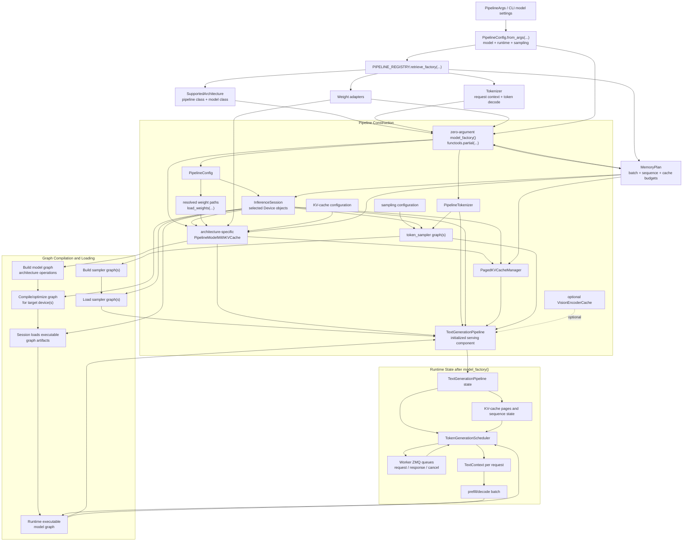
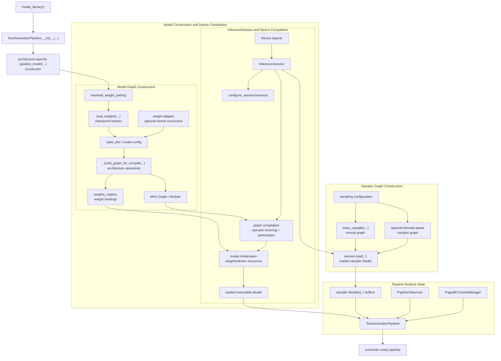

<a id="model-factory-call"></a>

# Model Factory Setup: Pipeline Construction, Graph Compilation, and Runtime State

This document expands the startup call:

```text
model_factory()
```

It follows the normal text-generation path used by `max serve`. The exact
architecture class varies by model, but the construction contract is shared by
the text-generation pipeline.

<details>
<summary><strong>Expand: Model factory component and interaction block diagram</strong></summary>



<p><strong>Interaction summary:</strong></p>

<pre>
Configuration and registry
    |
    +-- choose architecture, tokenizer, adapters, and memory plan
    |
    v
Pipeline Construction
    |
    +-- create InferenceSession and devices
    +-- load weights into the architecture model
    +-- create KV-cache manager
    +-- prepare sampler and optional vision cache
    |
    v
Graph Compilation
    |
    +-- build model operations into a MAX graph
    +-- compile/optimize graph for target devices
    +-- load executable graph into the session
    +-- build/load sampler graph(s)
    |
    v
TextGenerationPipeline
    |
    +-- holds executable model graph
    +-- holds session, tokenizer, sampler, and KV-cache manager
    |
    v
Runtime State
    |
    +-- scheduler receives request contexts through worker queues
    +-- scheduler creates prefill/decode batches
    +-- batches execute the already-loaded graph
    +-- KV cache and request context are updated
    +-- results return through the response queue
</pre>

<p><strong>Pipeline Construction</strong> creates and connects the long-lived objects. <strong>Graph Compilation</strong> turns model and sampler operations into device-executable artifacts. <strong>Runtime State</strong> is the live state retained after construction and consumed repeatedly by the scheduler for incoming requests.</p>

<p><strong>Key boundary:</strong> <code>model_factory()</code> creates the model execution environment and returns the initialized pipeline. It does not process a particular HTTP request. HTTP parsing, request context creation, batching, and token streaming occur after this setup.</p>
</details>

Source files used by this walkthrough:

```text
max/python/max/_entrypoints/cli/serve/serve_api_and_model_worker.py
max/python/max/serve/pipelines/model_worker.py
max/python/max/pipelines/lib/registry.py
max/python/max/pipelines/lib/pipeline_variants/text_generation.py
max/python/max/pipelines/modeling/types/__init__.py
```

## 1. Model factory call in the worker

<details>
<summary><strong>Expand: Worker invokes the zero-argument factory</strong></summary>

<pre>
ModelWorker.run(...)
    |
    +-- pipeline = model_factory()
    |     model_worker.py:327
    |       |
    |       +-- EXAMPLE: model="meta-llama/Llama-3.1-8B-Instruct"
    |       +-- IN: zero-argument callable captured during serve setup
    |       +-- STRUCTURES: PipelinesFactory; PipelineConfig; MemoryPlan
    |       +-- LOGIC: construct the model pipeline once in the worker process
    |       +-- OUT: initialized Pipeline instance
    |
    +-- inspect model-load and compilation timings
    +-- create worker ZMQ queues
    +-- load scheduler using the returned pipeline
    |
    v
TokenGenerationScheduler or another task-specific scheduler
</pre>

<p><strong>Important process boundary:</strong> the factory is invoked inside the model-worker process. The API process resolves the factory description, but the expensive model construction happens in the worker that owns the model execution device.</p>

<p><strong>Factory type:</strong></p>

<pre>
PipelinesFactory = Callable[
    [],
    Pipeline[PipelineInputsType, PipelineOutputType],
]
</pre>

<p>The worker calls the factory with no arguments because the required values were captured earlier in a closure, normally through <code>functools.partial(...)</code>.</p>
</details>

## 2. How the factory is assembled

<details>
<summary><strong>Expand: Pipeline registry resolves architecture, tokenizer, factory, and memory plan</strong></summary>

<pre>
serve_api_and_model_worker(...)
    |
    +-- PipelineConfig.from_args(pipeline_args)
    |     |
    |     +-- resolve model path and architecture
    |     +-- resolve runtime/sampling settings
    |     +-- load model configuration metadata
    |     +-- resolve memory-planning inputs
    |     v
    |   pipeline_config
    |
    +-- PIPELINE_REGISTRY.retrieve_factory(
    |       pipeline_config,
    |       task,
    |       override_architecture,
    |   )
    |     |
    |     +-- find SupportedArchitecture
    |     +-- choose pipeline class
    |     +-- create tokenizer
    |     +-- select weight adapters
    |     +-- obtain memory_plan
    |     +-- create zero-argument factory
    |     v
    |   RetrievedPipeline
    |       +-- tokenizer
    |       +-- factory
    |       +-- memory_plan
    |
    +-- ServingTokenGeneratorSettings(
    |       model_factory=retrieved.factory,
    |       pipeline_config=pipeline_config,
    |       tokenizer=retrieved.tokenizer,
    |       memory_plan=retrieved.memory_plan,
    |   )
    |
    v
ModelWorker.run(...)
</pre>

<p><strong>Actual text-generation factory closure:</strong></p>

<pre>
pipeline_factory = functools.partial(
    pipeline_class,
    pipeline_config=pipeline_config,
    pipeline_model=arch.pipeline_model,
    weight_adapters=arch.weight_adapters,
    tokenizer=typed_tokenizer,
    memory_plan=memory_plan,
)
</pre>

<p>Calling <code>pipeline_factory()</code> later is equivalent to constructing the selected pipeline class with these captured values.</p>

<p><strong>Structures returned by the registry:</strong></p>

<pre>
RetrievedPipeline
    |
    +-- tokenizer: PipelineTokenizer
    |     converts requests into model contexts and decodes tokens
    |
    +-- factory: Callable[[], Pipeline]
    |     constructs the pipeline inside the worker process
    |
    +-- memory_plan: MemoryPlan
          contains planned batch/sequence/cache/device budgets
</pre>

<p>The registry performs architecture selection and preparation. It does not itself execute the model graph. The factory performs the heavyweight pipeline initialization when the worker invokes it.</p>
</details>

## 3. Complete model_factory tree

<details>
<summary><strong>Expand: End-to-end model_factory construction</strong></summary>

<pre>
model_factory()
    |
    +-- read captured model/configuration information
    |     |
    |     +-- PipelineConfig
    |     +-- architecture-specific pipeline_model class
    |     +-- tokenizer
    |     +-- weight adapters
    |     +-- MemoryPlan
    |     +-- model weight paths
    |     v
    +-- create TextGenerationPipeline
    |     |
    |     +-- save pipeline configuration
    |     +-- read planned max batch size
    |     +-- load target devices
    |     +-- initialize structured-output helper
    |     +-- create InferenceSession
    |     +-- configure session
    |     +-- resolve and load weights
    |     +-- instantiate architecture-specific model
    |     +-- create KV-cache manager
    |     +-- optionally create vision encoder cache
    |     +-- build/load sampler graph(s)
    |     +-- allocate reusable sampling buffers
    |     v
    +-- return initialized TextGenerationPipeline
    |
    v
TextGenerationPipeline
    +-- compiled/loaded model state
    +-- inference session
    +-- tokenizer
    +-- KV-cache manager
    +-- sampler
    +-- generation configuration
</pre>

<p><strong>Input:</strong> a zero-argument factory whose captured values identify the model architecture, weights, tokenizer, target devices, runtime configuration, sampling configuration, and memory plan.</p>

<p><strong>Output:</strong> an initialized text-generation pipeline that the worker scheduler can execute for many requests.</p>
</details>

## 4. TextGenerationPipeline initialization

<details>
<summary><strong>Expand: TextGenerationPipeline.__init__(...)</strong></summary>

<pre>
TextGenerationPipeline.__init__(
    pipeline_config,
    pipeline_model,
    weight_adapters,
    tokenizer,
    memory_plan,
)
    text_generation.py:140
    |
    +-- self._pipeline_config = pipeline_config
    |
    +-- self._max_batch_size = memory_plan.planned_max_batch_size
    |
    +-- model_config = pipeline_config.model
    +-- huggingface_config = model_config.huggingface_config
    |     |
    |     +-- missing -> raise ValueError
    |     +-- present -> continue
    |
    +-- self._devices = load_devices(memory_plan.require_device_specs())
    |
    +-- self._tokenizer = tokenizer
    |
    +-- StructuredOutputHelper.from_tokenizer(...)
    |
    +-- InferenceSession(devices=..., precompiled_mefs=..., export_mefs=...)
    |
    +-- pipeline_config.configure_session(session)
    |
    +-- resolve weight paths
    |
    +-- validate pipeline_model supports KV cache
    |
    +-- self._pipeline_model = pipeline_model(...)
    |
    +-- self._kv_manager = load_kv_manager(...)
    |
    +-- optionally create VisionEncoderCache
    |
    +-- select sampler device
    +-- build and session.load sampler graph(s)
    +-- allocate reusable sampling buffers when required
    |
    v
initialized TextGenerationPipeline
</pre>

<p>The pipeline constructor is where the captured factory inputs become long-lived runtime objects. It sets up the execution session, architecture model, weights, KV cache, tokenizer integration, and sampler.</p>
</details>

## 5. Read configuration and memory plan

<details>
<summary><strong>Expand: Configuration and planned resources</strong></summary>

<pre>
pipeline_config
    |
    +-- model
    |     +-- model_path
    |     +-- model_name
    |     +-- HuggingFace configuration
    |     +-- KV-cache configuration
    |     +-- quantization/weight settings
    |
    +-- runtime
    |     +-- device specifications
    |     +-- pipeline role
    |     +-- graph-capture settings
    |     +-- precompiled/export settings
    |     +-- max input token settings
    |
    +-- sampling
    |     +-- sampling algorithm settings
    |     +-- structured-output settings
    |     +-- sample-on-host setting
    |
    +-- task and architecture metadata

memory_plan
    |
    +-- planned_max_batch_size
    +-- planned_max_length
    +-- available_cache_memory
    +-- resolved device specifications
    +-- optional vision-cache plan
</pre>

<p><strong>Why the memory plan matters:</strong> the pipeline is sized against the plan. Its batch capacity, sequence capacity, device placement, and KV-cache budget must agree with the scheduler configuration created later.</p>

<p><strong>Example:</strong></p>

<pre>
model_config.model_path       = "meta-llama/Llama-3.1-8B-Instruct"
memory_plan.planned_max_batch_size = 8
memory_plan.planned_max_length     = 8192
pipeline_config.runtime.pipeline_role = "prefill_and_decode"
pipeline_config.runtime.device_graph_capture = true
</pre>
</details>

## 5A. Graph Compilation and Loading

<details>
<summary><strong>Expand: Detailed graph compilation and loading block</strong></summary>



<p><strong>High-level interaction:</strong></p>

<pre>
model_factory()
    |
    v
TextGenerationPipeline.__init__(...)
    |
    +-- architecture-specific pipeline_model(...)
    |     |
    |     +-- load/adapt checkpoint weights
    |     +-- create model configuration
    |     +-- build MAX model graph
    |     +-- bind weights to graph inputs
    |     +-- session.load(graph, weights_registry=...)
    |           |
    |           +-- compile graph for target device(s)
    |           +-- initialize executable model state
    |           v
    |         loaded model Model
    |
    +-- build token_sampler graph(s)
    +-- session.load(sampler_graph)
    |     |
    |     +-- normal sampler
    |     +-- optional bitmask-aware sampler
    |     v
    |   loaded sampler Model(s)
    |
    +-- connect model, sampler, tokenizer, KV manager, and session
    |
    v
TextGenerationPipeline ready for scheduler execution
</pre>

<p>The exact model graph builder is architecture-specific. The common pipeline supplies the session, devices, weights, KV-cache configuration, batch size, and memory plan; the selected model implementation defines the actual attention, MLP, normalization, embedding, output, and cache operations.</p>
</details>

<details>
<summary><strong>Expand: Phase 1 - prepare graph inputs and weights</strong></summary>

<pre>
pipeline_config.model
    |
    +-- resolved_weight_paths()
    |       |
    |       v
    |   checkpoint files / weight repository
    |
    +-- huggingface_config
    +-- kv_cache configuration
    +-- quantization and model options

weight_paths
    |
    +-- load_weights(weight_paths)
    |       |
    |       v
    |   loaded weight tensors
    |
    +-- weights_format(weight_paths)
            |
            v
        weight_adapters.get(format)
            |
            v
        optional adapted weight representation
</pre>

<p><strong>Input:</strong> model path/repository, model configuration, checkpoint format, and optional weight adapter.</p>

<p><strong>Logic:</strong> resolve the actual weight sources, load the tensors, and adapt their names/layout/representation when the selected weight format requires it.</p>

<p><strong>Output:</strong> model state that can be used to build the architecture graph and bind graph parameters.</p>

<p>The weights are data used by the graph. They are not the graph itself: the graph describes operations, while the weights provide the trained parameter values used by those operations.</p>
</details>

<details>
<summary><strong>Expand: Phase 2 - build the model graph - <a href="0000_G_llama_3_1_8b_prefill_graph.md#llama-3-1-8b-prefill-graph">Llama 3.1 8B prefill example</a></strong></summary>

<pre>
architecture-specific PipelineModelWithKVCache
    |
    +-- create model configuration
    |     +-- hidden size
    |     +-- layer count
    |     +-- attention heads
    |     +-- vocabulary size
    |     +-- RoPE/position settings
    |     +-- KV-cache layout/settings
    |
    +-- create model modules/operations
    |     +-- token embedding
    |     +-- attention blocks
    |     +-- MLP blocks
    |     +-- normalization
    |     +-- output projection
    |     +-- cache read/write operations
    |
    +-- create graph input/output signatures
    |
    +-- bind weight values or weight references
    |
    v
MAX Graph / Module + weights_registry
</pre>

<p><strong>Graph construction</strong> is the Python-side phase where model operations are assembled. For the common graph-API model path, <code>GraphPipelineModel.load_model(...)</code> calls <code>_build_graph_for_compile(session, state_dict, model_config)</code>.</p>

<p>That builder returns:</p>

<pre>
(
    graph,
    weights_registry,
)
</pre>

<p>The <code>graph</code> contains the computation structure. The <code>weights_registry</code> records the parameter values or bindings that the compiled model will use.</p>

<p><strong>Build output:</strong> a graph representation, not yet the final device-executable model.</p>

<p><strong>Worked prefill example:</strong> <a href="0000_G_llama_3_1_8b_prefill_graph.md#llama-3-1-8b-prefill-graph">Llama 3.1 8B prefill graph, stage-by-stage shapes, operations, and KV-cache writes</a>.</p>
</details>

<details>
<summary><strong>Expand: Phase 3 - compile and initialize the model graph</strong></summary>

<pre>
MAX Graph / Module
    |
    v
session.load(
    graph,
    weights_registry=weights_registry,
)
    |
    +-- graph compilation
    |     +-- lower graph operations
    |     +-- select device implementations/kernels
    |     +-- apply graph optimizations
    |     +-- produce compiled artifact
    |
    +-- model initialization
          +-- bind expected weights
          +-- allocate/initialize device resources
          +-- create executable runtime handle
    |
    v
loaded Model
</pre>

<p>In the source, <code>session.load(...)</code> is the high-level operation that turns the graph and weight bindings into a model object usable by the session. The engine internally records compilation and initialization as distinct phases.</p>

<p><strong>Do not confuse these phases:</strong></p>

<pre>
Graph build:
    Python/MAX code creates the operation graph.

Graph compile:
    MAX lowers and optimizes the graph for the selected device(s).

Model initialization:
    compiled code is associated with weights and runtime/device state.

Runtime execution:
    the scheduler later invokes the loaded model for request batches.
</pre>

<p>The worker wraps <code>model_factory()</code> with compilation statistics. It reports separate values for graph build, graph compile, initialization, and other startup work.</p>

</details>

<details>
<summary><strong>Expand: Phase 4 - build and load sampler graph(s)</strong></summary>

<pre>
pipeline_config.sampling
    |
    +-- sample_on_host?
    |     +-- yes -> CPU sampler device
    |     +-- no  -> first model device
    |
    +-- needs_bitmask_constraints?
          |
          +-- yes
          |     +-- token_sampler(needs_bitmask_input=True)
          |     +-- token_sampler(needs_bitmask_input=False)
          |
          +-- no
                +-- token_sampler(needs_bitmask_input=False)
    |
    v
sampler graph(s)
    |
    +-- session.load(with_bitmask_graph)  [optional]
    +-- session.load(without_bitmask_graph)
    |
    v
sampler Model(s)
</pre>

<p>The sampler graph receives logits from the model and produces the next token according to temperature, top-k, top-p, penalties, seeds, and constrained-decoding state.</p>

<p>When structured output may be active, the pipeline keeps two sampler variants:</p>

<pre>
normal sampler
    -> unconstrained token selection

bitmask-aware sampler
    -> token selection restricted by the request's valid-token mask
</pre>

<p>The sampler graphs are loaded during startup. Choosing which sampler to use for a particular batch happens during request-time execution.</p>
</details>

<details>
<summary><strong>Expand: Phase 5 - assemble the runtime execution state</strong></summary>

<pre>
loaded model Model
loaded sampler Model(s)
InferenceSession
PipelineTokenizer
PagedKVCacheManager
reusable sampling buffers
    |
    v
TextGenerationPipeline
    |
    +-- _pipeline_model
    +-- session
    +-- tokenizer
    +-- _kv_manager
    +-- _sampler_with_bitmask
    +-- _sampler_without_bitmask
    +-- pinned token-copy buffer, when enabled
    +-- identity logit offsets
    +-- pipeline configuration
    |
    v
TokenGenerationScheduler
</pre>

<p>The pipeline is now a long-lived runtime object. The scheduler can repeatedly pass batches to it without rebuilding or recompiling the model graph.</p>

<p><strong>Runtime interaction for one generation step:</strong></p>

<pre>
TokenGenerationScheduler
    |
    +-- constructs TextGenerationInputs
    |
    v
TextGenerationPipeline.execute(inputs)
    |
    +-- prepare model inputs and optional output bitmask
    +-- select normal or bitmask-aware sampler
    +-- _pipeline_model.execute(model_inputs)
    +-- obtain logits/model outputs
    +-- sample next token
    +-- copy generated token to host when needed
    +-- update request context
    +-- advance KV-cache state
    |
    v
PipelineOutputsDict[TextGenerationOutput]
</pre>
</details>

<details>
<summary><strong>Expand: Graph compilation timing and artifacts</strong></summary>

<pre>
collect_compilation_stats()
    |
    +-- model_factory()
          |
          +-- build_seconds
          |     Python-side graph construction time
          |
          +-- compile_seconds
          |     engine graph compilation time
          |
          +-- init_seconds
          |     compiled model/runtime initialization time
          |
          +-- other startup time
                tokenizer/session/cache/buffer setup not attributed
                to the three phases above
</pre>

<p>Depending on runtime configuration, the session may consume precompiled artifacts or export compiled artifacts. The logical contract remains the same: produce a loaded model that the pipeline can execute on the selected device.</p>

<p><strong>Lifecycle:</strong></p>

<pre>
build graph -> compile graph -> initialize/load model -> execute repeatedly
      once          once                  once              many times
</pre>
</details>

## 6. Device and inference session setup

<details>
<summary><strong>Q: memory_plan.require_device_specs() - What is the memory plan, what are devices, and how are the devices loaded into MAX InferenceSession?</strong></summary>

<pre>
memory_plan.require_device_specs()
    |
    v
load_devices(...)
    |
    v
devices: list[Device]
    |
    v
InferenceSession(
    devices=devices,
    precompiled_mefs=pipeline_config.runtime.precompiled_mefs,
    export_mefs=pipeline_config.runtime.export_mefs,
)
    |
    +-- session owns graph compilation/loading context
    +-- session targets the selected device(s)
    +-- session may use precompiled/exported graph artifacts
    |
    v
pipeline_config.configure_session(session)
</pre>

<p><strong>Input:</strong> resolved device specifications and runtime session flags.</p>

<p><strong>Structure:</strong> MAX <code>Device</code> objects and an <code>InferenceSession</code>.</p>

<p><strong>Logic:</strong> create the execution context that will own or load the compiled model and sampler graphs.</p>

<p><strong>Output:</strong> a configured session passed into the architecture-specific model constructor.</p>

<p>This is the runtime context used by the model and sampler. It is distinct from the HTTP server's event loop and from the scheduler's request queues.</p>
</details>

<details>
<summary><strong>Q: Do we have the native MAX driver implementation that interacts with actual hardware and discovers or enumerates NVIDIA GPUs in this repository?</strong></summary>

<p><strong>Is the native NVIDIA GPU-discovery implementation available in this repository?</strong></p>

<p>No. This workspace contains the public API, Python/native bindings, declarations, and tests around accelerator discovery, but not the concrete MLRT/CUDA implementation that enumerates NVIDIA devices.</p>

<pre>
Python
max.driver.accelerator_count()
    |
    v
Native Python extension
max._core.driver.accelerator_count()
    |
    v
MAX/MLRT native device layer
Device::numberOfDevices(...)
    |
    v
API-specific device implementation
CUDADeviceContext
    |
    v
NVIDIA CUDA driver/runtime
</pre>

<p>Only the upper API/binding layers and the interface to the lower layers are visible in this checkout.</p>

<p><strong>Python facade:</strong></p>

<pre>
max/python/max/driver/driver.py
    |
    +-- from max._core.driver import accelerator_count
</pre>

<p><code>accelerator_count()</code> has no Python implementation. It is imported directly from the compiled <code>max._core.driver</code> extension.</p>

<p><strong>Generated native-binding declaration:</strong></p>

<pre>
max/python/max/_core/driver.pyi
    |
    +-- def accelerator_count() -&gt; int
          "Returns number of accelerator devices available."
</pre>

<p>This <code>.pyi</code> file is a generated type stub for a native nanobind function; it is not the implementation.</p>

<p><strong>C API declaration:</strong></p>

<pre>
max/include/max/c/device.h
    |
    +-- M_getAcceleratorCount(void)
          returns the number of available accelerator devices
</pre>

<p>The repository contains the declaration and tests that call it, but no implementation body for <code>M_getAcceleratorCount()</code>.</p>

<p><strong>Mojo/native runtime boundary:</strong></p>

<pre>
DeviceContext.number_of_devices(api="cuda")
    |
    v
external_call[
    "AsyncRT_DeviceContext_numberOfDevices"
]("cuda")
</pre>

<p><code>max/mojo/max/gpu/host/device_context.mojo</code> exposes this wrapper, but the implementation of <code>AsyncRT_DeviceContext_numberOfDevices</code> is not present.</p>

<p><strong>Missing native implementation:</strong></p>

<pre>
Build references found:
    //MLRT:Driver/DeviceContextImplCpp
    //max/python/max/_core/internal:_core.cpp

Implementation names mentioned by build/source comments:
    CUDADeviceContext.cpp
    HIPDeviceContext.cpp

Missing from this workspace:
    MLRT/Driver implementation sources
    max/python/max/_core/internal/_core.cpp
    CUDADeviceContext implementation
    AsyncRT_DeviceContext_numberOfDevices implementation
</pre>

<p>The build graph expects these components from an internal source tree, generated overlay, or another build input that is not included in this checkout.</p>

<p><strong>NVIDIA-specific enumeration:</strong></p>

<p>A repository-wide source search found no implementation calls such as:</p>

<pre>
cuDeviceGetCount(...)
cudaGetDeviceCount(...)
</pre>

<p>Therefore, the exact NVIDIA API call, initialization sequence, visibility handling, and native error handling cannot be proven from this repository.</p>

<p>The likely architecture, shown only as an inference from the exposed interfaces, is:</p>

<pre>
CUDADeviceContext::numberOfDevices()
    |
    +-- initialize or query the CUDA driver/runtime
    +-- ask CUDA for the process-visible device count
    +-- return the count through MLRT
    |
    v
AsyncRT_DeviceContext_numberOfDevices("cuda")
    |
    v
max._core.driver.accelerator_count()
    |
    v
Python integer count
</pre>

<p>The concrete CUDA function used by that implementation is not available for inspection here.</p>

<p><strong>Availability summary:</strong></p>

<table>
<thead>
<tr><th>Component</th><th>Present?</th></tr>
</thead>
<tbody>
<tr><td>Python <code>max.driver</code> facade</td><td>Yes</td></tr>
<tr><td><code>max._core.driver</code> generated stub</td><td>Yes</td></tr>
<tr><td>C API declaration</td><td>Yes</td></tr>
<tr><td>Mojo external-call wrapper</td><td>Yes</td></tr>
<tr><td>Virtual-device override implementation</td><td>Yes</td></tr>
<tr><td>Native nanobind driver implementation</td><td>No</td></tr>
<tr><td><code>M_getAcceleratorCount()</code> implementation</td><td>No</td></tr>
<tr><td><code>AsyncRT_DeviceContext_numberOfDevices()</code> implementation</td><td>No</td></tr>
<tr><td><code>CUDADeviceContext</code> implementation</td><td>No</td></tr>
<tr><td>NVIDIA device-count API call</td><td>No</td></tr>
</tbody>
</table>

<p>The NVIDIA kernels under <code>max/kernels/.../gpu/nvidia/</code> implement GPU computation. They are not responsible for hardware discovery or device enumeration.</p>

<p><strong>Source-backed conclusion:</strong></p>

<pre>
This repository exposes the accelerator-discovery contract and call boundary,
but not the native NVIDIA device-enumeration implementation.
</pre>
</details>

<details>
<summary><strong>Q: How do we use the MAX driver to find GPU core count, block count, warp and Streaming Multiprocessor details, host-device details, host/device memory, shared memory tightly coupled with GPU compute units or threads, regional memory, and related capabilities?</strong></summary>

<p><strong>Question:</strong> How do we use the MAX driver to find device capabilities such as GPU core count, block count, warp and Streaming Multiprocessor details, host device details, device memory, shared memory, local memory, and related runtime limits?</p>

<p><strong>Short answer:</strong> use two layers:</p>

<pre>
Python MAX driver
    |
    +-- best for serving/runtime setup
    +-- device count, selected CPU/GPU device, backend API, model name,
    |   architecture name, compatibility, coarse memory stats
    |
    v
Mojo max.gpu.host DeviceContext
    |
    +-- best for low-level GPU capability queries
    +-- SM count, warp size, launch limits, register/shared-memory limits,
    |   device free/total memory, function-specific resource usage,
    |   occupancy calculations
</pre>

<p><strong>Python driver path:</strong></p>

<pre>
from max import driver
from max.support.host_memory import (
    available_host_memory,
    host_memory_limit,
)

gpu_count = driver.accelerator_count()

gpu = driver.Accelerator(id=0)
print(gpu.id)
print(gpu.api)                  # "cuda", "hip", "metal", ...
print(gpu.model_name)           # example: "NVIDIA H100 80GB HBM3"
print(gpu.architecture_name)    # example: "sm_90"
print(gpu.is_host_unified)
print(gpu.is_compatible)
print(gpu.max_single_alloc_size)

stats = gpu.stats
print(stats.get("free_memory"))
print(stats.get("total_memory"))
print(stats.get("graph_mem_reserved"))
print(stats.get("graph_mem_used"))

cpu = driver.CPU()
print(cpu.stats)

print(host_memory_limit())      # process-visible host-memory limit, or None
print(available_host_memory())  # remaining host memory, or None
</pre>

<p><strong>What Python gives you:</strong></p>

<table>
<thead>
<tr><th>Need</th><th>Python MAX driver query</th><th>Meaning</th></tr>
</thead>
<tbody>
<tr><td>How many accelerator devices exist?</td><td><code>driver.accelerator_count()</code></td><td>Number of runtime-visible accelerator devices.</td></tr>
<tr><td>Which backend is this device using?</td><td><code>gpu.api</code></td><td><code>cuda</code>, <code>hip</code>, <code>metal</code>, or <code>cpu</code>.</td></tr>
<tr><td>Which GPU model is selected?</td><td><code>gpu.model_name</code></td><td>Human-readable device model.</td></tr>
<tr><td>Which target architecture is selected?</td><td><code>gpu.architecture_name</code></td><td>Backend architecture name, such as <code>sm_90</code> or <code>gfx942</code>.</td></tr>
<tr><td>How much device memory is free/total?</td><td><code>gpu.stats["free_memory"]</code>, <code>gpu.stats["total_memory"]</code></td><td>Device-memory availability exposed through MAX runtime stats.</td></tr>
<tr><td>How much graph memory is reserved/used?</td><td><code>gpu.stats["graph_mem_reserved"]</code>, <code>gpu.stats["graph_mem_used"]</code></td><td>MAX graph allocator memory accounting for accelerator devices.</td></tr>
<tr><td>How much host memory can this process use?</td><td><code>host_memory_limit()</code></td><td>Minimum of physical RAM and enclosing cgroup limits, or <code>None</code>.</td></tr>
<tr><td>How much host memory remains available?</td><td><code>available_host_memory()</code></td><td>Minimum of machine free memory and cgroup headroom, or <code>None</code>.</td></tr>
</tbody>
</table>

<p>The Python driver is the right level for serving decisions, memory planning, and logging. It does not expose every low-level CUDA/HIP/Metal device attribute.</p>

<p><strong>Mojo DeviceContext path:</strong></p>

<pre>
from std.sys import exit, has_accelerator
from max.gpu.host import DeviceAttribute, DeviceContext

def main() raises:
    comptime if not has_accelerator():
        print("No GPU detected")
        exit(0)
    else:
        var num_devices = DeviceContext.number_of_devices()
        print("Number of GPUs:", num_devices)

        var ctx = DeviceContext()
        print("Device ID:", ctx.id())
        print("Device API:", ctx.api())
        print("Device name:", ctx.name())
        print("Device API version:", ctx.get_api_version())

        var mem_info = ctx.get_memory_info()
        print("Free device memory:", mem_info[0])
        print("Total device memory:", mem_info[1])

        print(
            "SM count:",
            ctx.get_attribute(DeviceAttribute.MULTIPROCESSOR_COUNT),
        )
        print("Warp size:", ctx.get_attribute(DeviceAttribute.WARP_SIZE))
        print(
            "Max threads/block:",
            ctx.get_attribute(DeviceAttribute.MAX_THREADS_PER_BLOCK),
        )
        print(
            "Max resident blocks/SM:",
            ctx.get_attribute(
                DeviceAttribute.MAX_BLOCKS_PER_MULTIPROCESSOR
            ),
        )
        print(
            "Max threads/SM:",
            ctx.get_attribute(
                DeviceAttribute.MAX_THREADS_PER_MULTIPROCESSOR
            ),
        )
        print(
            "Shared memory/block:",
            ctx.get_attribute(DeviceAttribute.MAX_SHARED_MEMORY_PER_BLOCK),
        )
        print(
            "Shared memory/SM:",
            ctx.get_attribute(
                DeviceAttribute.MAX_SHARED_MEMORY_PER_MULTIPROCESSOR
            ),
        )
        print(
            "Registers/block:",
            ctx.get_attribute(DeviceAttribute.MAX_REGISTERS_PER_BLOCK),
        )
        print(
            "Registers/SM:",
            ctx.get_attribute(
                DeviceAttribute.MAX_REGISTERS_PER_MULTIPROCESSOR
            ),
        )
        print("L2 cache:", ctx.get_attribute(DeviceAttribute.L2_CACHE_SIZE))
        print(
            "Compute capability major:",
            ctx.get_attribute(DeviceAttribute.COMPUTE_CAPABILITY_MAJOR),
        )
        print(
            "Compute capability minor:",
            ctx.get_attribute(DeviceAttribute.COMPUTE_CAPABILITY_MINOR),
        )
</pre>

<p><strong>What Mojo gives you:</strong></p>

<table>
<thead>
<tr><th>Need</th><th>Mojo query</th><th>Meaning</th></tr>
</thead>
<tbody>
<tr><td>Runtime-visible GPU count</td><td><code>DeviceContext.number_of_devices()</code></td><td>Number of visible accelerator devices for the selected backend.</td></tr>
<tr><td>Device identity</td><td><code>ctx.id()</code>, <code>ctx.api()</code>, <code>ctx.name()</code>, <code>ctx.get_api_version()</code></td><td>Selected device id, backend API, name, and backend version.</td></tr>
<tr><td>Free/total device memory</td><td><code>ctx.get_memory_info()</code></td><td>Returns <code>(free, total)</code> bytes for the selected device.</td></tr>
<tr><td>Streaming Multiprocessor count</td><td><code>DeviceAttribute.MULTIPROCESSOR_COUNT</code></td><td>Number of GPU multiprocessor units. On NVIDIA, this is the SM count.</td></tr>
<tr><td>Warp size</td><td><code>DeviceAttribute.WARP_SIZE</code></td><td>Threads per warp or backend equivalent.</td></tr>
<tr><td>Block and grid launch limits</td><td><code>MAX_THREADS_PER_BLOCK</code>, <code>MAX_BLOCK_DIM_X/Y/Z</code>, <code>MAX_GRID_DIM_X/Y/Z</code></td><td>Maximum legal launch dimensions.</td></tr>
<tr><td>Resident blocks per SM</td><td><code>MAX_BLOCKS_PER_MULTIPROCESSOR</code></td><td>Hardware maximum for concurrently resident blocks per multiprocessor.</td></tr>
<tr><td>Resident threads per SM</td><td><code>MAX_THREADS_PER_MULTIPROCESSOR</code></td><td>Hardware maximum for concurrently resident threads per multiprocessor.</td></tr>
<tr><td>Shared memory limits</td><td><code>MAX_SHARED_MEMORY_PER_BLOCK</code>, <code>MAX_SHARED_MEMORY_PER_MULTIPROCESSOR</code>, <code>MAX_SHARED_MEMORY_PER_BLOCK_OPTIN</code></td><td>Shared-memory capacity limits, not current free/used shared memory.</td></tr>
<tr><td>Register limits</td><td><code>MAX_REGISTERS_PER_BLOCK</code>, <code>MAX_REGISTERS_PER_MULTIPROCESSOR</code></td><td>Register-file limits used during occupancy and launch planning.</td></tr>
<tr><td>L2 cache</td><td><code>L2_CACHE_SIZE</code></td><td>Device L2 cache size in bytes when supported.</td></tr>
<tr><td>NVIDIA compute capability</td><td><code>COMPUTE_CAPABILITY_MAJOR</code>, <code>COMPUTE_CAPABILITY_MINOR</code></td><td>CUDA compute capability values when supported.</td></tr>
</tbody>
</table>

<p><strong>Function-specific resource usage:</strong></p>

<pre>
from max.gpu.host import Attribute, DeviceContext

def some_kernel():
    pass

def main() raises:
    var ctx = DeviceContext()
    var func = ctx.compile_function[some_kernel]()

    print(func.get_attribute(Attribute.MAX_THREADS_PER_BLOCK))
    print(func.get_attribute(Attribute.NUM_REGS))
    print(func.get_attribute(Attribute.SHARED_SIZE_BYTES))
    print(func.get_attribute(Attribute.LOCAL_SIZE_BYTES))
    print(func.get_attribute(Attribute.CONST_SIZE_BYTES))
    print(func.get_attribute(Attribute.MAX_DYNAMIC_SHARED_SIZE_BYTES))

    var block_size = 256
    var dynamic_shared_mem_size = 0
    print(
        func.occupancy_max_active_blocks_per_multiprocessor(
            block_size,
            dynamic_shared_mem_size,
        )
    )
</pre>

<p>This is how to answer questions such as "how many blocks can this compiled kernel keep resident per SM?" The answer depends on both the device and the compiled function's resource usage, especially registers, static shared memory, dynamic shared memory, and threads per block.</p>

<p><strong>Important distinctions:</strong></p>

<table>
<thead>
<tr><th>Term</th><th>What MAX can query directly</th><th>Clarification</th></tr>
</thead>
<tbody>
<tr><td>CUDA core count</td><td>Not directly exposed by the MAX APIs visible here.</td><td>MAX exposes multiprocessor count and architecture name. CUDA-core count requires vendor architecture tables or vendor tools.</td></tr>
<tr><td>SM count</td><td><code>DeviceAttribute.MULTIPROCESSOR_COUNT</code></td><td>This is the useful scheduling-level unit for GPU occupancy and launch planning.</td></tr>
<tr><td>Block count</td><td>Launch grid size is chosen by the caller; resident block limit is queried with <code>MAX_BLOCKS_PER_MULTIPROCESSOR</code> or occupancy APIs.</td><td>Do not confuse "blocks launched" with "blocks concurrently resident".</td></tr>
<tr><td>Shared memory</td><td>Device limits via <code>DeviceAttribute</code>; per-function usage via <code>Attribute.SHARED_SIZE_BYTES</code> and dynamic shared-memory launch size.</td><td>Shared memory is per-block/per-SM scratchpad capacity, not a global free-memory pool.</td></tr>
<tr><td>Local memory</td><td><code>Attribute.LOCAL_SIZE_BYTES</code></td><td>Per-thread local memory used by the compiled function, often from spills or compiler-lowered storage.</td></tr>
<tr><td>Registers</td><td><code>Attribute.NUM_REGS</code> and device register limits.</td><td>Register usage is function-specific and affects occupancy.</td></tr>
<tr><td>Global device memory</td><td><code>gpu.stats</code> in Python or <code>ctx.get_memory_info()</code> in Mojo.</td><td>This is the large device memory pool used for model weights, KV cache, tensors, and graph allocations.</td></tr>
<tr><td>Host memory</td><td><code>host_memory_limit()</code>, <code>available_host_memory()</code>, and <code>driver.CPU().stats</code>.</td><td>Serving code uses this for host-side memory planning and safety limits.</td></tr>
</tbody>
</table>

<p>In short: use Python <code>max.driver</code> for MAX Serve startup and memory-planning visibility; use Mojo <code>DeviceContext</code> and <code>DeviceAttribute</code> for hardware capability details; use compiled <code>DeviceFunction</code> attributes and occupancy APIs for kernel-specific register/shared/local-memory and resident-block answers.</p>
</details>

<details>
<summary><strong>Q: The above Q&amp;A is for NVIDIA GPUs. Is it the same for AMD GPUs? How does it differ, including compute-unit and memory details? Explain with an example.</strong></summary>

<p><strong>Question:</strong> The previous device-capability Q&amp;A uses NVIDIA terms such as SM, warp, CUDA core, and shared memory. Is the query flow the same for AMD GPUs? How does compute-unit and memory interpretation differ?</p>

<p><strong>Short answer:</strong> the MAX query shape is mostly the same, but the backend, architecture names, execution-unit terms, warp/wave size, and some low-level attributes differ.</p>

<pre>
MAX portable accelerator view
    |
    +-- NVIDIA GPU
    |     +-- api = "cuda"
    |     +-- architecture_name = "sm_80", "sm_90", "sm_100", ...
    |     +-- execution unit = SM / Streaming Multiprocessor
    |     +-- warp size = usually 32
    |     +-- tensor hardware = Tensor Cores
    |
    +-- AMD GPU
          +-- api = "hip"
          +-- architecture_name = "gfx90a", "gfx942", "gfx950", "gfx11xx", ...
          +-- execution unit = CU/WGP-like backend execution unit
          +-- wavefront size = often 64 on CDNA, often 32 on RDNA
          +-- tensor hardware = Matrix Cores / MFMA path
</pre>

<p><strong>Python driver example:</strong></p>

<pre>
from max import driver

gpu = driver.Accelerator(id=0)

print(gpu.api)
print(gpu.model_name)
print(gpu.architecture_name)
print(gpu.stats["free_memory"])
print(gpu.stats["total_memory"])
print(gpu.stats.get("graph_mem_reserved"))
print(gpu.stats.get("graph_mem_used"))
</pre>

<p><strong>Example outputs:</strong></p>

<pre>
NVIDIA-like:
    api = "cuda"
    model_name = "NVIDIA H100 80GB HBM3"
    architecture_name = "sm_90"

AMD-like:
    api = "hip"
    model_name = "AMD Instinct MI300X"
    architecture_name = "gfx942"
</pre>

<p>The serving-level memory fields have the same broad meaning on both backends: free device memory, total device memory, and MAX graph allocator accounting. The hardware interpretation differs below that layer.</p>

<p><strong>Compute-unit interpretation:</strong></p>

<table>
<thead>
<tr><th>Question</th><th>NVIDIA interpretation</th><th>AMD interpretation</th></tr>
</thead>
<tbody>
<tr><td><code>DeviceAttribute.MULTIPROCESSOR_COUNT</code></td><td>SM count.</td><td>Backend-exposed compute-unit-like count. Treat it as the scheduling-level execution-unit count, not as a CUDA SM.</td></tr>
<tr><td><code>DeviceAttribute.WARP_SIZE</code></td><td>Warp size, commonly 32 threads.</td><td>Wavefront size. CDNA commonly uses 64; RDNA commonly uses 32.</td></tr>
<tr><td>CUDA core count</td><td>Not directly exposed by MAX; derive only from vendor tables if needed.</td><td>Not applicable. AMD has stream processors/CUs/WGPs, not CUDA cores.</td></tr>
<tr><td>Resident block count</td><td>Resident CUDA blocks per SM when the attribute is supported.</td><td>Resident workgroup/block-style limit per CU-like unit when the backend supports that attribute. Some detailed occupancy fields are backend-dependent.</td></tr>
<tr><td>Tensor acceleration</td><td>Tensor Cores.</td><td>Matrix Cores / MFMA instructions on supported AMD architectures.</td></tr>
</tbody>
</table>

<p>For portable documentation, prefer these terms:</p>

<pre>
Instead of "SM count":
    execution-unit count
    multiprocessor / compute-unit-like count

Instead of "warp size":
    warp / wavefront size

Instead of "shared memory":
    shared memory / LDS

Instead of "CUDA cores":
    do not use a portable replacement; this is vendor-specific
</pre>

<p><strong>Mojo query example for AMD-capable code:</strong></p>

<pre>
from max.gpu.host import DeviceAttribute, DeviceContext

def main() raises:
    var ctx = DeviceContext()

    print("Device API:", ctx.api())       # "hip" on AMD
    print("Device name:", ctx.name())
    print("Device ID:", ctx.id())

    var mem = ctx.get_memory_info()
    print("Free device memory:", mem[0])
    print("Total device memory:", mem[1])

    print(
        "Execution-unit count:",
        ctx.get_attribute(DeviceAttribute.MULTIPROCESSOR_COUNT),
    )
    print(
        "Warp/wavefront size:",
        ctx.get_attribute(DeviceAttribute.WARP_SIZE),
    )
    print(
        "Max threads/workgroup:",
        ctx.get_attribute(DeviceAttribute.MAX_THREADS_PER_BLOCK),
    )
    print(
        "Shared memory or LDS per block/workgroup:",
        ctx.get_attribute(DeviceAttribute.MAX_SHARED_MEMORY_PER_BLOCK),
    )
</pre>

<p>This example intentionally uses neutral names such as "execution-unit", "warp/wavefront", and "block/workgroup" because the same MAX API can point at different GPU backends.</p>

<p><strong>AMD memory interpretation:</strong></p>

<table>
<thead>
<tr><th>Memory topic</th><th>MAX query</th><th>AMD interpretation</th></tr>
</thead>
<tbody>
<tr><td>Global device memory</td><td><code>gpu.stats["free_memory"]</code>, <code>gpu.stats["total_memory"]</code>, or <code>ctx.get_memory_info()</code></td><td>VRAM/HBM visible to the HIP backend. Used for model weights, activations, KV cache, tensors, and graph allocations.</td></tr>
<tr><td>MAX graph memory</td><td><code>gpu.stats["graph_mem_reserved"]</code>, <code>gpu.stats["graph_mem_used"]</code></td><td>Memory reserved and used by MAX graph/runtime allocation paths.</td></tr>
<tr><td>Shared memory / LDS</td><td><code>DeviceAttribute.MAX_SHARED_MEMORY_PER_BLOCK</code></td><td>AMD local data share style scratch memory available to a workgroup. This is not a global free-memory pool.</td></tr>
<tr><td>Shared memory per execution unit</td><td><code>DeviceAttribute.MAX_SHARED_MEMORY_PER_MULTIPROCESSOR</code> when supported</td><td>Backend-dependent. Treat as an execution-unit-level LDS/shared-memory capacity limit when available.</td></tr>
<tr><td>Registers</td><td><code>DeviceAttribute.MAX_REGISTERS_PER_BLOCK</code>, <code>DeviceAttribute.MAX_REGISTERS_PER_MULTIPROCESSOR</code>, and <code>Attribute.NUM_REGS</code></td><td>Register resources affect occupancy. AMD hardware has SGPR/VGPR concepts underneath, while MAX exposes portable function/device attributes where available.</td></tr>
<tr><td>Local memory</td><td><code>Attribute.LOCAL_SIZE_BYTES</code></td><td>Per-thread private/local memory used by the compiled function, often due to spills or compiler-lowered storage.</td></tr>
<tr><td>Constant memory</td><td><code>Attribute.CONST_SIZE_BYTES</code></td><td>Function-level constant-memory usage reported for the compiled function.</td></tr>
<tr><td>Host memory</td><td><code>host_memory_limit()</code>, <code>available_host_memory()</code>, <code>driver.CPU().stats</code></td><td>CPU/process memory used for host-side planning, staging, and safety checks. This is separate from AMD device memory.</td></tr>
</tbody>
</table>

<p><strong>Function-specific resource usage on AMD:</strong></p>

<pre>
from max.gpu.host import Attribute, DeviceContext

def some_kernel():
    pass

def main() raises:
    var ctx = DeviceContext()
    var func = ctx.compile_function[some_kernel]()

    print(func.get_attribute(Attribute.MAX_THREADS_PER_BLOCK))
    print(func.get_attribute(Attribute.NUM_REGS))
    print(func.get_attribute(Attribute.SHARED_SIZE_BYTES))
    print(func.get_attribute(Attribute.LOCAL_SIZE_BYTES))
    print(func.get_attribute(Attribute.CONST_SIZE_BYTES))
    print(func.get_attribute(Attribute.MAX_DYNAMIC_SHARED_SIZE_BYTES))

    var block_size = 256
    var dynamic_shared_mem_size = 0
    print(
        func.occupancy_max_active_blocks_per_multiprocessor(
            block_size,
            dynamic_shared_mem_size,
        )
    )
</pre>

<p>The occupancy answer is a function of the AMD device, compiled function resource usage, workgroup size, and dynamic shared-memory/LDS request. It should not be read as a CUDA-only "blocks per SM" concept; for AMD, read it as resident workgroups per backend execution unit where the backend supports the query.</p>

<p><strong>Practical rule:</strong></p>

<pre>
Serving/runtime decisions:
    use Python max.driver stats and device metadata

Low-level GPU capability decisions:
    use Mojo DeviceContext and DeviceAttribute

Kernel-specific occupancy/resource decisions:
    use compiled DeviceFunction attributes

Portable docs:
    say execution-unit count, warp/wavefront size, shared memory/LDS,
    and backend-specific tensor hardware
</pre>
</details>

<details>
<summary><strong>Q: The above Q&amp;A is for NVIDIA and AMD GPUs. Is it the same for Qualcomm NPUs? How does it differ, including compute and memory details? Explain with an example.</strong></summary>

<p><strong>Question:</strong> The previous Q&amp;A sections explain NVIDIA and AMD GPU capability queries. Is the same MAX <code>DeviceContext</code> / <code>DeviceAttribute</code> pattern used for Qualcomm NPUs? How do compute and memory details differ?</p>

<p><strong>Short answer:</strong> no, not in the same way. NVIDIA and AMD are handled as programmable GPU backends in this MAX path. Qualcomm NPU/HTP is normally a graph/delegate backend path through Qualcomm AI Runtime, QNN, or AI Engine Direct. In this checkout, Qualcomm NPU is not exposed as a visible <code>DeviceContext</code> backend like CUDA or HIP.</p>

<pre>
NVIDIA / AMD GPU path
    |
    +-- programmable GPU backend
    +-- CUDA / HIP
    +-- compile and launch kernels
    +-- query SM/CU-like count, warp/wavefront size,
    |   shared memory/LDS, registers, occupancy
    |
    v
MAX DeviceContext / DeviceAttribute / DeviceFunction

Qualcomm NPU path
    |
    +-- graph/delegate accelerator backend
    +-- QAIRT / QNN / AI Engine Direct
    +-- convert, quantize, optimize, compile graph/context
    +-- execute graph on HTP / Hexagon NPU backend
    +-- profile graph/operator execution and memory movement
    |
    v
QNN backend/context/graph/profiling APIs and tools
</pre>

<p><strong>What this MAX checkout exposes:</strong></p>

<pre>
max/python/max/_core/driver.pyi
    |
    +-- Device.api possible values documented as:
          "cpu", "cuda", "hip", "metal"

max/mojo/max/gpu/host/device_context.mojo
    |
    +-- DeviceContext.api() possible values documented as:
          "cpu", "cuda", "hip"

docs/releases/v26.6.md
    |
    +-- removed max.driver.NPU
    +-- removed DeviceRef.NPU(), DeviceRef.is_npu(), DeviceKind.NPU
    +-- removed M_newNPUDevice()
    +-- guidance: use Accelerator() or DeviceRef.GPU() for non-CPU devices
</pre>

<p>Therefore, do not expect the local MAX <code>DeviceAttribute</code> path to return Qualcomm NPU details such as HTP core count, VTCM size, or NPU occupancy. Those details belong to the Qualcomm runtime/backend/tooling layer, not the visible CUDA/HIP-style MAX GPU API in this tree.</p>

<p><strong>Compute-unit model difference:</strong></p>

<table>
<thead>
<tr><th>Topic</th><th>NVIDIA GPU</th><th>AMD GPU</th><th>Qualcomm NPU / HTP</th></tr>
</thead>
<tbody>
<tr><td>Backend style</td><td>CUDA programmable GPU.</td><td>HIP/ROCm programmable GPU.</td><td>QNN/QAIRT graph backend targeting HTP/Hexagon NPU.</td></tr>
<tr><td>Execution unit term</td><td>SM / Streaming Multiprocessor.</td><td>CU/WGP-like execution unit.</td><td>HTP/NPU hardware resources managed behind graph/backend scheduling.</td></tr>
<tr><td>Thread grouping</td><td>Warp, usually 32 lanes.</td><td>Wavefront, often 64 on CDNA and 32 on RDNA.</td><td>No normal user-facing warp/wavefront model in the QNN graph API.</td></tr>
<tr><td>Kernel launch model</td><td>Grid/block/thread style launch.</td><td>Grid/workgroup/thread style launch through HIP-like backend.</td><td>Compile/load a graph or context, then execute graph requests.</td></tr>
<tr><td>Occupancy concept</td><td>Resident blocks per SM based on registers, shared memory, and threads.</td><td>Resident workgroups per CU-like unit where supported.</td><td>Backend/compiler graph scheduling and profiling; not exposed as CUDA-style occupancy.</td></tr>
<tr><td>Tensor acceleration</td><td>Tensor Cores.</td><td>Matrix Cores / MFMA.</td><td>HTP/HVX/HMX/NPU execution resources, selected by QNN backend and compiler.</td></tr>
</tbody>
</table>

<p><strong>Memory model difference:</strong></p>

<table>
<thead>
<tr><th>Memory topic</th><th>NVIDIA / AMD GPU interpretation</th><th>Qualcomm NPU / HTP interpretation</th></tr>
</thead>
<tbody>
<tr><td>Large device memory</td><td>VRAM/HBM queried through <code>gpu.stats</code> or <code>ctx.get_memory_info()</code>.</td><td>Often system/DDR-backed tensors and QNN-managed allocations, depending on platform and backend.</td></tr>
<tr><td>Shared scratch memory</td><td>NVIDIA shared memory or AMD LDS queried through <code>DeviceAttribute.MAX_SHARED_MEMORY_PER_BLOCK</code>.</td><td>HTP-local/tightly-coupled memory such as VTCM/TCM-style scratch space, usually managed by the compiler/backend rather than a CUDA-style per-block query.</td></tr>
<tr><td>Graph/runtime memory</td><td>MAX graph allocator accounting through <code>graph_mem_reserved</code> and <code>graph_mem_used</code>.</td><td>QNN context, graph binary, tensor arena, intermediate activations, backend-managed buffers, and op-package resources.</td></tr>
<tr><td>Host/device transfers</td><td>Explicit copies or mapped buffers through the MAX GPU runtime.</td><td>QNN shared-buffer paths can reduce copies between host CPU/client code and HTP accelerator domains.</td></tr>
<tr><td>Spill/fill traffic</td><td>Kernel-specific register/local/shared-memory pressure is inspected through compiled function attributes and profilers.</td><td>Graph compiler may spill/fill intermediate tensors between local NPU memory and DDR when local memory constraints require it; this is inspected through QNN/QAIRT profiling and optimization reports.</td></tr>
<tr><td>Register details</td><td>Function-level attributes such as <code>Attribute.NUM_REGS</code>.</td><td>No equivalent exposed through the visible MAX GPU <code>DeviceFunction</code> path here; use Qualcomm backend/compiler profiling when available.</td></tr>
</tbody>
</table>

<p><strong>Qualcomm-style flow:</strong></p>

<pre>
Framework model
    |
    +-- PyTorch / TensorFlow / ONNX / TFLite
    |
    v
QNN / QAIRT preparation
    |
    +-- convert graph
    +-- quantize or lower as required by target backend
    +-- optimize graph
    +-- compile/link backend-specific context
    |
    v
QNN context / graph artifact
    |
    +-- backend = HTP / NPU path
    +-- tensors and buffers registered with runtime
    +-- optional shared-buffer configuration
    |
    v
Graph execution
    |
    +-- enqueue or execute graph
    +-- runtime schedules ops on HTP/NPU resources
    +-- outputs copied, shared, or mapped back to client
    |
    v
Profiling and optimization
    |
    +-- per-op timing
    +-- memory movement
    +-- spill/fill reports
    +-- backend-specific performance counters when available
</pre>

<p><strong>What not to map directly:</strong></p>

<table>
<thead>
<tr><th>GPU term</th><th>Why it does not map directly to Qualcomm NPU</th><th>Better Qualcomm-side concept</th></tr>
</thead>
<tbody>
<tr><td>SM count</td><td>HTP/NPU execution resources are not exposed as CUDA SMs.</td><td>Backend-selected HTP/NPU resources; inspect QNN backend/device/profile data.</td></tr>
<tr><td>Warp size</td><td>QNN graph execution is not a user-facing SIMT warp programming model.</td><td>Backend/compiler vector/tensor scheduling, normally hidden from graph callers.</td></tr>
<tr><td>CUDA core count</td><td>Vendor-specific NVIDIA concept.</td><td>Qualcomm Hexagon/HTP execution units and backend capabilities.</td></tr>
<tr><td>Blocks per SM</td><td>CUDA/HIP kernel occupancy concept.</td><td>Graph-level scheduling, operator placement, concurrency, and profiling.</td></tr>
<tr><td>Shared memory per block</td><td>CUDA/HIP launch-level scratchpad query.</td><td>VTCM/TCM-style local memory constraints managed by QNN compiler/runtime.</td></tr>
</tbody>
</table>

<p><strong>Practical rule:</strong></p>

<pre>
For NVIDIA / AMD in this MAX tree:
    use max.driver + DeviceContext + DeviceAttribute + DeviceFunction

For Qualcomm NPU / HTP:
    use QNN / QAIRT / AI Engine Direct tooling
    inspect graph/context compile output
    use QNN profiling and shared-buffer reports
    reason in terms of graph execution, op scheduling,
    memory movement, VTCM/DDR pressure, and backend-specific profiles
</pre>

<p>So the Qualcomm NPU answer is not "same API, different names." It is a different execution abstraction: graph/backend/runtime profiling instead of CUDA/HIP-style kernel launch and device-attribute queries.</p>
</details>

<details>
<summary><strong>Q: How do Mojo or the MAX driver abstract and provide APIs for handling devices such as NVIDIA GPUs, AMD GPUs, Apple GPUs, and Qualcomm NPUs? What are the abstraction APIs?</strong></summary>

<p><strong>Question:</strong> How do Mojo and the MAX driver abstract different devices such as NVIDIA GPUs, AMD GPUs, Apple GPUs, and Qualcomm NPUs? Which APIs are the abstraction APIs?</p>

<p><strong>Short answer:</strong> MAX abstracts devices in layers. Python <code>max.driver</code> gives high-level device discovery, selection, memory stats, and runtime device objects. MAX graph APIs describe where graph tensors live. <code>InferenceSession</code> owns graph compilation/execution. Mojo <code>DeviceContext</code> is the lower-level programmable GPU abstraction for CUDA/HIP-style devices. Qualcomm NPU/HTP, when used, is normally a graph/backend runtime path through QNN/QAIRT rather than the same Mojo <code>DeviceContext</code> kernel-launch API visible here.</p>

<pre>
User / MAX Serve
    |
    v
Python max.driver
    |
    +-- CPU()
    +-- Accelerator()
    +-- DeviceSpec.cpu()
    +-- DeviceSpec.accelerator()
    |
    v
MAX graph / InferenceSession
    |
    +-- device-independent graph IR
    +-- TensorType / BufferType device placement
    +-- backend-specific lowering and compilation
    |
    v
Native runtime / AsyncRT / MLRT driver layer
    |
    +-- CUDA backend for NVIDIA
    +-- HIP backend for AMD
    +-- Metal backend exposed by Python driver surface
    +-- backend/plugin-specific paths when available
</pre>

<p><strong>Discovery and selection APIs:</strong></p>

<table>
<thead>
<tr><th>API</th><th>Layer</th><th>Purpose</th></tr>
</thead>
<tbody>
<tr><td><code>accelerator_count()</code></td><td>Python <code>max.driver</code></td><td>Return the number of visible accelerator devices.</td></tr>
<tr><td><code>accelerator_api()</code></td><td>Python <code>max.driver</code></td><td>Return the default accelerator backend API, such as <code>cuda</code>, <code>hip</code>, or <code>metal</code>.</td></tr>
<tr><td><code>accelerator_architecture_name()</code></td><td>Python <code>max.driver</code></td><td>Return the default accelerator architecture name, such as <code>sm_90</code> or <code>gfx942</code>.</td></tr>
<tr><td><code>DeviceSpec.cpu()</code></td><td>Python serving/config</td><td>Declare a CPU device request.</td></tr>
<tr><td><code>DeviceSpec.accelerator(id)</code></td><td>Python serving/config</td><td>Declare an accelerator request by logical id.</td></tr>
<tr><td><code>scan_available_devices()</code></td><td>Python serving/config</td><td>Return visible accelerators, or CPU fallback when no accelerators are visible.</td></tr>
<tr><td><code>load_device()</code>, <code>load_devices()</code></td><td>Python serving/config</td><td>Turn <code>DeviceSpec</code> values into runtime <code>Device</code> objects.</td></tr>
</tbody>
</table>

<p><strong>Runtime device object APIs:</strong></p>

<table>
<thead>
<tr><th>API</th><th>Purpose</th></tr>
</thead>
<tbody>
<tr><td><code>Device</code></td><td>Base abstraction for compute devices.</td></tr>
<tr><td><code>CPU</code></td><td>Host CPU device.</td></tr>
<tr><td><code>Accelerator</code></td><td>Any non-CPU accelerator device exposed by the MAX driver.</td></tr>
<tr><td><code>device.api</code></td><td>Concrete backend API, such as <code>cpu</code>, <code>cuda</code>, <code>hip</code>, or <code>metal</code>.</td></tr>
<tr><td><code>device.model_name</code></td><td>Human-readable device model name.</td></tr>
<tr><td><code>device.architecture_name</code></td><td>Backend architecture name, such as <code>sm_90</code> or <code>gfx942</code>.</td></tr>
<tr><td><code>device.stats</code></td><td>Runtime memory/utilization statistics exposed by the driver.</td></tr>
<tr><td><code>device.max_single_alloc_size</code></td><td>Largest single allocation size reported by the backend.</td></tr>
<tr><td><code>device.can_access(other)</code></td><td>Peer-access capability between devices.</td></tr>
<tr><td><code>device.synchronize()</code></td><td>Wait for queued work on the device to complete.</td></tr>
</tbody>
</table>

<p><strong>Python example:</strong></p>

<pre>
from max import driver

device = driver.Accelerator(id=0)

print(device.api)                # "cuda", "hip", "metal", ...
print(device.architecture_name)  # "sm_90", "gfx942", ...
print(device.model_name)
print(device.stats)
</pre>

<p><strong>Memory and queue APIs:</strong></p>

<table>
<thead>
<tr><th>API</th><th>Purpose</th></tr>
</thead>
<tbody>
<tr><td><code>Buffer</code></td><td>Python-side typed memory buffer that can live on CPU or an accelerator.</td></tr>
<tr><td><code>DeviceQueue</code></td><td>Execution queue/stream abstraction for a device.</td></tr>
<tr><td><code>DeviceQueue.native_stream_handle</code></td><td>Backend stream handle, such as CUDA <code>CUstream</code> or HIP <code>hipStream_t</code>, exposed as an integer when available.</td></tr>
</tbody>
</table>

<p><strong>Graph-level abstraction APIs:</strong></p>

<table>
<thead>
<tr><th>API</th><th>Purpose</th></tr>
</thead>
<tbody>
<tr><td><code>DeviceRef.CPU()</code></td><td>Graph IR reference to a CPU device.</td></tr>
<tr><td><code>DeviceRef.GPU(id)</code></td><td>Graph IR reference to an accelerator/GPU-style device.</td></tr>
<tr><td><code>DeviceRef.from_device(device)</code></td><td>Convert a runtime <code>Device</code> to a graph <code>DeviceRef</code>.</td></tr>
<tr><td><code>TensorType(..., device=...)</code></td><td>Declare a tensor type placed on a graph device.</td></tr>
<tr><td><code>BufferType(..., device=...)</code></td><td>Declare a buffer type placed on a graph device.</td></tr>
<tr><td><code>InferenceSession</code></td><td>Own graph compilation, loading, and execution context.</td></tr>
<tr><td><code>Model</code></td><td>Compiled executable model object.</td></tr>
</tbody>
</table>

<p>This layer is where model code says "this tensor lives on this abstract device" without hardcoding CUDA or HIP in the model graph.</p>

<p><strong>Mojo low-level GPU abstraction APIs:</strong></p>

<table>
<thead>
<tr><th>API</th><th>Purpose</th></tr>
</thead>
<tbody>
<tr><td><code>DeviceContext</code></td><td>Low-level accelerator/GPU context for allocation, copies, compilation, launching, and synchronization.</td></tr>
<tr><td><code>DeviceContext(api="cuda")</code></td><td>Request a CUDA/NVIDIA context.</td></tr>
<tr><td><code>DeviceContext(api="hip")</code></td><td>Request a HIP/AMD context.</td></tr>
<tr><td><code>DeviceContext.number_of_devices(api=...)</code></td><td>Count visible devices for a backend API.</td></tr>
<tr><td><code>ctx.get_memory_info()</code></td><td>Return free and total device memory.</td></tr>
<tr><td><code>ctx.get_attribute(DeviceAttribute.X)</code></td><td>Query generic GPU device capability attributes.</td></tr>
<tr><td><code>ctx.compile_function[kernel]()</code></td><td>Compile a Mojo device function/kernel.</td></tr>
<tr><td><code>ctx.enqueue_function[kernel](...)</code></td><td>Launch a Mojo device function/kernel.</td></tr>
<tr><td><code>ctx.synchronize()</code></td><td>Wait for queued context work to complete.</td></tr>
</tbody>
</table>

<p><strong>Mojo memory APIs:</strong></p>

<table>
<thead>
<tr><th>API</th><th>Purpose</th></tr>
</thead>
<tbody>
<tr><td><code>DeviceBuffer[dtype]</code></td><td>Device-side buffer.</td></tr>
<tr><td><code>HostBuffer[dtype]</code></td><td>Host-side staging or host-accessible buffer.</td></tr>
<tr><td><code>ctx.enqueue_create_buffer[dtype](count)</code></td><td>Allocate device memory.</td></tr>
<tr><td><code>ctx.enqueue_create_host_buffer[dtype](count)</code></td><td>Allocate host-accessible memory.</td></tr>
<tr><td><code>ctx.enqueue_copy(...)</code></td><td>Copy between host/device buffers or compatible device buffers.</td></tr>
</tbody>
</table>

<p><strong>Capability query APIs:</strong></p>

<table>
<thead>
<tr><th>API</th><th>Purpose</th></tr>
</thead>
<tbody>
<tr><td><code>DeviceAttribute.MULTIPROCESSOR_COUNT</code></td><td>SM count on NVIDIA; compute-unit-like execution-unit count on AMD.</td></tr>
<tr><td><code>DeviceAttribute.WARP_SIZE</code></td><td>Warp/wavefront size.</td></tr>
<tr><td><code>DeviceAttribute.MAX_THREADS_PER_BLOCK</code></td><td>Maximum threads per block/workgroup.</td></tr>
<tr><td><code>DeviceAttribute.MAX_SHARED_MEMORY_PER_BLOCK</code></td><td>Shared memory or LDS per block/workgroup.</td></tr>
<tr><td><code>DeviceAttribute.MAX_REGISTERS_PER_BLOCK</code></td><td>Register limit per block/workgroup where supported.</td></tr>
<tr><td><code>DeviceAttribute.L2_CACHE_SIZE</code></td><td>L2 cache size where supported.</td></tr>
<tr><td><code>DeviceAttribute.COMPUTE_CAPABILITY_MAJOR/MINOR</code></td><td>NVIDIA CUDA compute capability values where supported.</td></tr>
</tbody>
</table>

<p><strong>Compiled function resource APIs:</strong></p>

<table>
<thead>
<tr><th>API</th><th>Purpose</th></tr>
</thead>
<tbody>
<tr><td><code>DeviceFunction</code></td><td>Compiled Mojo device function/kernel.</td></tr>
<tr><td><code>Attribute.NUM_REGS</code></td><td>Registers used per thread by the compiled function.</td></tr>
<tr><td><code>Attribute.SHARED_SIZE_BYTES</code></td><td>Static shared memory used by the compiled function.</td></tr>
<tr><td><code>Attribute.LOCAL_SIZE_BYTES</code></td><td>Local/private memory used by the compiled function.</td></tr>
<tr><td><code>Attribute.MAX_DYNAMIC_SHARED_SIZE_BYTES</code></td><td>Dynamic shared-memory limit for the compiled function.</td></tr>
<tr><td><code>occupancy_max_active_blocks_per_multiprocessor(...)</code></td><td>Estimate resident blocks/workgroups per execution unit, subject to backend support and interpretation.</td></tr>
</tbody>
</table>

<p><strong>Backend-specific escape hatches:</strong></p>

<table>
<thead>
<tr><th>API</th><th>Backend</th><th>Purpose</th></tr>
</thead>
<tbody>
<tr><td><code>_amdgpu_hip.HIP(ctx)</code></td><td>AMD HIP</td><td>Get an underlying HIP device handle from a <code>DeviceContext</code>.</td></tr>
<tr><td><code>_amdgpu_hip.HIP(stream)</code></td><td>AMD HIP</td><td>Get an underlying HIP stream handle.</td></tr>
<tr><td><code>_metal.metal_device(ctx)</code></td><td>Apple Metal</td><td>Get the underlying Metal device handle.</td></tr>
<tr><td><code>native_stream_handle</code></td><td>CUDA/HIP</td><td>Expose a native stream handle as an integer when available.</td></tr>
</tbody>
</table>

<p><strong>Qualcomm NPU note:</strong></p>

<pre>
NVIDIA / AMD:
    MAX Accelerator
        -> CUDA/HIP backend
        -> DeviceContext / DeviceAttribute / DeviceFunction

Qualcomm NPU:
    graph/backend runtime path
        -> QNN / QAIRT / AI Engine Direct
        -> graph/context/profiling APIs
</pre>

<p>In this checkout, Qualcomm NPU is not exposed through the same Mojo <code>DeviceContext</code> capability-query path. The old explicit <code>NPU</code> device class and related graph/C API entries were removed. For NPU-style backends, expect graph/context/runtime profiling APIs rather than CUDA/HIP-style kernel-launch attributes.</p>

<p><strong>Bottom line:</strong> MAX gives common device, graph, buffer, and session APIs. Mojo gives a portable programmable-GPU API for CUDA/HIP-style accelerators. Vendor-specific hardware details still require backend-specific interpretation or separate backend tooling.</p>
</details>

<details>
<summary><strong>Q: DeviceContext is a Mojo struct - can you explain its APIs in detail, how each is implemented, the C++ _DeviceContextCpp struct, and the object created using AsyncRT?</strong></summary>

<p><strong>Question:</strong> Is <code>DeviceContext</code> a Python class or a Mojo struct? What APIs does it expose, how is each API implemented, and what is the relationship between the Mojo <code>_DeviceContextCpp</code> marker and the real C++ object created by AsyncRT?</p>

<p><strong>Short answer:</strong> <code>DeviceContext</code> is a Mojo <code>struct</code>, not a Python class. It is a small ownership-aware wrapper around an opaque, reference-counted native AsyncRT device-context pointer. The Mojo methods perform type checking, argument conversion, resource ownership, and error translation; operations that require a runtime device call an <code>AsyncRT_DeviceContext_*</code> C ABI symbol implemented by the native MAX/MLRT driver layer.</p>

<pre>
Mojo caller
    |
    v
DeviceContext Mojo struct
    |
    +-- _handle: _DeviceContextPtr[_DeviceContextCpp]
    +-- _owning: Bool
    |
    +-- Mojo-side validation, argument encoding and ownership
    |
    v
external_call("AsyncRT_DeviceContext_*")
    |
    v
Native AsyncRT / MLRT C++ DeviceContext
    |
    +-- CUDA backend for NVIDIA
    +-- HIP backend for AMD
    +-- CPU backend
    +-- Metal-specific paths where supported
</pre>

<p><strong>Mojo struct declaration and fields:</strong></p>

<pre>
struct DeviceContext(
    ImplicitlyCopyable,
    RegisterPassable,
    _FunctionEnqueuer,
):
    var _handle: _DeviceContextPtr[mut=True]
    var _owning: Bool
</pre>

<table>
<thead>
<tr><th>Part</th><th>Meaning</th></tr>
</thead>
<tbody>
<tr><td><code>ImplicitlyCopyable</code></td><td>Allows Mojo values to be copied. The explicit copy constructor retains the native object when the source wrapper owns it.</td></tr>
<tr><td><code>RegisterPassable</code></td><td>Allows the small wrapper value to cross appropriate Mojo ABI boundaries efficiently.</td></tr>
<tr><td><code>_FunctionEnqueuer</code></td><td>Internal launch interface shared by <code>DeviceContext</code>, <code>DeviceStream</code>, and device-graph builders.</td></tr>
<tr><td><code>_handle</code></td><td>Typed opaque pointer to the native AsyncRT device-context object.</td></tr>
<tr><td><code>_owning</code></td><td>Determines whether this Mojo wrapper must release the native reference during destruction.</td></tr>
<tr><td><code>target</code></td><td>Compile-time <code>CompilationTarget</code> used when compiling kernels for the selected accelerator target.</td></tr>
<tr><td><code>default_device_info</code></td><td>Compile-time information for the default target accelerator, including its default API.</td></tr>
</tbody>
</table>

<p><strong>Construction and ownership APIs:</strong></p>

<table>
<thead>
<tr><th>API</th><th>Mojo-side logic</th><th>Native operation</th></tr>
</thead>
<tbody>
<tr><td><code>DeviceContext(device_id, api)</code></td><td>Creates a nullable result pointer, passes its address to the native factory, checks the returned error string, stores the result, and sets <code>_owning=True</code>.</td><td><code>AsyncRT_DeviceContext_create</code></td></tr>
<tr><td><code>DeviceContext(ctx_ptr)</code></td><td>Wraps an existing typed native pointer without taking ownership.</td><td>No native call.</td></tr>
<tr><td><code>DeviceContext(opaque_handle)</code></td><td>Retypes a type-erased pointer received across a C/Python ABI boundary and creates a non-owning wrapper.</td><td>No native call.</td></tr>
<tr><td>Copy constructor</td><td>Copies the handle and ownership flag. If the source is owning, increments the native reference count first.</td><td><code>AsyncRT_DeviceContext_retain</code></td></tr>
<tr><td><code>__deinit__()</code></td><td>Does nothing for a non-owning wrapper; otherwise decrements the native reference count.</td><td><code>AsyncRT_DeviceContext_release</code></td></tr>
<tr><td><code>__eq__()</code>, <code>__ne__()</code></td><td>Compare native handle identity. Two independently created contexts for the same device are not necessarily equal.</td><td>No native call.</td></tr>
<tr><td><code>__enter__()</code></td><td>Returns the context value for use by a Mojo <code>with</code> statement.</td><td>No native call.</td></tr>
</tbody>
</table>

<pre>
DeviceContext(device_id=0, api="cuda")
    |
    +-- result: OptionalPointer[_DeviceContextCpp] = null
    |
    +-- AsyncRT_DeviceContext_create(&amp;result, "cuda", 0)
    |       |
    |       +-- validate backend and device id
    |       +-- initialize backend-specific runtime state
    |       +-- return native DeviceContext pointer or error string
    |
    +-- _checked(error)
    |
    +-- self._handle = result
    +-- self._owning = True
</pre>

<p><strong>Device identity, capability, and memory-query APIs:</strong></p>

<table>
<thead>
<tr><th>API</th><th>Purpose</th><th>Native symbol</th></tr>
</thead>
<tbody>
<tr><td><code>name()</code></td><td>Return the native device model/name string.</td><td><code>AsyncRT_DeviceContext_deviceName</code></td></tr>
<tr><td><code>api()</code></td><td>Return the selected backend API, such as <code>cuda</code>, <code>hip</code>, or <code>cpu</code>.</td><td><code>AsyncRT_DeviceContext_deviceApi</code></td></tr>
<tr><td><code>id()</code></td><td>Return the runtime device identifier.</td><td><code>AsyncRT_DeviceContext_id</code></td></tr>
<tr><td><code>arch_name()</code></td><td>Return a backend architecture name, such as an AMD <code>gfx*</code> identifier.</td><td><code>AsyncRT_DeviceContext_archName</code></td></tr>
<tr><td><code>compute_capability()</code></td><td>Return NVIDIA compute capability as an integer, such as <code>90</code> for 9.0.</td><td><code>AsyncRT_DeviceContext_computeCapability</code></td></tr>
<tr><td><code>get_api_version()</code></td><td>Return the installed backend driver/runtime API version.</td><td><code>AsyncRT_DeviceContext_getApiVersion</code></td></tr>
<tr><td><code>get_attribute(attr)</code></td><td>Query a <code>DeviceAttribute</code>, such as warp size, multiprocessor count, block limits, or shared-memory capacity.</td><td><code>AsyncRT_DeviceContext_getAttribute</code></td></tr>
<tr><td><code>get_memory_info()</code></td><td>Return <code>(free_bytes, total_bytes)</code>.</td><td><code>AsyncRT_DeviceContext_getMemoryInfo</code></td></tr>
<tr><td><code>max_single_alloc_size()</code></td><td>Return the largest supported contiguous allocation.</td><td><code>AsyncRT_DeviceContext_maxSingleAllocationSize</code></td></tr>
<tr><td><code>is_host_unified()</code></td><td>Report whether host and device use one physical memory pool.</td><td><code>AsyncRT_DeviceContext_isHostUnified</code></td></tr>
<tr><td><code>is_compatible()</code></td><td>Ask whether this device is compatible with the MAX runtime; converts a native error into <code>False</code>.</td><td><code>AsyncRT_DeviceContext_isCompatible</code></td></tr>
<tr><td><code>run_healthcheck()</code></td><td>Check conditions such as throttling, uncorrectable ECC failures, and stuck VRAM.</td><td><code>AsyncRT_DeviceContext_runHealthcheck</code></td></tr>
<tr><td><code>number_of_devices(api=...)</code></td><td>Static device enumeration for a requested backend API.</td><td><code>AsyncRT_DeviceContext_numberOfDevices</code></td></tr>
</tbody>
</table>

<p><strong>Memory allocation APIs:</strong></p>

<table>
<thead>
<tr><th>API</th><th>Implementation</th></tr>
</thead>
<tbody>
<tr><td><code>enqueue_create_buffer[dtype](size)</code></td><td>Constructs a <code>DeviceBuffer</code>. Its constructor calls <code>AsyncRT_DeviceContext_createBuffer_async</code> and stores both the native buffer handle and device-visible pointer.</td></tr>
<tr><td><code>create_buffer_sync[dtype](size)</code></td><td>Performs the same asynchronous allocation and immediately calls <code>synchronize()</code>.</td></tr>
<tr><td><code>enqueue_create_host_buffer[dtype](size)</code></td><td>Constructs a <code>HostBuffer</code> through <code>AsyncRT_DeviceContext_createHostBuffer</code>. Accelerator backends normally use pinned/page-locked host memory for efficient DMA.</td></tr>
<tr><td><code>wrap_host_memory(ptr, size)</code></td><td>Calls <code>AsyncRT_DeviceContext_wrapHostMemory</code> and returns a non-owning device-visible buffer. CUDA/HIP paths normally register or pin the supplied host pages; the caller must keep the original allocation alive.</td></tr>
<tr><td><code>enqueue_memset(buffer, value)</code></td><td>Validates an 8/16/32/64-bit element width, bit-casts the value into <code>UInt64</code>, and calls <code>AsyncRT_DeviceContext_setMemory_async</code>.</td></tr>
</tbody>
</table>

<p><strong>Copy APIs:</strong></p>

<pre>
Host pointer / Span -&gt; DeviceBuffer
    AsyncRT_DeviceContext_HtoD_async

DeviceBuffer -&gt; Host pointer / Span
    AsyncRT_DeviceContext_DtoH_async

DeviceBuffer / HostBuffer -&gt; compatible buffer
    AsyncRT_DeviceContext_DtoD_async

DeviceBuffer -&gt; DeviceBuffer without inserted cross-stream ordering
    AsyncRT_DeviceContext_DtoD_async_no_cross_stream_sync
</pre>

<p>The many <code>enqueue_copy()</code> overloads provide typed host pointers, <code>Span</code>, <code>HostBuffer</code>, and <code>DeviceBuffer</code> combinations. <code>Span</code> overloads perform debug bounds checks and forward to pointer overloads. Raw device-pointer copies create temporary non-owning <code>DeviceBuffer</code> wrappers. The normal device-to-device path may insert cross-stream synchronization; <code>enqueue_copy_no_cross_stream_sync()</code> leaves ordering entirely to the caller or graph compiler.</p>

<p><strong>Kernel compilation and loading APIs:</strong></p>

<table>
<thead>
<tr><th>API</th><th>Implementation</th></tr>
</thead>
<tbody>
<tr><td><code>compile_function[kernel]()</code></td><td>Uses Mojo <code>_compile_code</code> to compile the function for <code>DeviceContext.target</code>, producing object code or target assembly. It then calls <code>AsyncRT_DeviceContext_loadFunction</code> and returns a reference-counted <code>DeviceFunction</code>.</td></tr>
<tr><td><code>load_function(..., asm=...)</code></td><td>Loads an externally supplied GPU function, such as PTX/assembly, through <code>AsyncRT_DeviceContext_loadFunction</code> and returns <code>DeviceExternalFunction</code>.</td></tr>
<tr><td><code>enqueue_function(DeviceExternalFunction, ...)</code></td><td>Validates grid/block dimensions, packages raw arguments, applies constant-memory mappings and launch attributes, then dispatches the already loaded native function.</td></tr>
<tr><td><code>enqueue_function(capturing closure, ...)</code></td><td>Compiles the closure call method and device-encodes captured values before launch.</td></tr>
<tr><td><code>enqueue_function(callable struct, ...)</code></td><td>For register-passable callables that cannot implement <code>DevicePassable</code>, bit-copies the callable into a device-passable launch bag.</td></tr>
<tr><td><code>enqueue_function[kernel](args..., ...)</code></td><td>Compiles or retrieves the typed kernel, validates declared versus actual arguments, encodes each <code>DevicePassable</code> value, and launches it.</td></tr>
</tbody>
</table>

<pre>
Mojo kernel function
    |
    +-- _compile_code(...)
    |       +-- compile for CUDA / HIP / Metal target
    |       +-- produce object code or target assembly
    |
    +-- AsyncRT_DeviceContext_loadFunction(...)
    |       +-- load backend module
    |       +-- resolve native kernel function
    |
    +-- DeviceFunction
            |
            +-- validate argument count and encodability
            +-- translate DeviceBuffer/DevicePointer to device addresses
            +-- pack scalar and captured values
            +-- copy constant-memory mappings
            +-- add cluster/launch attributes
            |
            +-- AsyncRT_DeviceContext_enqueueFunctionDirect(...)
</pre>

<p>For dynamic shared memory above the normal NVIDIA 48 KiB threshold, <code>_get_max_dynamic_shared_memory_bytes()</code> queries <code>MAX_SHARED_MEMORY_PER_BLOCK_OPTIN</code> and may infer <code>MAX_DYNAMIC_SHARED_SIZE_BYTES</code>. Unsupported backends, including AMD paths without that CUDA attribute, fall back without setting it automatically.</p>

<p><strong>Stream, event, and synchronization APIs:</strong></p>

<table>
<thead>
<tr><th>API</th><th>Implementation</th></tr>
</thead>
<tbody>
<tr><td><code>stream()</code></td><td>Returns a <code>DeviceStream</code> wrapper for the context's default stream.</td></tr>
<tr><td><code>create_stream(priority=...)</code></td><td>Calls <code>AsyncRT_DeviceContext_createStream</code>.</td></tr>
<tr><td><code>create_external_stream(ptr)</code></td><td>Calls <code>AsyncRT_DeviceContext_createExternalStream</code>; the returned wrapper does not own the external CUDA/HIP stream.</td></tr>
<tr><td><code>stream_priority_range()</code></td><td>Queries the supported native stream-priority range.</td></tr>
<tr><td><code>create_event(...)</code></td><td>Builds event flags and calls <code>AsyncRT_DeviceContext_eventCreate</code>.</td></tr>
<tr><td><code>synchronize()</code></td><td>Calls <code>AsyncRT_DeviceContext_synchronize</code> and blocks the host until previously queued work on the selected context stream completes.</td></tr>
<tr><td><code>enqueue_wait_for(other)</code></td><td>Calls <code>AsyncRT_DeviceContext_enqueue_wait_for_context</code> to insert a dependency on another context's queued work.</td></tr>
<tr><td><code>num_streams()</code></td><td>Returns the number of streams represented by the context.</td></tr>
<tr><td><code>select_stream(id)</code></td><td>Calls <code>AsyncRT_DeviceContext_selectStream</code>. The returned owning view shares the driver context, stream set, and memory pool but changes the selected stream.</td></tr>
</tbody>
</table>

<p><strong>CPU dispatch, timing, and current-context APIs:</strong></p>

<table>
<thead>
<tr><th>API</th><th>Implementation</th></tr>
</thead>
<tbody>
<tr><td><code>enqueue_cpu_function(func)</code></td><td>Requires <code>api()=="cpu"</code>, wraps the function as a coroutine, and sends its resume/destroy callbacks to <code>AsyncRT_DeviceContext_enqueueHostFunction</code>.</td></tr>
<tr><td><code>enqueue_cpu_range(func, count)</code></td><td>Creates one coroutine handle per index and submits them to <code>AsyncRT_DeviceContext_enqueueHostFunctionRange</code> for parallel CPU-worker execution.</td></tr>
<tr><td><code>execution_time(...)</code></td><td>Starts a native timer, invokes the supplied body repeatedly, stops the timer, and returns total nanoseconds.</td></tr>
<tr><td><code>execution_time_iter(...)</code></td><td>Same timer path, while also passing the iteration index to the measured function.</td></tr>
<tr><td><code>push_context()</code></td><td>Returns a scope object that calls <code>AsyncRT_DeviceContextScope_create</code> on entry and releases/restores the previous native context on exit.</td></tr>
<tr><td><code>set_as_current()</code></td><td>Calls <code>AsyncRT_DeviceContext_setAsCurrent</code> for external libraries that depend on a current CUDA/HIP driver context.</td></tr>
</tbody>
</table>

<p><strong>Peer-access and multi-device APIs:</strong></p>

<table>
<thead>
<tr><th>API</th><th>Native symbol and purpose</th></tr>
</thead>
<tbody>
<tr><td><code>can_access(peer)</code></td><td><code>AsyncRT_DeviceContext_canAccess</code>; test whether direct peer memory access is supported.</td></tr>
<tr><td><code>enable_peer_access(peer)</code></td><td><code>AsyncRT_DeviceContext_enablePeerAccess</code>; enable one directional peer access.</td></tr>
<tr><td><code>supports_multicast()</code></td><td><code>AsyncRT_DeviceContext_supportsMulticast</code>; query multicast-memory support.</td></tr>
<tr><td><code>enable_all_peer_access()</code></td><td><code>AsyncRT_DeviceContext_enableAllPeerAccess</code>; attempt to enable P2P for all visible accelerator pairs.</td></tr>
<tr><td><code>all_peer_access_enabled()</code></td><td><code>AsyncRT_DeviceContext_allPeerAccessEnabled</code>; report whether every applicable pair has P2P enabled.</td></tr>
</tbody>
</table>

<p><strong>What exactly is <code>_DeviceContextCpp</code>?</strong></p>

<pre>
struct _DeviceContextCpp:
    pass

comptime _DeviceContextPtr[...] =
    OptionalPointer[_DeviceContextCpp, ...]
</pre>

<p>Despite its name, <code>_DeviceContextCpp</code> is not the implementation of the C++ device context. It is an empty Mojo marker type. Mojo never constructs it, dereferences it, or reads fields from it. Its only purpose is to give an opaque native pointer a distinct type so that a device-context pointer cannot accidentally be passed where a buffer, stream, event, or function pointer is expected.</p>

<p>Conceptually, it serves the same role as a C++ forward declaration:</p>

<pre>
struct DeviceContext;  // type is known, layout is hidden
DeviceContext* handle;
</pre>

<p><code>OptionalPointer</code> is used because the pointer must initially be null while being passed as an output parameter to the native factory. After successful creation, its numeric address points to the real native object.</p>

<p><strong>What is the actual object created by AsyncRT?</strong></p>

<pre>
var result: _DeviceContextPtr[mut=True] = {}

error = AsyncRT_DeviceContext_create(
    &amp;result,
    api,
    device_id,
)

self._handle = result
</pre>

<p>The ABI comment describes the native output as a C++ <code>DeviceContext*</code>. The implementation belongs to the native <code>//MLRT:Driver/DeviceContext</code> dependency. That C++ source is not included in this checkout, so its exact class layout and exact vendor-driver calls cannot be inspected here.</p>

<p>From the exported contract, the native object is responsible for or provides access to:</p>

<pre>
Native DeviceContext
    |
    +-- selected backend and logical device id
    +-- backend driver/device context
    +-- default stream and additional stream views
    +-- asynchronous memory allocation and buffer ownership
    +-- host/device/device copy scheduling
    +-- events and cross-stream dependencies
    +-- loaded modules and compiled function handles
    +-- kernel launch submission
    +-- capability, memory, health and topology queries
    +-- peer-access state
    +-- reference-counted native lifetime
</pre>

<table>
<thead>
<tr><th>Backend</th><th>Native object conceptually connects AsyncRT to</th></tr>
</thead>
<tbody>
<tr><td>CUDA</td><td>NVIDIA device/context, CUDA stream/event, device memory, module/function loading, kernel launch, attributes, and P2P operations.</td></tr>
<tr><td>HIP</td><td>AMD device/context, HIP stream/event, memory, module/function loading, launches, architecture queries, and P2P operations.</td></tr>
<tr><td>CPU</td><td>Host allocations, AsyncRT CPU worker queues, host callbacks, range dispatch, and synchronization.</td></tr>
<tr><td>Metal</td><td>Metal device/queue/buffer/function mechanisms, including a Metal-specific kernel-argument packing path in the Mojo layer.</td></tr>
</tbody>
</table>

<p><strong>Error handling:</strong> most native calls return an optional owned C string. An empty/null value means success. <code>_checked()</code> converts a returned native error into a Mojo <code>Error</code>; <code>_string_from_owned_charptr()</code> copies the message and releases it with <code>AsyncRT_DeviceContext_strfree</code>.</p>

<p><strong>Important boundary:</strong> the Mojo implementation, API contracts, argument packing, ownership rules, and C ABI symbol names are visible in this repository. The concrete C++ backend class fields and exact CUDA/HIP/Metal implementation calls are not visible because the <code>//MLRT:Driver/DeviceContext</code> source is not present here. Therefore, it is accurate to say that an API delegates to AsyncRT, but not to claim a particular vendor call such as <code>cuMemAllocAsync</code> unless that native source or runtime trace is available.</p>
</details>

<details>
<summary><strong>Q: What is the complete internal implementation flow of AsyncRT_DeviceContext_create?</strong></summary>

<p><strong>Question:</strong> What is the complete internal flow of <code>AsyncRT_DeviceContext_create</code>?</p>

<p><strong>Short answer:</strong> the Mojo constructor calls a C ABI wrapper. That wrapper converts the C API string into an LLVM <code>StringRef</code>, invokes <code>M::Driver::DeviceContext::create(api, id)</code>, writes the resulting native context pointer to the caller's output parameter, and returns either null for success or an owned error string for failure.</p>

<pre>
Mojo DeviceContext.__init__(device_id, api)
    |
    +-- result: _DeviceContextPtr = null
    |
    +-- AsyncRT_DeviceContext_create(&amp;result, api, device_id)
          |
          +-- convert const char* api
          |     +-- null pointer -> empty StringRef
          |     +-- otherwise -> StringRef(api, strlen(api))
          |
          +-- M::Driver::DeviceContext::create(api_ref, device_id)
          |     |
          |     +-- M::Driver::Device::create(api_ref, device_id)
          |     |
          |     +-- device compatibility validation
          |     |     +-- backend virtual call through Device vtable
          |     |
          |     +-- backend DeviceContext factory
          |           +-- backend virtual call through Device vtable
          |           +-- CUDADeviceContext / HIPDeviceContext /
          |               CpuDeviceContext / plugin context
          |
          +-- success
          |     +-- *result = native DeviceContext pointer
          |     +-- return null error pointer
          |
          +-- failure
                +-- *result = null
                +-- duplicate error text with strdup(...)
                +-- release temporary native error storage
                +-- return owned error C string
</pre>

<p><strong>IN:</strong></p>

<table>
<thead>
<tr><th>Input</th><th>Meaning</th></tr>
</thead>
<tbody>
<tr><td><code>DeviceContext **result</code></td><td>Output location where the created native context pointer is stored.</td></tr>
<tr><td><code>const char *api</code></td><td>Requested backend name such as <code>cuda</code>, <code>hip</code>, <code>gpu</code>, or <code>cpu</code>.</td></tr>
<tr><td><code>int id</code></td><td>Logical device ID after vendor visibility filtering.</td></tr>
</tbody>
</table>

<p><strong>STRUCTURES:</strong></p>

<ul>
<li>Opaque native <code>M::Driver::DeviceContext*</code>.</li>
<li>Reference-counted backend <code>Device</code>.</li>
<li>Error-or-value result used internally by the native C++ implementation.</li>
<li>Backend virtual methods used for compatibility checking and context construction.</li>
</ul>

<p><strong>LOGIC:</strong> select a backend device, validate that the installed runtime and device are compatible with the bindings, ask the selected backend to create its concrete context, then translate the native result into the C ABI's output-pointer plus error-string convention.</p>

<p><strong>OUT:</strong></p>

<ul>
<li>Success: <code>*result</code> contains a native context and the function returns null.</li>
<li>Failure: <code>*result</code> is null and the function returns an owned error string.</li>
</ul>

<p>The Mojo <code>_checked()</code> helper turns a non-null error string into a Mojo <code>Error</code>. The native string must ultimately be released through the matching AsyncRT string-free API.</p>

<p><strong>Evidence boundary:</strong> the C wrapper, native symbols, control flow, virtual calls, ownership transitions, and error conversion are visible in the compiled <code>libAsyncRTMojoBindings.so</code>. The original MLRT C++ source text is not present, so this is source-equivalent reconstruction rather than copied C++ source.</p>
</details>

<details>
<summary><strong>Q: Device::create() handles virtual-device mode, generic gpu resolution, CPU, CUDA/HIP/Metal or plugin-backed lookup, runtime-visible device-count validation, and invalid API or device-ID errors. Can you explain this internal implementation?</strong></summary>

<p><strong>Question:</strong> How does <code>M::Driver::Device::create(api, id)</code> internally handle virtual devices, generic <code>gpu</code> resolution, CPU, CUDA/HIP/Metal or plugin-backed lookup, device-count validation, and invalid inputs?</p>

<p><strong>Short answer:</strong> it first handles compilation-only virtual accelerators, then validates physical device IDs, tries built-in CUDA and HIP factories, consults registered driver plugins, falls back to the built-in CPU device, and finally returns an API-specific error.</p>

<pre>
Device::create(api, id)
    |
    +-- virtual-device mode and accelerator API?
    |     |
    |     +-- api in {"gpu", "cuda", "hip", "metal"}
    |           +-- getVirtualDeviceAPI()
    |           +-- getVirtualDeviceTargetArch()
    |           +-- CompilationDevice::create(virtual_api, target_arch)
    |           +-- create virtual device named "VirtualGPU-&lt;id&gt;"
    |           +-- return
    |
    +-- id &lt; 0?
    |     +-- error: Device id must be positive. Got &lt;id&gt;
    |
    +-- count = Device::numberOfDevices(api)
    |
    +-- count &gt; 0 and id &gt;= count?
    |     +-- error: requested logical ID is outside visible range
    |
    +-- api == "cuda" or "gpu"?
    |     +-- try built-in CUDA device factory
    |     +-- success -> return CUDA device
    |     +-- explicit "cuda" failure -> return CUDA error
    |     +-- generic "gpu" failure -> continue
    |
    +-- api == "hip" or "gpu"?
    |     +-- try built-in HIP device factory
    |     +-- success -> return HIP device
    |     +-- explicit "hip" failure -> return HIP error
    |     +-- generic "gpu" failure -> continue
    |
    +-- Plugin::ensurePluginsLoaded()
    |
    +-- Plugin::hasPluginForApi(api)?
    |     +-- Plugin::getDevice(api, id, -1)
    |     +-- success -> return plugin device
    |     +-- explicit API failure -> return plugin error
    |     +-- generic "gpu" failure -> continue
    |
    +-- api == "cpu"?
    |     +-- create/return built-in CPU device
    |
    +-- api == "gpu"?
    |     +-- error: No supported "gpu" device available.
    |
    +-- error: Unsupported device api: "&lt;api&gt;".
</pre>

<p><strong>Virtual-device branch:</strong> this branch creates a compilation device for a configured target architecture instead of opening physical hardware. A request such as <code>api="gpu"</code> is resolved using the configured virtual API. Missing virtual API or architecture settings produce explicit errors. CUDA and HIP compilation-device branches are present; Metal virtual mode reports that it is not implemented. Other APIs may use a plugin compilation-device factory.</p>

<p><strong>Physical ID validation:</strong></p>

<ul>
<li>The actual check is <code>id &lt; 0</code>, although the message says the ID must be "positive". ID zero is valid, so the intended meaning is nonnegative.</li>
<li>An upper-bound error is produced only when <code>numberOfDevices(api)</code> returns a positive count and <code>id &gt;= count</code>.</li>
<li>A zero count is allowed to continue into backend creation so a more specific unsupported-backend error can be returned.</li>
</ul>

<p><strong>Generic <code>gpu</code> resolution order:</strong></p>

<pre>
"gpu"
    |
    +-- built-in CUDA
    +-- built-in HIP
    +-- default/generic registered GPU plugin
    +-- "No supported gpu device" error
</pre>

<p>An explicit <code>cuda</code> request does not silently switch to HIP, and an explicit <code>hip</code> request does not switch to CUDA. Vendor fallback is performed only for the generic <code>gpu</code> alias.</p>

<p><strong>Built-in accelerator factories:</strong> CUDA and HIP device creation is lazy, mutex-protected, and cached by device ID. If a device object for the ID has already been constructed, the factory returns the cached reference-counted object. Otherwise, it initializes the vendor API table, validates the ID through the vendor runtime, builds the backend device object, and caches it.</p>

<p><strong>CPU handling:</strong> the built-in CPU factory supports ID zero and uses thread-safe one-time initialization. A registered plugin for <code>cpu</code> is consulted before the built-in CPU fallback.</p>

<p><strong>Plugin handling:</strong> <code>Plugin::ensurePluginsLoaded()</code> performs one-time loading. The compiled implementation reads the colon-separated <code>MODULAR_DRIVER_PLUGINS</code> setting, loads each library, and registers API descriptors. <code>Plugin::getDevice()</code> invokes the matching plugin's device callback and verifies that the callback succeeded and returned a non-null native device. <code>Device::create()</code> passes <code>-1</code> as the callback's third argument; the exact source-level parameter name is unavailable in the stripped implementation.</p>
</details>

<details>
<summary><strong>Q: Can you just tell me the flow where we touch the GPU device driver for NVIDIA CUDA or AMD HIP?</strong></summary>

<p><strong>Question:</strong> Where in the <code>Device::create</code> flow does MAX first touch the NVIDIA CUDA or AMD HIP driver?</p>

<p><strong>Short answer:</strong> for a physical accelerator, the first normal vendor-driver interaction occurs while <code>Device::create()</code> calls <code>Device::numberOfDevices(api)</code>. Device construction then makes additional vendor calls to select the requested device and create its runtime state.</p>

<pre>
Device::create(api, id)
    |
    +-- Device::numberOfDevices(api)
    |     |
    |     +-- NVIDIA CUDA
    |     |     +-- initialize/load CUDA Driver API table
    |     |     +-- cuInit(...)
    |     |     +-- cuDeviceGetCount(...)
    |     |     +-- apply CUDA-visible logical ordering
    |     |
    |     +-- AMD HIP
    |           +-- initialize/load HIP runtime API table
    |           +-- hipInit(...)
    |           +-- hipGetDeviceCount(...)
    |           +-- apply HIP-visible logical ordering
    |
    +-- validate id against runtime-visible count
    |
    +-- createCUDADevice(id)
    |     +-- cuDeviceGet(...)
    |     +-- query device attributes
    |     +-- retain/create CUDA context
    |     +-- initialize streams and memory state
    |
    +-- or createHIPDevice(id)
          +-- hipSetDevice(...)
          +-- query device attributes
          +-- initialize streams and memory state
</pre>

<p><strong>Important boundary:</strong></p>

<pre>
MAX Device abstraction
        |
        v
native CUDA/HIP backend factory
        |     first vendor API calls occur here
        v
libcuda.so / libamdhip64.so
        |
        v
Linux NVIDIA / AMD kernel driver
        |
        v
physical GPU
</pre>

<p>The Python <code>DeviceSpec</code>, model configuration, and Mojo opaque pointer do not themselves issue Linux GPU-driver requests. They select and carry device information. The compiled native CUDA/HIP backend is the layer that calls the vendor API.</p>

<p><strong>Virtual-device exception:</strong> compilation-only virtual mode builds a <code>CompilationDevice</code> for an architecture such as <code>sm_90</code> or an AMD <code>gfx*</code> target. It does not need to enumerate or open a physical GPU in this <code>Device::create()</code> branch.</p>
</details>

<details>
<summary><strong>Q: Can you just tell me the flow where we touch, query, or call the GPU device driver for NVIDIA CUDA or AMD HIP?</strong></summary>

<p><strong>Question:</strong> What is the flow where MAX touches, queries, or calls the NVIDIA CUDA or AMD HIP GPU driver?</p>

<p>The interaction is easier to understand as five phases: load the vendor API, enumerate devices, select one logical device, query capabilities, and create execution resources.</p>

<p><strong>NVIDIA CUDA path:</strong></p>

<pre>
MAX CUDA backend
    |
    +-- 1. Load/resolve CUDA Driver API
    |     +-- libcuda.so.1
    |     +-- function table for cu* entry points
    |
    +-- 2. Initialize and enumerate
    |     +-- cuInit(...)
    |     +-- cuDeviceGetCount(...)
    |
    +-- 3. Select logical device
    |     +-- cuDeviceGet(&amp;device, id)
    |
    +-- 4. Query capabilities
    |     +-- cuDeviceGetName(...)
    |     +-- cuDeviceGetAttribute(...)
    |     +-- SM count, warp size, limits, compute capability, etc.
    |     +-- cuMemGetInfo_v2(...) for current free/total memory state
    |
    +-- 5. Create execution state
          +-- cuDevicePrimaryCtxRetain(...) or cuCtxCreate_v2(...)
          +-- cuCtxSetCurrent(...) / push-pop current context
          +-- cuStreamCreate(...) or priority stream creation
          +-- CUDA allocation, event, module, function and launch APIs
</pre>

<p><strong>AMD HIP path:</strong></p>

<pre>
MAX HIP backend
    |
    +-- 1. Load/resolve HIP runtime API
    |     +-- libamdhip64.so
    |     +-- function table for hip* entry points
    |
    +-- 2. Initialize and enumerate
    |     +-- hipInit(...)
    |     +-- hipGetDeviceCount(...)
    |
    +-- 3. Select logical device
    |     +-- hipSetDevice(id)
    |
    +-- 4. Query capabilities
    |     +-- hipDeviceGetName(...)
    |     +-- hipDeviceGetAttribute(...)
    |     +-- CU count, wavefront size, workgroup limits, LDS limits, etc.
    |     +-- hipMemGetInfo(...) for current free/total memory state
    |
    +-- 5. Create execution state
          +-- hipStreamCreate(...) or priority stream creation
          +-- HIP allocation, event, module, function and launch APIs
</pre>

<p>The listed entry-point names are present in the compiled native bindings. Their source-level call sites are not available because the MLRT implementation is supplied through the prebuilt bindings library.</p>

<p><strong>Discovery versus later execution:</strong></p>

<table>
<thead>
<tr><th>Phase</th><th>Purpose</th><th>Example calls</th></tr>
</thead>
<tbody>
<tr><td>Enumeration</td><td>Determine how many accelerators the process can use.</td><td><code>cuDeviceGetCount</code>, <code>hipGetDeviceCount</code></td></tr>
<tr><td>Selection</td><td>Resolve logical ID zero, one, and so on to a vendor device.</td><td><code>cuDeviceGet</code>, <code>hipSetDevice</code></td></tr>
<tr><td>Capability query</td><td>Obtain architecture and execution limits.</td><td><code>cuDeviceGetAttribute</code>, <code>hipDeviceGetAttribute</code></td></tr>
<tr><td>Memory query</td><td>Obtain current allocator-visible free and total memory.</td><td><code>cuMemGetInfo_v2</code>, <code>hipMemGetInfo</code></td></tr>
<tr><td>Context/stream setup</td><td>Create the state used for asynchronous work submission.</td><td>CUDA context APIs and CUDA/HIP stream APIs</td></tr>
<tr><td>Request execution</td><td>Allocate buffers, copy data, and launch compiled kernels.</td><td>Vendor memory, event, module and launch calls</td></tr>
</tbody>
</table>
</details>

<details>
<summary><strong>Q: How do we get from Device::numberOfDevices() to the driver? If Linux exposes something like /dev/gpu0, how do we access the device driver and query more details?</strong></summary>

<p><strong>Question:</strong> If Linux exposes a GPU through a device node, how does MAX reach that kernel driver and query device details?</p>

<p><strong>Correction:</strong> Linux normally does not expose NVIDIA or AMD compute GPUs as <code>/dev/gpu0</code>. NVIDIA and AMD use different device-node families. MAX does not directly implement either kernel ioctl protocol; it calls the vendor's user-space library, and that library opens the nodes and communicates with the kernel.</p>

<p><strong>Setup performed by Linux before MAX starts:</strong></p>

<pre>
Linux boot / PCIe scan
    |
    +-- discover GPU PCI device
    +-- bind NVIDIA or AMD kernel module
    +-- initialize device and firmware
    +-- register character/DRM device nodes
    +-- udev assigns ownership and permissions
    |
    v
device nodes available to user processes and containers
</pre>

<p><strong>NVIDIA CUDA path through Linux:</strong></p>

<pre>
Device::numberOfDevices("cuda")
    |
    +-- MAX CUDA backend calls libcuda.so.1
    |
    +-- libcuda.so.1 uses Linux system calls
    |     +-- openat("/dev/nvidiactl", ...)
    |     +-- openat("/dev/nvidia0", ...)
    |     +-- openat("/dev/nvidia-uvm", ...) when UVM is needed
    |     +-- ioctl(...)
    |     +-- mmap(...)
    |     +-- poll/event synchronization operations
    |
    +-- NVIDIA kernel modules
    |     +-- nvidia
    |     +-- nvidia_uvm
    |
    +-- kernel driver reads hardware/firmware state
    |
    v
device count, handles, attributes, memory mappings and execution queues
</pre>

<p><code>libcuda.so.1</code> is the user-space portion of the NVIDIA driver. It understands NVIDIA's private ioctl request structures. MAX only sees the supported CUDA Driver API such as <code>cuInit</code>, <code>cuDeviceGetCount</code>, <code>cuDeviceGet</code>, and <code>cuDeviceGetAttribute</code>.</p>

<p><strong>AMD HIP path through Linux:</strong></p>

<pre>
Device::numberOfDevices("hip")
    |
    +-- MAX HIP backend calls libamdhip64.so
    |
    +-- HIP/ROCr/HSA and DRM user-space libraries use
    |     +-- openat("/dev/kfd", ...)
    |     +-- openat("/dev/dri/renderD128", ...)
    |     +-- ioctl(...)
    |     +-- mmap(...)
    |     +-- topology information exposed through sysfs
    |
    +-- AMD kernel drivers
    |     +-- amdgpu DRM driver
    |     +-- KFD compute support
    |
    +-- kernel driver reads hardware/firmware state
    |
    v
GPU topology, device count, queues, memory mappings and synchronization state
</pre>

<p><code>/dev/kfd</code> is the AMD compute interface used for process, queue, memory and synchronization management. <code>/dev/dri/renderD*</code> provides non-display DRM access to individual GPUs. The exact render-node number is assigned by Linux and is not necessarily <code>renderD128</code> on every machine.</p>

<p><strong>What <code>ioctl</code> and <code>mmap</code> do:</strong></p>

<table>
<thead>
<tr><th>System operation</th><th>Role</th></tr>
</thead>
<tbody>
<tr><td><code>openat</code></td><td>Obtains a process file descriptor for a GPU control, compute, or render device node.</td></tr>
<tr><td><code>ioctl</code></td><td>Sends a structured vendor/DRM command to the kernel driver and receives returned data or handles.</td></tr>
<tr><td><code>mmap</code></td><td>Maps driver-managed command queues, synchronization pages, pinned host memory, or GPU-visible regions into the process.</td></tr>
<tr><td><code>poll</code> / event mechanisms</td><td>Waits for asynchronous GPU work or driver notifications without continuously spinning.</td></tr>
</tbody>
</table>

<p><strong>Capability-query example:</strong></p>

<pre>
MAX
  -> cuDeviceGetAttribute(...) or hipDeviceGetAttribute(...)
      -> vendor user-space library
          -> ioctl/device metadata query
              -> kernel driver
                  -> cached hardware/firmware capability information
              &lt;- attribute value
          &lt;- vendor API result
  &lt;- SM/CU count, warp/wave size, shared-memory/LDS limits, etc.
</pre>

<p><strong>Visibility variables:</strong> <code>CUDA_VISIBLE_DEVICES</code> and <code>HIP_VISIBLE_DEVICES</code> do not create, destroy, or hide Linux device nodes. They filter and remap the logical device list presented by the vendor runtime.</p>

<pre>
CUDA_VISIBLE_DEVICES=2,3
    |
    +-- physical GPU 2 -> CUDA logical device 0
    +-- physical GPU 3 -> CUDA logical device 1

Device::create("cuda", 0)
    |
    +-- selects the physical GPU represented as logical CUDA device 0
</pre>

<p><strong>Container requirement:</strong> the necessary device nodes and user-space libraries must be made available inside the container. NVIDIA container tooling commonly injects <code>/dev/nvidia*</code> and compatible libraries. AMD containers generally require access to <code>/dev/kfd</code> and the relevant <code>/dev/dri/renderD*</code> nodes.</p>
</details>

<details>
<summary><strong>Q: libcuda.so and libamdhip64.so - where can we find the source code for these shared libraries, and are they open source?</strong></summary>

<p><strong>Question:</strong> Where can the source code for <code>libcuda.so</code> and <code>libamdhip64.so</code> be found? Are these libraries open source?</p>

<table>
<thead>
<tr><th>Library</th><th>Open source?</th><th>Primary implementation source</th></tr>
</thead>
<tbody>
<tr><td><code>libcuda.so</code></td><td>No</td><td>Proprietary NVIDIA user-space driver distributed with the NVIDIA driver package.</td></tr>
<tr><td><code>libamdhip64.so</code></td><td>Yes, primarily</td><td>AMD ROCm <code>clr</code> repository, principally its HIP runtime implementation.</td></tr>
</tbody>
</table>

<p><strong>NVIDIA <code>libcuda.so</code>:</strong></p>

<p><code>libcuda.so.1</code> is normally installed by the NVIDIA driver rather than by the application. Typical locations include:</p>

<pre>
/usr/lib/x86_64-linux-gnu/libcuda.so.1
/usr/lib64/libcuda.so.1
</pre>

<p>The installed location can be inspected with:</p>

<pre>
ldconfig -p | grep libcuda
readlink -f "$(ldconfig -p | awk '/libcuda.so.1/{print $NF; exit}')"
</pre>

<p>The implementation of <code>libcuda.so</code> is proprietary. NVIDIA publishes CUDA API headers and documentation, but not the source of the user-space CUDA driver library.</p>

<p>The CUDA Toolkit may contain:</p>

<pre>
/usr/local/cuda/lib64/stubs/libcuda.so
</pre>

<p>This is only a link-time stub. It exports enough symbol information for linking an application but does not contain the implementation that initializes or controls a GPU.</p>

<p>NVIDIA does publish the Linux kernel-side GPU modules at <a href="https://github.com/NVIDIA/open-gpu-kernel-modules">NVIDIA/open-gpu-kernel-modules</a>. Those sources implement the kernel-facing part of the driver stack; they are not the source for <code>libcuda.so</code>.</p>

<pre>
MAX
  -> proprietary libcuda.so
      -> /dev/nvidia*
          -> NVIDIA kernel module
              -> NVIDIA GPU
</pre>

<p><strong>AMD <code>libamdhip64.so</code>:</strong></p>

<p>The Linux ROCm HIP runtime is open source. Its principal implementation is in <a href="https://github.com/ROCm/clr">ROCm/clr</a>. Relevant source areas generally include:</p>

<pre>
clr/
  hipamd/       HIP runtime implementation
  rocclr/       common runtime abstraction
</pre>

<p>Related open-source components include:</p>

<table>
<thead>
<tr><th>Repository</th><th>Purpose</th></tr>
</thead>
<tbody>
<tr><td><a href="https://github.com/ROCm/ROCR-Runtime">ROCm/ROCR-Runtime</a></td><td>ROCr/HSA user-space runtime.</td></tr>
<tr><td><a href="https://github.com/ROCm/ROCT-Thunk-Interface">ROCm/ROCT-Thunk-Interface</a></td><td>User-space interface to the Linux KFD compute driver.</td></tr>
<tr><td>Linux <code>amdgpu</code> and KFD sources</td><td>Open-source Linux kernel graphics and compute drivers.</td></tr>
<tr><td><a href="https://github.com/ROCm/llvm-project">ROCm/llvm-project</a></td><td>ROCm compiler toolchain and AMDGPU compiler support.</td></tr>
</tbody>
</table>

<pre>
MAX
  -> libamdhip64.so
      -> ROCr/HSA and DRM user-space components
          -> /dev/kfd and /dev/dri/renderD*
              -> amdgpu/KFD kernel driver
                  -> AMD GPU
</pre>

<p><strong>Installed AMD library location:</strong> use the same dynamic-linker inspection approach:</p>

<pre>
ldconfig -p | grep libamdhip64
readlink -f "$(ldconfig -p | awk '/libamdhip64.so/{print $NF; exit}')"
</pre>

<p><strong>Open-source boundary:</strong> AMD's Linux HIP runtime, HSA runtime, thunk interface, compiler stack, and Linux kernel driver are available as source. Some GPU firmware loaded by the kernel remains distributed as binary firmware. NVIDIA's open kernel modules expose substantially more kernel-side source than older NVIDIA releases, but the user-space <code>libcuda.so</code> implementation remains proprietary.</p>
</details>

<details>
<summary><strong>Q: You mentioned virtual devices and plugins above. How are they different from libcuda.so APIs and device drivers such as /dev/nvidia*?</strong></summary>

<p><strong>Question:</strong> How are MAX virtual devices and MAX driver plugins different from vendor libraries such as <code>libcuda.so</code> and kernel device nodes such as <code>/dev/nvidia*</code>?</p>

<p>These components belong to different layers and have different responsibilities:</p>

<pre>
MAX abstraction layer
    |
    +-- virtual compilation device
    +-- built-in CUDA/HIP backend
    +-- optional MAX driver plugin
            |
            v
vendor user-space driver/runtime
    |
    +-- libcuda.so
    +-- libamdhip64.so
            |
            v
Linux kernel interface
    |
    +-- /dev/nvidia*
    +-- /dev/kfd
    +-- /dev/dri/renderD*
            |
            v
kernel driver -> physical accelerator
</pre>

<p><strong>MAX virtual device:</strong></p>

<p>A MAX virtual device is a compile-only representation of a target accelerator architecture. It allows MAX to build code for hardware that is not installed on the machine performing compilation.</p>

<pre>
virtual API = "cuda"
target architecture = "sm_90"
        |
        +-- build CUDA CompilationDevice
        +-- compile kernels for the requested architecture
        |
        +-- no cuInit(...)
        +-- no cuDeviceGetCount(...)
        +-- no /dev/nvidia* access
        +-- no physical CUDA context
</pre>

<p>For example, a CPU-only build machine can create a virtual CUDA compilation device targeting <code>sm_90</code>. It can produce target code, but it cannot execute that code locally, report current free GPU memory, or submit kernels to a physical GPU.</p>

<p>This MAX virtual-device mode is not the same as NVIDIA vGPU, MIG, CUDA virtual memory, PCI passthrough, a container-visible logical device, or <code>CUDA_VISIBLE_DEVICES</code>.</p>

<p><strong>MAX driver plugin:</strong></p>

<p>A driver plugin is an extension library that implements MAX's driver-plugin ABI and teaches MAX how to create devices for another backend.</p>

<pre>
Device::create("custom_api", 0)
    |
    +-- Plugin::ensurePluginsLoaded()
    +-- find plugin registered for "custom_api"
    +-- plugin device-creation callback
    |
    v
MAX Device object
</pre>

<p>Plugins can be loaded from the colon-separated <code>MODULAR_DRIVER_PLUGINS</code> setting. A plugin may:</p>

<ul>
<li>Call <code>libcuda.so</code> or <code>libamdhip64.so</code>.</li>
<li>Call a different accelerator-vendor runtime.</li>
<li>Communicate with a vendor-specific <code>/dev</code> node.</li>
<li>Connect to a remote accelerator service.</li>
<li>Provide only a compilation-device implementation.</li>
</ul>

<p>The plugin is a MAX-facing adapter. It is not itself necessarily a Linux kernel driver, and it is not necessarily supplied by the hardware vendor.</p>

<p><strong><code>libcuda.so</code>:</strong></p>

<p><code>libcuda.so</code> is NVIDIA's user-space implementation of the CUDA Driver API:</p>

<pre>
MAX built-in CUDA backend or a CUDA-aware plugin
    |
    +-- cuInit(...)
    +-- cuDeviceGetCount(...)
    +-- cuDeviceGetAttribute(...)
    +-- cuMemAlloc_v2(...)
    +-- cuLaunchKernel(...)
    |
    v
libcuda.so
</pre>

<p>It translates supported CUDA Driver API calls into NVIDIA-specific kernel-driver operations. Applications normally use this documented API instead of implementing NVIDIA's private kernel ioctl protocol.</p>

<p><strong><code>/dev/nvidia*</code>:</strong></p>

<p>The <code>/dev/nvidia*</code> entries are Linux device nodes, not shared libraries or application APIs:</p>

<pre>
libcuda.so
    |
    +-- openat("/dev/nvidiactl", ...)
    +-- openat("/dev/nvidia0", ...)
    +-- ioctl(...)
    +-- mmap(...)
    |
    v
NVIDIA kernel module
    |
    v
physical GPU
</pre>

<table>
<thead>
<tr><th>Component</th><th>Purpose</th><th>Requires a physical GPU?</th><th>Communicates with device nodes?</th></tr>
</thead>
<tbody>
<tr><td>MAX virtual device</td><td>Compile for a target architecture.</td><td>No</td><td>No</td></tr>
<tr><td>MAX driver plugin</td><td>Adapt MAX to a backend.</td><td>Depends on the plugin</td><td>Depends on the plugin</td></tr>
<tr><td><code>libcuda.so</code></td><td>Provide NVIDIA's CUDA Driver API.</td><td>Yes for execution and physical queries</td><td>Yes</td></tr>
<tr><td><code>/dev/nvidia*</code></td><td>Expose kernel-driver communication endpoints.</td><td>Yes</td><td>These are the endpoints</td></tr>
<tr><td>NVIDIA kernel module</td><td>Manage hardware and process requests.</td><td>Yes</td><td>Creates and handles the nodes</td></tr>
</tbody>
</table>

<p><strong>Physical CUDA execution:</strong></p>

<pre>
MAX
  -> built-in CUDA backend or plugin
      -> libcuda.so
          -> /dev/nvidia*
              -> NVIDIA kernel module
                  -> physical GPU
</pre>

<p><strong>Virtual CUDA compilation:</strong></p>

<pre>
MAX
  -> CompilationDevice(api="cuda", arch="sm_90")
      -> compiler output

No physical CUDA driver or /dev/nvidia* access is required by this branch.
</pre>
</details>

<details>
<summary><strong>Q: Is the MAX CUDA backend or plugin provided by NVIDIA, or is it source code developed by MAX/Mojo on top of libcuda.so APIs?</strong></summary>

<p><strong>Question:</strong> Is the MAX CUDA backend an NVIDIA-provided CUDA plugin, or is it Modular source code implemented on top of <code>libcuda.so</code> APIs?</p>

<p><strong>Answer:</strong> the built-in MAX CUDA backend is developed by Modular. It is not an NVIDIA-provided MAX plugin.</p>

<pre>
Mojo DeviceContext
    |
    v
Modular AsyncRT C ABI
    |
    v
Modular MAX CUDA backend
    +-- CUDADevice
    +-- CUDADeviceContext
    +-- CUDA streams, events, buffers and function wrappers
    |
    +-- calls cuInit(...)
    +-- calls cuDeviceGet(...)
    +-- calls cuMemAlloc_v2(...)
    +-- calls cuLaunchKernel(...)
    |
    v
NVIDIA libcuda.so
    |
    v
NVIDIA kernel driver
    |
    v
NVIDIA GPU
</pre>

<p>The compiled native bindings contain source-path references such as:</p>

<pre>
MLRT/lib/Driver/DeviceContext/CUDA/CUDADeviceContext.cpp
</pre>

<p>This identifies a Modular MLRT/MAX implementation layer. The source file itself is not included in this checkout; the implementation is supplied through the prebuilt <code>libAsyncRTMojoBindings.so</code>.</p>

<p><strong>NVIDIA provides:</strong></p>

<ul>
<li>The CUDA Driver API contract, headers, constants, and documentation.</li>
<li>The proprietary <code>libcuda.so</code> user-space implementation.</li>
<li>NVIDIA Linux kernel modules, including the available open kernel-module source.</li>
<li>GPU firmware and physical hardware.</li>
</ul>

<p><strong>Modular provides:</strong></p>

<ul>
<li>The MAX and AsyncRT device abstractions.</li>
<li>The built-in CUDA device and context implementation.</li>
<li>Translation from MAX buffer, stream, event, module, function, launch, and capability operations into CUDA Driver API calls.</li>
<li>The MAX driver-plugin ABI used by optional backend extensions.</li>
</ul>

<p><strong>Meaning of "built-in backend or plugin":</strong></p>

<pre>
MAX
  |
  +-- built-in Modular CUDA backend
  |      |
  |      v
  |   NVIDIA libcuda.so
  |
  +-- optional MAX driver plugin
         |
         +-- may call libcuda.so
         +-- may call another vendor runtime
         +-- may communicate with remote/custom hardware
</pre>

<p>A MAX driver plugin can be developed by Modular, a hardware vendor, or another integrator, provided it implements the MAX plugin ABI. It is not automatically an NVIDIA component merely because it eventually calls CUDA.</p>

<p>For an ordinary explicit CUDA request in the examined implementation:</p>

<pre>
Device::create("cuda", id)
    |
    +-- Modular built-in CUDA device factory
    |
    +-- NVIDIA CUDA Driver API through libcuda.so
    |
    v
CUDA Device object
</pre>

<p><strong>CUDA library distinction:</strong> <code>libcuda.so</code> implements the lower-level CUDA Driver API with <code>cu*</code> functions. It is different from <code>libcudart.so</code>, which implements the higher-level CUDA Runtime API with functions such as <code>cudaMalloc</code> and <code>cudaLaunchKernel</code>. The MAX native path examined here exposes and resolves CUDA Driver API entry points.</p>
</details>

### NVIDIA and AMD driver/backend companion documents

- [NVIDIA `libcuda.so`, built-in Modular CUDA backend, and optional MAX driver plugins](0000_E_nvidia_cuda_driver_backend.md#nvidia-cuda-driver-backend)
- [AMD `libamdhip64.so`, built-in Modular HIP backend, and optional MAX driver plugins](0000_F_amd_hip_driver_backend.md#amd-hip-driver-backend)

## 7. Architecture model and weight loading

<details>
<summary><strong>Expand: Instantiate the architecture-specific model</strong></summary>

<pre>
model_config.resolved_weight_paths()
    |
    v
weight_paths: list[Path]
    |
    +-- load_weights(weight_paths)
    |       |
    |       v
    |   loaded model parameters
    |
    +-- weights_format(weight_paths)
    |       |
    |       v
    |   weight_adapters.get(...)
    |
    v
pipeline_model(
    pipeline_config=pipeline_config,
    session=session,
    devices=devices,
    kv_cache_config=model_config.kv_cache,
    weights=loaded_weights,
    adapter=selected_weight_adapter,
    return_logits=ALL or LAST_TOKEN,
    max_batch_size=planned_max_batch_size,
    memory_plan=memory_plan,
)
    |
    v
architecture-specific PipelineModelWithKVCache
</pre>

<p><strong>Model architecture:</strong> <code>pipeline_model</code> is the concrete registered model implementation, such as a Llama-family model class. The factory selects the class; the constructor builds its layers and model execution graph according to the model implementation.</p>

<p><strong>Weight loading:</strong> <code>resolved_weight_paths()</code> determines the actual checkpoint files or repositories. <code>load_weights(...)</code> reads them, and a matching weight adapter is selected when the format requires conversion or adaptation.</p>

<p><strong>KV-cache requirement:</strong> text generation requires a model implementing <code>PipelineModelWithKVCache</code>. If the selected model does not support this interface, initialization raises a <code>ValueError</code>.</p>

<p><strong>Return-logit choice:</strong> the model returns all logits when echo behavior requires them; otherwise it can return only the last-token logits needed for ordinary generation.</p>
</details>

## 8. KV-cache manager construction

<details>
<summary><strong>Expand: Connect the model to paged KV cache</strong></summary>

<pre>
pipeline_model
    |
    +-- kv_params
    +-- max_seq_len
    |
memory_plan
    |
    +-- available_cache_memory
    |
    v
load_kv_manager(
    params=kv_params,
    max_batch_size=planned_max_batch_size,
    max_seq_len=model_max_seq_len,
    session=session,
    available_cache_memory=available_cache_memory,
    is_di_enabled=runtime.is_disaggregated,
    model_name=model_config.model_name,
    max_num_input_tokens=runtime.max_num_input_tokens,
)
    |
    v
PagedKVCacheManager
</pre>

<p>The KV-cache manager owns the runtime bookkeeping for cached key/value tensors. The scheduler later consults it while admitting requests and constructing prefill/decode batches.</p>

<p><strong>Example:</strong></p>

<pre>
Request A prompt: 2,000 tokens
Request B prompt: 1,000 tokens
      |
      +-- scheduler asks KV manager for capacity
      +-- cache pages are assigned to admitted sequences
      +-- decode steps append new token states
      +-- completed/cancelled requests release pages
</pre>

<p>The KV cache is long-lived pipeline state. It is not recreated by each HTTP request.</p>
</details>

## 9. Sampler setup

<details>
<summary><strong>Expand: Build and load token sampler graph(s)</strong></summary>

<pre>
pipeline_config.sampling.sample_on_host
    |
    +-- true  -> sampler device = CPU
    +-- false -> sampler device = first model device
    |
    v
pipeline_config.needs_bitmask_constraints
    |
    +-- true
    |     +-- build bitmask-aware token_sampler graph
    |     +-- build normal token_sampler graph
    |
    +-- false
          +-- build normal token_sampler graph
    |
    v
session.load(graph)
    |
    +-- self._sampler_with_bitmask  (optional)
    +-- self._sampler_without_bitmask
    |
    +-- allocate pinned token-copy buffer when required
    +-- allocate identity logit offsets
    |
    v
ready sampler state
</pre>

<p>The sampler converts model logits into next-token IDs using configured temperature, top-k, top-p, penalties, seeds, and related sampling settings. A second sampler graph is built when structured-output constraints may require a vocabulary bitmask.</p>

<p><strong>Important distinction:</strong> building/loading the sampler graph is startup work. Selecting the next token for a live request happens later during scheduler execution.</p>
</details>

## 10. Optional vision support

<details>
<summary><strong>Expand: Vision encoder cache branch</strong></summary>

<pre>
pipeline_model supports SupportsVisionEncoding?
    |
    +-- no  -> no vision encoder cache
    |
    +-- yes
          |
          +-- memory_plan.vision_cache_plan
          +-- devices
          |
          v
      VisionEncoderCache
</pre>

<p>Text-only models skip this branch. Vision-language models may create a reusable encoder cache so image features can be handled without rebuilding the encoder state for every operation.</p>
</details>

## 11. Startup versus request-time execution

<details>
<summary><strong>Expand: What happens once and what happens per request?</strong></summary>

<pre>
STARTUP: model_factory()
    |
    +-- resolve architecture and tokenizer
    +-- create devices and InferenceSession
    +-- load weights
    +-- build/compile/load model graph
    +-- create KV-cache manager
    +-- build/load sampler graph(s)
    +-- create TextGenerationPipeline
    +-- create scheduler

REQUEST TIME: scheduler.run_iteration()
    |
    +-- receive TextContext from request queue
    +-- admit request and allocate KV pages
    +-- construct prefill/decode batch
    +-- execute already-initialized pipeline
    +-- sample next token
    +-- update context and KV cache
    +-- send SchedulerResult to response queue
</pre>

<p>The expensive model setup is performed once per worker process. Request processing reuses the initialized session, model weights, graph state, sampler, tokenizer integration, and KV-cache manager.</p>
</details>

## 12. Final input/output summary

<details>
<summary><strong>Expand: model_factory input, structures, logic, and output</strong></summary>

<pre>
model_factory()
    |
    +-- IN
    |     zero-argument closure containing:
    |       +-- PipelineConfig
    |       +-- architecture-specific pipeline model class
    |       +-- tokenizer
    |       +-- weight adapters
    |       +-- MemoryPlan
    |
    +-- STRUCTURES
    |     +-- InferenceSession
    |     +-- Device objects
    |     +-- PipelineModelWithKVCache
    |     +-- PagedKVCacheManager
    |     +-- sampler graph(s)
    |     +-- TextGenerationPipeline
    |
    +-- LOGIC
    |     resolve -> initialize session -> load weights
    |     -> construct model -> connect KV cache
    |     -> load sampler -> package pipeline
    |
    +-- OUT
          initialized TextGenerationPipeline
          ready for TokenGenerationScheduler
</pre>

<p><strong>Key boundary:</strong> <code>model_factory()</code> prepares the executable serving component. It does not receive an HTTP request, does not parse chat messages, and does not choose individual request batches. Those responsibilities occur later in the API route, tokenizer/context creation, and scheduler.</p>
</details>
