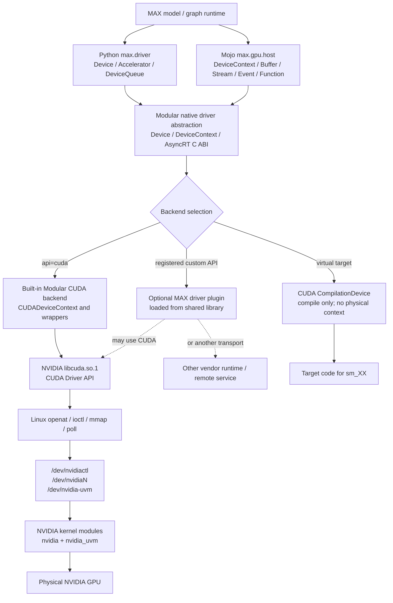

<a id="nvidia-cuda-driver-backend"></a>

# NVIDIA CUDA Driver, Modular CUDA Backend, and MAX Driver Plugins

This document expands the NVIDIA branch of MAX device discovery and execution:

```text
MAX / Mojo device API
    |
    +-- built-in Modular CUDA backend
    |       |
    |       v
    |   NVIDIA libcuda.so
    |       |
    |       v
    |   NVIDIA Linux kernel driver -> NVIDIA GPU
    |
    +-- optional MAX driver plugin
            |
            +-- may call libcuda.so
            +-- may call another vendor runtime
            +-- may implement a remote or custom device
```

The built-in CUDA backend is Modular code. `libcuda.so` is NVIDIA code. An
optional MAX driver plugin is a separate adapter loaded into the MAX process;
it is not automatically an NVIDIA component.

## 1. Evidence boundary

The layers have different source-code visibility in this checkout:

| Layer | Visibility here | What can be verified |
|---|---|---|
| Mojo `DeviceContext` and CUDA handle accessors | Source-visible | Public operations and AsyncRT C ABI calls |
| Python `max.driver` facade | Source-visible or generated stubs | Python-facing device operations |
| Modular MLRT/AsyncRT CUDA backend | Prebuilt binary | Class-path strings, entry-point names, behavior and errors |
| Optional MAX driver-plugin loader | Prebuilt binary plus Bazel environment wiring | Loader methods, environment variable, selection behavior |
| NVIDIA `libcuda.so` | Installed proprietary library | Public CUDA Driver API contract and exported functions |
| NVIDIA Linux kernel modules | External to this checkout | Kernel-side device management and `/dev/nvidia*` handling |

The native Modular C++ source file is not included, although the prebuilt
runtime contains the source-path string:

```text
MLRT/lib/Driver/DeviceContext/CUDA/CUDADeviceContext.cpp
```

Therefore, this document labels implementation details as one of:

- **Source-visible:** directly present in Mojo or Python source.
- **Binary-confirmed:** represented by native symbol names, strings, or runtime
  behavior in `libAsyncRTMojoBindings.so`.
- **Vendor architecture:** behavior defined by NVIDIA's public CUDA Driver API
  and Linux driver stack.

<details>
<summary><strong>Expand: NVIDIA component and ownership block diagram</strong></summary>



**Ownership:**

| Component | Owner | Purpose |
|---|---|---|
| `DeviceContext`, AsyncRT bridge, built-in CUDA backend | Modular | Present one MAX device model across supported backends |
| `libcuda.so.1` | NVIDIA | Implement the public CUDA Driver API in user space |
| `/dev/nvidia*` and kernel modules | NVIDIA/Linux | Mediate privileged access to the physical GPU |
| MAX driver plugin | Modular, a vendor, or an integrator | Add a backend through MAX's plugin contract |

</details>

## 2. What is `libcuda.so`?

`libcuda.so.1` is the user-space implementation of NVIDIA's CUDA **Driver
API**. Applications call functions whose names begin with `cu`, such as
`cuInit`, `cuDeviceGetCount`, `cuMemAlloc`, and `cuLaunchKernel`.

```text
application or framework
    |
    +-- cuInit(...)
    +-- cuDeviceGetCount(...)
    +-- cuDeviceGetAttribute(...)
    +-- cuMemAlloc_v2(...)
    +-- cuLaunchKernel(...)
    |
    v
libcuda.so.1
    |
    +-- validates API arguments and tracks user-space objects
    +-- opens NVIDIA device nodes
    +-- submits structured requests to the kernel driver
    +-- maps memory and queue-related regions
    +-- reports driver errors through CUresult
    |
    v
NVIDIA kernel driver -> GPU
```

`libcuda.so` does not contain MAX or Mojo APIs. It exposes NVIDIA's API, and
the Modular CUDA backend adapts MAX operations to that API.

### `libcuda.so` versus `libcudart.so`

| Library | API prefix | Role |
|---|---|---|
| `libcuda.so.1` | `cu*` | Lower-level CUDA Driver API, installed with the NVIDIA driver |
| `libcudart.so` | `cuda*` | Higher-level CUDA Runtime API, normally installed with the CUDA Toolkit |

The examined Modular native binary contains CUDA Driver API names such as
`cuDeviceGetCount`, `cuMemAlloc_v2`, and `cuLaunchKernel`. The path documented
here is therefore the `libcuda.so` path, not a `libcudart.so` implementation.

### Installed library versus Toolkit stub

Typical real driver-library locations include:

```text
/usr/lib/x86_64-linux-gnu/libcuda.so.1
/usr/lib64/libcuda.so.1
```

The CUDA Toolkit may also provide:

```text
/usr/local/cuda/lib64/stubs/libcuda.so
```

The latter is a link-time stub. It allows an executable to be linked but does
not initialize or control a GPU. At runtime, the dynamic loader must resolve
the real `libcuda.so.1` supplied by the NVIDIA driver or container runtime.

Useful inspection commands are:

```bash
ldconfig -p | grep libcuda
readelf -Ws /path/to/libcuda.so.1 | grep cuDeviceGetCount
```

The implementation of `libcuda.so.1` is proprietary. NVIDIA publishes the
Driver API headers and documentation, but not this library's source. NVIDIA's
open GPU kernel modules are a different, kernel-side component.

## 3. CUDA Driver API families

The following tables describe the API families relevant to a MAX-style device
backend. They do not imply that every call is made for every request.

### Initialization, enumeration, and capabilities

| CUDA Driver API | Purpose | MAX-level operation |
|---|---|---|
| `cuInit(flags)` | Initialize the CUDA driver API in the process | First physical CUDA discovery or creation |
| `cuDriverGetVersion(...)` | Read installed CUDA driver version | `DeviceContext.get_api_version()` |
| `cuDeviceGetCount(...)` | Return runtime-visible CUDA device count | `accelerator_count()` / `number_of_devices("cuda")` |
| `cuDeviceGet(...)` | Convert a logical ordinal into a `CUdevice` handle | Create CUDA device ID `n` |
| `cuDeviceGetName(...)` | Return the model name | `DeviceContext.name()` / `Device.model_name` |
| `cuDeviceGetAttribute(...)` | Query SM count, warp size, limits, compute capability, and related attributes | `DeviceContext.get_attribute(...)` |
| `cuDeviceCanAccessPeer(...)` | Test direct GPU-to-GPU accessibility | `can_access(peer)` |

`CUDA_VISIBLE_DEVICES` filters and remaps the logical list exposed by CUDA. It
does not remove Linux device nodes.

```text
CUDA_VISIBLE_DEVICES=2,3
    |
    +-- CUDA logical device 0 represents selected physical GPU 2
    +-- CUDA logical device 1 represents selected physical GPU 3
```

### Context management

| CUDA Driver API | Purpose |
|---|---|
| `cuDevicePrimaryCtxRetain(...)` | Retain the device's primary CUDA context |
| `cuDevicePrimaryCtxRelease_v2(...)` | Release a retained primary context |
| `cuCtxCreate_v2(...)` | Create a separate CUDA context |
| `cuCtxDestroy(...)` | Destroy a CUDA context |
| `cuCtxSetCurrent(...)` | Make a context current on the calling host thread |
| `cuCtxGetCurrent(...)` | Read the current host-thread CUDA context |
| `cuCtxPushCurrent(...)` / `cuCtxPopCurrent(...)` | Scope current-context changes |
| `cuCtxEnablePeerAccess(...)` | Enable one context to access a peer context's allocations |

The native binary contains names for both primary-context retention and
explicit context creation. The source that chooses between them is not present,
so this document does not claim that one mechanism is always used.

### Streams, events, and host coordination

| CUDA Driver API | Purpose | MAX abstraction |
|---|---|---|
| `cuStreamCreate(...)` | Create an asynchronous execution stream | `DeviceStream` / default queue |
| `cuStreamCreateWithPriority(...)` | Create a prioritized stream | `create_stream(priority=...)` |
| `cuStreamSynchronize(...)` | Wait for earlier stream work | `stream.synchronize()` |
| `cuStreamWaitEvent(...)` | Add an inter-stream dependency | `stream.enqueue_wait_for(event)` |
| `cuLaunchHostFunc(...)` | Run a host callback after earlier stream work | Enqueued host callback |
| `cuEventCreate(...)` | Create an event | `DeviceEvent` |
| `cuEventRecord(...)` | Record an event in a stream | `record_event(...)` |
| `cuEventSynchronize(...)` | Wait for event completion | `event.synchronize()` |
| `cuEventElapsedTime(...)` | Measure elapsed GPU time | Execution timing helper |

Streams provide ordered command queues. Operations in one stream execute in
submission order; separate streams may overlap when dependencies and hardware
resources allow it.

### Memory and transfer APIs

| CUDA Driver API | Purpose |
|---|---|
| `cuMemGetInfo_v2(...)` | Return current free and total device memory |
| `cuMemAlloc_v2(...)` / `cuMemFree_v2(...)` | Traditional device allocation and release |
| `cuMemAllocAsync(...)` / `cuMemFreeAsync(...)` | Stream-ordered memory-pool allocation and release |
| `cuMemAllocHost_v2(...)` / `cuMemFreeHost(...)` | Allocate pinned host memory |
| `cuMemHostRegister_v2(...)` / `cuMemHostUnregister(...)` | Pin an existing host region |
| `cuMemHostGetDevicePointer_v2(...)` | Get a device-visible address for mapped host memory |
| `cuMemcpyHtoDAsync_v2(...)` | Enqueue host-to-device copy |
| `cuMemcpyDtoHAsync_v2(...)` | Enqueue device-to-host copy |
| `cuMemcpyDtoDAsync_v2(...)` | Enqueue same-device copy |
| `cuMemcpyPeerAsync(...)` | Enqueue cross-context/device copy |
| `cuMemsetD8Async(...)`, `cuMemsetD16Async(...)`, `cuMemsetD32Async(...)` | Fill device memory |

The binary also contains CUDA virtual-memory-management names such as
`cuMemAddressReserve`, `cuMemCreate`, `cuMemMap`, `cuMemSetAccess`, and
`cuMemUnmap`. These support address reservation and explicit physical-memory
mapping. Backend policy determines whether a conventional allocator, an async
pool, or VMM is used for a particular allocation.

### Module, function, and launch APIs

| CUDA Driver API | Purpose | MAX abstraction |
|---|---|---|
| `cuModuleLoadDataEx(...)` | Load compiled CUDA code from memory | Load a compiled device module |
| `cuModuleGetFunction(...)` | Resolve a kernel function by name | `DeviceFunction` |
| `cuModuleGetGlobal_v2(...)` | Resolve module global/constant storage | Constant-memory mapping |
| `cuFuncGetAttribute(...)` | Query function resource properties | `DeviceFunction.get_attribute(...)` |
| `cuFuncSetAttribute(...)` | Set launch/resource options | Dynamic shared-memory opt-in |
| `cuOccupancyMaxActiveBlocksPerMultiprocessor(...)` | Estimate active blocks per SM | Occupancy helper |
| `cuLaunchKernel(...)` | Submit a kernel launch | `enqueue_function(...)` |
| `cuLaunchKernelEx(...)` | Submit a launch with extended attributes | Cluster or extended launch path |
| `cuModuleUnload(...)` | Release a loaded module | Device-function/module destruction |

### Graph and advanced memory APIs

The binary contains support for CUDA graph construction and launch, including
`cuGraphCreate`, graph-node creation, `cuGraphInstantiate`, and
`cuGraphLaunch`. It also contains newer VMM and multicast API names. Presence
in the native binary indicates backend support code; actual use depends on the
graph/runtime configuration and device/driver capability.

## 4. How `libcuda.so` reaches the Linux driver

MAX does not normally issue NVIDIA's private ioctls itself. NVIDIA's
user-space library performs that work.

```text
Modular CUDA backend
    |
    +-- public CUDA Driver API call
    v
libcuda.so.1
    |
    +-- openat("/dev/nvidiactl", ...)
    +-- openat("/dev/nvidia0", ...)
    +-- openat("/dev/nvidia-uvm", ...) when unified-memory services are needed
    +-- ioctl(file_descriptor, NVIDIA_private_request, ...)
    +-- mmap(...) driver-managed regions
    +-- poll/event mechanisms for asynchronous completion
    v
NVIDIA kernel modules
    |
    +-- validate process and device state
    +-- manage contexts, channels, mappings, and firmware interaction
    +-- program or submit work to the physical GPU
    v
NVIDIA GPU
```

| Linux operation | Meaning in this stack |
|---|---|
| `openat` | Obtain a process file descriptor for an NVIDIA control or device node |
| `ioctl` | Send a structured control request to the NVIDIA kernel module |
| `mmap` | Map driver-managed memory, queues, doorbells, or synchronization regions |
| `poll` / event wait | Sleep until work or a driver notification becomes ready |

The exact NVIDIA ioctl protocol is not the application contract. MAX uses the
stable, documented CUDA Driver API and leaves the private kernel protocol to
NVIDIA's user-space and kernel components.

## 5. Physical-device startup and enumeration

<details>
<summary><strong>Expand: CUDA enumeration call tree</strong></summary>

```text
Python scan_available_devices()
    |
    +-- accelerator_count()
    |     max._core.driver native binding
    |       |
    |       v
    |   Modular Device::numberOfDevices("gpu" or "cuda")
    |       |
    |       +-- initialize/select built-in CUDA backend
    |       |
    |       +-- cuInit(0)
    |       |
    |       +-- cuDeviceGetCount(&count)
    |       |
    |       +-- CUDA applies runtime-visible ordinal filtering/remapping
    |       |
    |       v
    |   count
    |
    +-- count > 0
          |
          +-- DeviceSpec.accelerator(0..count-1)
```

For the Mojo path:

```text
DeviceContext.number_of_devices(api="cuda")
    |
    +-- external_call["AsyncRT_DeviceContext_numberOfDevices"]("cuda")
    |
    +-- native Modular device layer
    |
    +-- built-in CUDA backend
    |
    +-- cuInit(0) -> cuDeviceGetCount(...)
    |
    v
Int count
```

**IN:** requested API name, process environment, installed driver, and visible
Linux devices.

**STRUCTURES:** API string, native backend registry, CUDA driver state, and
logical device ordinals.

**LOGIC:** initialize the CUDA API, ask NVIDIA for the process-visible device
count, and expose that count through the MAX abstraction.

**OUT:** zero or more CUDA logical devices. A zero count causes higher layers
to fall back to CPU or reject an explicitly requested GPU.

</details>

<details>
<summary><strong>Expand: CUDA DeviceContext creation call tree</strong></summary>

```text
DeviceContext(device_id=0, api="cuda")
    |
    +-- AsyncRT_DeviceContext_create(result, "cuda", 0)
    |
    +-- Modular Device::create("cuda", 0)
    |     |
    |     +-- validate API name
    |     +-- get runtime-visible CUDA count
    |     +-- reject id < 0 or id >= count
    |     +-- cuDeviceGet(&device, 0)
    |     +-- query name and required attributes
    |     +-- retain/create CUDA context
    |     +-- create default stream(s)
    |     +-- initialize backend allocators/pools as required
    |     +-- run compatibility/health validation
    |     +-- construct Modular CUDADeviceContext wrapper
    |
    v
Mojo DeviceContext holding an opaque native handle
```

The exact ordering and whether a primary or private CUDA context is selected
are native implementation details not source-visible here. The native binary
confirms the relevant CUDA entry points and the CUDA backend class path.

**IN:** `api="cuda"`, device ordinal, environment visibility, driver state.

**STRUCTURES:** `CUdevice`, `CUcontext`, one or more `CUstream` objects,
backend memory state, and a reference-counted Modular context wrapper.

**LOGIC:** resolve a CUDA device, establish execution state, and wrap it behind
the backend-neutral AsyncRT handle.

**OUT:** a `DeviceContext` able to allocate, copy, compile/load, and launch on
the selected NVIDIA GPU.

</details>

## 6. Modular APIs above CUDA

### Python driver facade

The Python facade is in `max/python/max/driver/driver.py`; native class
signatures are described by `max/python/max/_core/driver.pyi`.

| Python API | Role |
|---|---|
| `accelerator_count()` | Return the number of MAX-visible accelerator devices |
| `Accelerator(id)` | Create a physical accelerator object for a logical ID |
| `Device.api` | Report `"cuda"` for a CUDA device |
| `Device.architecture_name` | Report an architecture such as `sm_80` or `sm_90` |
| `Device.model_name` | Report a product name such as an NVIDIA H100 |
| `Device.default_queue` | Return the default asynchronous execution queue |
| `Device.can_access(other)` | Query peer accessibility |
| `Device.synchronize()` | Wait for queued device work |
| `Device.is_compatible` | Report MAX compatibility |
| `Device.is_host_unified` | Report whether host/device use one physical memory pool |
| `Device.stats` | Return available device utilization information |

These Python objects are native bindings; they are not implemented by calling
CUDA from Python source directly.

### Mojo host APIs

The primary source-visible API is
`max/mojo/max/gpu/host/device_context.mojo`.

| Mojo API | AsyncRT boundary | Typical CUDA operation |
|---|---|---|
| `DeviceContext(...)` | `AsyncRT_DeviceContext_create` | Device/context/stream setup |
| `number_of_devices(...)` | `AsyncRT_DeviceContext_numberOfDevices` | `cuDeviceGetCount` |
| `name()` | `AsyncRT_DeviceContext_deviceName` | `cuDeviceGetName` |
| `get_api_version()` | `AsyncRT_DeviceContext_getApiVersion` | `cuDriverGetVersion` |
| `get_attribute(...)` | `AsyncRT_DeviceContext_getAttribute` | `cuDeviceGetAttribute` |
| `compute_capability()` | `AsyncRT_DeviceContext_computeCapability` | Major/minor capability query |
| `get_memory_info()` | `AsyncRT_DeviceContext_getMemoryInfo` | `cuMemGetInfo_v2` |
| `create_buffer_sync(...)` | Native create-buffer call | CUDA device allocation |
| `enqueue_copy(...)` | HtoD/DtoH/DtoD AsyncRT calls | CUDA memcpy calls |
| `enqueue_memset(...)` | `AsyncRT_DeviceContext_setMemory_async` | CUDA memset calls |
| `create_stream(...)` | `AsyncRT_DeviceContext_createStream` | `cuStreamCreateWithPriority` |
| `create_event(...)` | `AsyncRT_DeviceContext_eventCreate` | `cuEventCreate` |
| `compile_function[...]` | Mojo compiler plus native function wrapper | Produce/load target code |
| `load_function[...]` | `AsyncRT_DeviceContext_loadFunction` | Module load and function lookup |
| `enqueue_function(...)` | `AsyncRT_DeviceContext_enqueueFunctionDirect` | `cuLaunchKernel` or extended launch |
| `synchronize()` | `AsyncRT_DeviceContext_synchronize` | Stream/context synchronization |
| `can_access(...)` | `AsyncRT_DeviceContext_canAccess` | `cuDeviceCanAccessPeer` |
| `enable_peer_access(...)` | `AsyncRT_DeviceContext_enablePeerAccess` | `cuCtxEnablePeerAccess` |

`DeviceAttribute` values include threads per block, block/grid dimensions,
shared memory, warp size, registers, clock rate, multiprocessor count, L2 size,
threads per multiprocessor, compute capability, and occupancy-related limits.

### Native CUDA handle accessors

`max/mojo/max/gpu/host/_nvidia_cuda.mojo` exposes escape hatches for code that
must interoperate with native CUDA objects:

| Mojo accessor | Returned native handle | AsyncRT call |
|---|---|---|
| `CUDA(ctx)` | `CUcontext` | `AsyncRT_DeviceContext_cuda_context` |
| `CUDA(stream)` | `CUstream` | `AsyncRT_DeviceStream_cuda_stream` |
| `CUDA_MODULE(func)` | `CUmodule` | `AsyncRT_DeviceFunction_cuda_module` |
| `CUDA_get_current_context()` | current `CUcontext` | `AsyncRT_DeviceContext_cuda_current_context` |

These functions expose an underlying NVIDIA handle; they do not replace the
MAX abstraction or transfer ownership to the caller.

## 7. Built-in Modular CUDA backend implementation

The built-in backend is the native adapter between backend-neutral MAX objects
and NVIDIA CUDA Driver API objects.

```text
MAX operation
    |
    +-- DeviceContext / DeviceQueue / Buffer / Event / Function
    |
    +-- AsyncRT C ABI entry point
    |
    +-- native Modular CUDA backend object
    |     +-- validate object and backend type
    |     +-- select current CUDA context and stream
    |     +-- translate MAX arguments to CUDA types
    |     +-- call one or more cu* functions
    |     +-- translate CUresult to MAX error text/status
    |     +-- retain/release native resources with wrapper lifetime
    |
    v
CUDA driver result represented through MAX
```

### Backend object mapping

| MAX/AsyncRT concept | CUDA concept |
|---|---|
| Physical `Device` | CUDA logical ordinal plus `CUdevice` |
| `DeviceContext` | CUDA context, selected stream, allocators, capability state |
| `DeviceQueue` / `DeviceStream` | `CUstream` |
| `DeviceEvent` | `CUevent` |
| `DeviceBuffer` | Device address/allocation plus owning context metadata |
| `DeviceFunction` | Loaded `CUmodule` plus `CUfunction` and metadata |
| Completion/timing helper | CUDA events or stream-ordered synchronization |

### Allocation, copy, and launch flow

```text
DeviceContext.create_buffer_sync(size)
    -> AsyncRT create-buffer entry point
    -> CUDA backend allocator
    -> cuMemAlloc_v2 / cuMemAllocAsync / supported VMM path
    -> DeviceBuffer

DeviceContext.enqueue_copy(dst, src)
    -> determine HtoD, DtoH, DtoD, or peer direction
    -> select current CUDA stream
    -> matching cuMemcpy*Async call
    -> return before transfer necessarily completes

DeviceContext.load_function(name, code)
    -> cuModuleLoadDataEx
    -> cuModuleGetFunction
    -> DeviceFunction

DeviceContext.enqueue_function(function, grid, block, args)
    -> validate launch dimensions and argument layout
    -> optionally set function/launch attributes
    -> cuLaunchKernel or cuLaunchKernelEx
    -> work enters the selected CUDA stream
```

### Error and lifetime translation

Mojo calls `_checked(...)` around AsyncRT functions that return an error
C-string. The native backend converts CUDA failures into that boundary. Mojo
then raises a language-level error and releases the native error string.

Reference-counted retain/release calls exist for contexts, streams, events,
buffers, and functions. Their destructors release Modular wrappers, which in
turn release the corresponding CUDA resources when ownership reaches zero.

### Binary-confirmed CUDA entry-point groups

The prebuilt `libAsyncRTMojoBindings.so` contains CUDA names covering:

- Initialization and devices: `cuInit`, `cuDeviceGetCount`, `cuDeviceGet`,
  `cuDeviceGetName`, `cuDeviceGetAttribute`.
- Contexts: primary-context APIs, context create/destroy/current APIs.
- Memory: conventional, async-pool, host-pinned, peer, VMM, and multicast APIs.
- Streams and events: creation, priority, synchronization, capture, and timing.
- Modules and kernels: module load, function lookup, attributes, occupancy, and
  kernel launch.
- CUDA graphs: graph creation, nodes, instantiation, and launch.

This confirms backend capability code, but a string's presence alone does not
prove that a particular model run executes that function.

## 8. Optional MAX driver-plugin path

The optional plugin path lets the native MAX device layer delegate an API name
to a dynamically loaded backend instead of a built-in implementation.

### Loader and selection flow

```text
process startup or first plugin-backed device query
    |
    +-- Plugin::ensurePluginsLoaded()
    |     |
    |     +-- one-time initialization
    |     +-- read MODULAR_DRIVER_PLUGINS
    |     +-- load configured shared library path(s)
    |     +-- validate plugin ABI/version
    |     +-- register API descriptors/factories
    |
    +-- Plugin::hasPluginForApi(api)
    |
    +-- enumeration
    |     +-- Plugin::deviceCount(api)
    |
    +-- physical creation
    |     +-- Plugin::getDevice(api, id, ...)
    |
    +-- compile-only creation
          +-- Plugin::getCompilationDevice(api, architecture)
```

The method names above are binary-confirmed internal C++ methods. They are not
documented here as a stable public C ABI.

The source-visible Bazel toolchain wiring sets:

```text
MODULAR_DRIVER_PLUGINS=<plugin-shared-library-path>
```

for tests configured with an optional driver plugin. The native loader also
contains errors for load failure, incompatible versions, missing API
registration, physical-device creation failure, and compilation-device
creation failure.

### What plugin APIs are available here?

The checkout does not contain a public driver-plugin header or a sample plugin
implementation. Consequently, the exact exported registration function,
descriptor layout, callback table, ownership rules, and ABI version constants
cannot be documented from source here.

What can be stated from binary behavior is that a plugin must provide enough
of the native MAX driver contract to support the operations it advertises,
which can include:

- API registration and device count.
- Physical device creation by API and ID.
- Compilation-device creation by API and architecture.
- Device/context, memory, queue, event, synchronization, and launch behavior
  required by the consuming runtime.
- Error and lifetime behavior compatible with the MAX native driver layer.

An implementation should use the actual plugin SDK/header matching the
installed MAX build. Reconstructing and publishing a C struct from binary
layout would be version-fragile and unsafe.

### Built-in CUDA backend versus plugin

| Property | Built-in Modular CUDA backend | Optional MAX driver plugin |
|---|---|---|
| Availability | Shipped in the MAX native runtime | Loaded only when configured |
| API name | Built-in `cuda`; also considered by generic `gpu` resolution | Plugin-registered API name |
| Implementation owner | Modular | Modular, vendor, or integrator |
| Lower layer | NVIDIA `libcuda.so` | CUDA, another vendor runtime, remote transport, or custom driver |
| ABI boundary | Internal Modular backend interface | Versioned plugin boundary |
| Source in this checkout | No native C++ body | No public plugin implementation/header |
| Normal explicit `api="cuda"` path | Built-in CUDA factory | Does not silently replace explicit CUDA in the examined selection logic |

For generic physical `api="gpu"`, the examined native selection order is:

```text
Device::create("gpu", id)
    |
    +-- try built-in CUDA
    +-- else try built-in HIP
    +-- else try a generic/default registered plugin
    +-- else report unsupported/no accelerator
```

An explicit `api="cuda"` request does not silently become HIP or an unrelated
plugin backend.

## 9. Virtual CUDA compilation devices

A virtual CUDA device is a compile target, not a physical CUDA context.

```text
create compilation device(api="cuda", architecture="sm_90")
    |
    +-- select compiler target and CUDA architecture
    +-- compile kernels/graphs for sm_90
    |
    +-- no cuInit required by the compile-only object
    +-- no cuDeviceGetCount required
    +-- no /dev/nvidia* access
    +-- no current free-memory query
    +-- no local kernel execution
    |
    v
compiled target artifact
```

This is different from NVIDIA vGPU, MIG, PCI passthrough, CUDA virtual memory,
containers, or `CUDA_VISIBLE_DEVICES`.

## 10. End-to-end input, structures, logic, and output

```text
NVIDIA physical-device path
    |
    +-- IN
    |     API="cuda" or generic GPU selection
    |     logical device ID
    |     CUDA visibility environment
    |     installed NVIDIA user-space and kernel driver
    |     requested memory/copy/launch operation
    |
    +-- STRUCTURES
    |     Python Device / Mojo DeviceContext
    |     AsyncRT opaque handles
    |     Modular CUDADeviceContext and resource wrappers
    |     CUdevice / CUcontext / CUstream / CUevent / CUmodule / CUfunction
    |     CUDA allocations and Linux driver file descriptors/mappings
    |
    +-- LOGIC
    |     select backend
    |     initialize and enumerate CUDA
    |     validate logical device ID
    |     create/retain execution context and streams
    |     translate MAX operations into cu* calls
    |     let libcuda translate those calls into kernel-driver operations
    |     translate results/errors back to MAX
    |
    +-- OUT
          a MAX device/context capable of compiling/loading code,
          allocating and transferring memory, and asynchronously launching
          work on the selected NVIDIA GPU
```

## 11. Relevant files and external references

Repository-visible files:

```text
max/mojo/max/gpu/host/device_context.mojo
max/mojo/max/gpu/host/device_attribute.mojo
max/mojo/max/gpu/host/_nvidia_cuda.mojo
max/python/max/driver/driver.py
max/python/max/_core/driver.pyi
bazel/internal/mojo_toolchain.bzl
.max+python+max+_entrypoints+pipelines.venv/lib/libAsyncRTMojoBindings.so
```

External implementation/documentation boundaries:

- NVIDIA CUDA Driver API documentation and `cuda.h` define the `cu*` API.
- The installed NVIDIA driver supplies the proprietary `libcuda.so.1`.
- NVIDIA's open GPU kernel modules are published separately at
  <https://github.com/NVIDIA/open-gpu-kernel-modules>.

The missing native Modular C++ source and plugin SDK are the main limits on a
line-by-line implementation explanation. The public MAX APIs, AsyncRT boundary,
native backend identity, CUDA call families, and plugin selection behavior are
still directly visible or binary-confirmed as described above.
