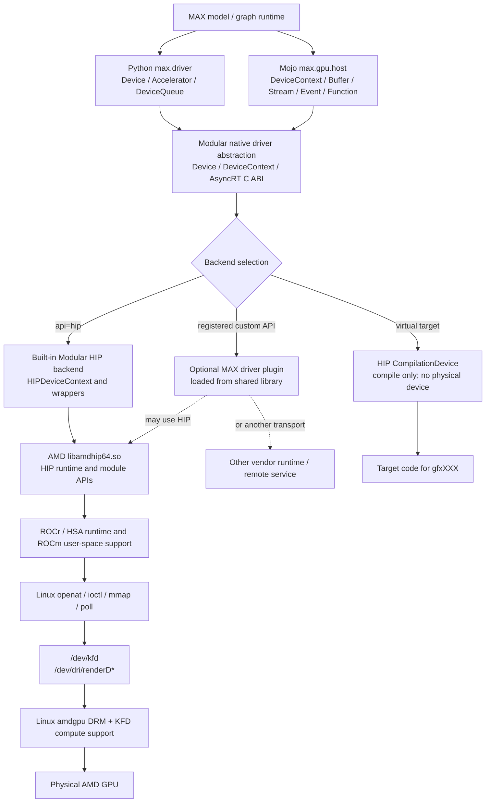

<a id="amd-hip-driver-backend"></a>

# AMD HIP Runtime, Modular HIP Backend, and MAX Driver Plugins

This document expands the AMD branch of MAX device discovery and execution:

```text
MAX / Mojo device API
    |
    +-- built-in Modular HIP backend
    |       |
    |       v
    |   AMD libamdhip64.so
    |       |
    |       +-- ROCr/HSA and DRM user-space components
    |       v
    |   amdgpu + KFD Linux kernel driver -> AMD GPU
    |
    +-- optional MAX driver plugin
            |
            +-- may call libamdhip64.so
            +-- may call another vendor runtime
            +-- may implement a remote or custom device
```

The AMD equivalent of Modular's built-in CUDA backend is the **built-in
Modular HIP backend**. It is Modular code that translates MAX operations to
AMD HIP operations. `libamdhip64.so` and the lower ROCm stack are AMD/ROCm
components.

## 1. Evidence boundary

| Layer | Visibility here | What can be verified |
|---|---|---|
| Mojo `DeviceContext` and HIP handle accessors | Source-visible | Public operations and AsyncRT C ABI calls |
| Python `max.driver` facade | Source-visible or generated stubs | Python-facing device operations |
| Modular MLRT/AsyncRT HIP backend | Prebuilt binary | Class-path strings, HIP entry-point names, behavior and errors |
| Optional MAX driver-plugin loader | Prebuilt binary plus Bazel environment wiring | Loader methods, environment variable, selection behavior |
| AMD `libamdhip64.so` | External open-source ROCm component | Public HIP API and implementation source |
| ROCr, thunk/DRM, amdgpu/KFD | External open-source components | User/kernel communication and hardware management |

The native Modular binary contains this source-path string:

```text
MLRT/lib/Driver/DeviceContext/HIP/HIPDeviceContext.cpp
```

The file itself is not present in this checkout. This document therefore
distinguishes:

- **Source-visible:** present in this repository's Mojo or Python source.
- **Binary-confirmed:** represented by native symbols, strings, or behavior in
  `libAsyncRTMojoBindings.so`.
- **ROCm architecture:** defined by public HIP, HSA, DRM, KFD, and Linux source
  and documentation.

<details>
<summary><strong>Expand: AMD component and ownership block diagram</strong></summary>



**Ownership:**

| Component | Owner/source community | Purpose |
|---|---|---|
| `DeviceContext`, AsyncRT bridge, built-in HIP backend | Modular | Present a common MAX device model |
| `libamdhip64.so` | AMD ROCm, primarily open source | Implement HIP APIs in user space |
| ROCr/HSA and thunk/DRM libraries | AMD ROCm and Linux communities | Manage queues, memory, topology, and kernel communication |
| `amdgpu` and KFD | Linux/AMD open-source kernel code | Manage physical AMD GPUs |
| MAX driver plugin | Modular, vendor, or integrator | Add another backend through MAX's plugin contract |

</details>

## 2. What is `libamdhip64.so`?

`libamdhip64.so` is the principal AMD HIP user-space runtime library on Linux.
It implements HIP APIs such as `hipInit`, `hipGetDeviceCount`, `hipMalloc`,
`hipMemcpy*`, and `hipModuleLaunchKernel`.

```text
application or framework
    |
    +-- hipInit(...)
    +-- hipGetDeviceCount(...)
    +-- hipDeviceGetAttribute(...)
    +-- hipMalloc(...)
    +-- hipModuleLaunchKernel(...)
    |
    v
libamdhip64.so
    |
    +-- validates HIP arguments and tracks runtime objects
    +-- selects a process-visible AMD GPU
    +-- cooperates with ROCr/HSA and DRM user-space components
    +-- creates queues, mappings, signals, and executable objects
    |
    v
/dev/kfd and /dev/dri/renderD*
    |
    v
amdgpu/KFD kernel driver -> AMD GPU
```

Unlike NVIDIA's `libcuda.so`, the Linux HIP runtime is primarily open source.
The principal source repository is:

```text
https://github.com/ROCm/clr
    |
    +-- hipamd/    AMD HIP runtime implementation
    +-- rocclr/    shared runtime abstraction used by the HIP stack
```

Related open-source projects include:

| Project | Role |
|---|---|
| `ROCm/ROCR-Runtime` | HSA/ROCr user-space runtime |
| `ROCm/ROCT-Thunk-Interface` | User-space interface to KFD services |
| `ROCm/llvm-project` | AMDGPU compiler and code-generation support |
| Linux `drivers/gpu/drm/amd` | `amdgpu` DRM and KFD kernel implementation |

Some device firmware remains distributed as binary firmware even though the
Linux user-space and kernel software is largely open source.

Typical installed locations include:

```text
/opt/rocm/lib/libamdhip64.so
/usr/lib/x86_64-linux-gnu/libamdhip64.so
```

Useful inspection commands are:

```bash
ldconfig -p | grep libamdhip64
readelf -Ws /path/to/libamdhip64.so | grep hipGetDeviceCount
```

## 3. HIP API families

The following APIs are relevant to a MAX-style AMD backend. Actual calls vary
with device capability, allocator mode, graph mode, and operation type.

### Initialization, enumeration, and capabilities

| HIP API | Purpose | MAX-level operation |
|---|---|---|
| `hipInit(flags)` | Initialize HIP runtime/driver state | First physical HIP discovery or creation |
| `hipDriverGetVersion(...)` | Return installed HIP driver/runtime version information | `DeviceContext.get_api_version()` |
| `hipGetDeviceCount(...)` | Return process-visible AMD device count | `accelerator_count()` / `number_of_devices("hip")` |
| `hipGetDevice(...)` | Return the calling thread's selected logical device | Current-device inspection |
| `hipSetDevice(id)` | Select the logical device for the calling thread | Establish device for context/queue operations |
| `hipDeviceGetName(...)` | Return the product/device name | `DeviceContext.name()` / `Device.model_name` |
| `hipDeviceGetAttribute(...)` | Query compute-unit, wavefront, memory, and launch limits | `DeviceContext.get_attribute(...)` |
| `hipDeviceCanAccessPeer(...)` | Test direct GPU-to-GPU accessibility | `can_access(peer)` |

`HIP_VISIBLE_DEVICES` filters/remaps the logical device list presented to the
process. ROCm environments may also use `ROCR_VISIBLE_DEVICES` or
`GPU_DEVICE_ORDINAL`; exact interaction and precedence can vary with ROCm
version and application stack.

```text
HIP_VISIBLE_DEVICES=2,3
    |
    +-- HIP logical device 0 represents selected physical GPU 2
    +-- HIP logical device 1 represents selected physical GPU 3
```

### Device selection, streams, and events

| HIP API | Purpose | MAX abstraction |
|---|---|---|
| `hipSetDevice(...)` | Select a GPU for subsequent thread-local operations | Device-context setup |
| `hipCtxGetCurrent(...)` | Read current HIP context state | Native interoperation/context checks |
| `hipStreamCreate(...)` | Create an asynchronous command stream | `DeviceStream` / default queue |
| `hipStreamCreateWithPriority(...)` | Create a prioritized stream | `create_stream(priority=...)` |
| `hipStreamSynchronize(...)` | Wait for stream work | `stream.synchronize()` |
| `hipStreamWaitEvent(...)` | Add an inter-stream dependency | `stream.enqueue_wait_for(event)` |
| `hipLaunchHostFunc(...)` | Run host callback after earlier stream work | Enqueued host callback where supported |
| `hipEventCreateWithFlags(...)` | Create a HIP event | `DeviceEvent` |
| `hipEventRecord(...)` | Record an event in a stream | `record_event(...)` |
| `hipEventSynchronize(...)` | Wait for event completion | `event.synchronize()` |
| `hipEventElapsedTime(...)` | Measure GPU elapsed time | Execution timing helper |

HIP's context model differs in API details from CUDA's explicit Driver API
context model. The built-in MAX HIP backend still presents a common
`DeviceContext`, while internally selecting the HIP device and managing the
streams and runtime objects required for that device.

### Memory and transfer APIs

| HIP API | Purpose |
|---|---|
| `hipMemGetInfo(...)` | Return current free and total device memory |
| `hipMalloc(...)` / `hipFree(...)` | Allocate and release device memory |
| `hipMallocAsync(...)` / `hipFreeAsync(...)` | Stream-ordered pool allocation and release |
| `hipHostMalloc(...)` / `hipHostFree(...)` | Allocate pinned/mapped host memory |
| `hipHostRegister(...)` / `hipHostUnregister(...)` | Register an existing host region |
| `hipHostGetDevicePointer(...)` | Get a device-visible address for host memory |
| `hipMemcpyHtoDAsync(...)` | Enqueue host-to-device copy |
| `hipMemcpyDtoHAsync(...)` | Enqueue device-to-host copy |
| `hipMemcpyDtoDAsync(...)` | Enqueue device-to-device copy |
| `hipMemsetD8Async(...)`, `hipMemsetD16Async(...)`, `hipMemsetD32Async(...)` | Fill device memory |

The native Modular binary also contains HIP VMM API names such as
`hipMemAddressReserve`, `hipMemCreate`, `hipMemMap`, `hipMemSetAccess`, and
`hipMemUnmap`. These can support explicit virtual-address and physical-memory
management when available.

### Module, function, and launch APIs

| HIP API | Purpose | MAX abstraction |
|---|---|---|
| `hipModuleLoadData(...)` / `hipModuleLoadDataEx(...)` | Load AMD GPU code from memory | Load compiled module |
| `hipModuleGetFunction(...)` | Resolve a kernel by name | `DeviceFunction` |
| `hipModuleGetGlobal(...)` | Resolve global/constant storage | Constant-memory mapping |
| `hipFuncGetAttribute(...)` | Query function resource properties | Function attribute query |
| `hipModuleOccupancyMaxActiveBlocksPerMultiprocessor(...)` | Estimate resident blocks per compute unit | Occupancy helper |
| `hipModuleLaunchKernel(...)` | Submit a kernel | `enqueue_function(...)` |
| `hipModuleUnload(...)` | Release a loaded module | Function/module destruction |

In MAX's cross-vendor terminology, an AMD compute unit occupies the abstraction
slot that NVIDIA calls a streaming multiprocessor. A HIP wavefront occupies the
slot represented by the common `WARP_SIZE` attribute. The underlying hardware
and scheduling details remain AMD-specific.

### Graph APIs

The binary contains names for HIP graph creation, node insertion,
instantiation, and launch. It also includes stream-capture APIs. Their use is a
runtime optimization choice rather than a requirement for every launch.

## 4. How HIP reaches the Linux driver

MAX normally calls HIP rather than implementing AMD's KFD or DRM ioctl
protocols itself.

```text
Modular HIP backend
    |
    +-- public HIP call
    v
libamdhip64.so
    |
    +-- ROCr/HSA runtime and ROCm support libraries
    +-- topology and ISA discovery
    +-- queue, signal, allocation, and executable management
    |
    +-- openat("/dev/kfd", ...)
    +-- openat("/dev/dri/renderD128", ...)  example render node
    +-- ioctl(...)
    +-- mmap(...)
    +-- sysfs topology/PCI information where required
    v
Linux amdgpu DRM + KFD
    |
    +-- process address-space and queue management
    +-- BO/VRAM/GTT allocation and mapping
    +-- firmware and command submission
    +-- synchronization and reset/error handling
    v
AMD GPU
```

`/dev/kfd` is the compute-facing KFD interface. `/dev/dri/renderD*` provides
non-display DRM access to individual GPUs. The render-node number is assigned
by Linux; `renderD128` is an example, not a guaranteed device name.

| Linux operation | Meaning in this stack |
|---|---|
| `openat` | Open KFD and per-GPU render nodes |
| `ioctl` | Submit KFD/DRM requests for queues, memory, topology, and synchronization |
| `mmap` | Map queue doorbells, buffers, shared pages, and driver-managed regions |
| `poll` / signals/events | Wait for asynchronous completion or notifications |

The open-source paths make this lower stack more inspectable than NVIDIA's
proprietary `libcuda.so`, but applications should still use HIP/HSA contracts
instead of depending on kernel ioctl details.

## 5. Physical-device startup and enumeration

<details>
<summary><strong>Expand: HIP enumeration call tree</strong></summary>

```text
Python scan_available_devices()
    |
    +-- accelerator_count()
    |     max._core.driver native binding
    |       |
    |       v
    |   Modular Device::numberOfDevices("gpu" or "hip")
    |       |
    |       +-- initialize/select built-in HIP backend
    |       |
    |       +-- hipInit(0)
    |       |
    |       +-- hipGetDeviceCount(&count)
    |       |
    |       +-- HIP/ROCr applies process-visible filtering/remapping
    |       |
    |       v
    |   count
    |
    +-- count > 0
          |
          +-- DeviceSpec.accelerator(0..count-1)
```

For the Mojo path:

```text
DeviceContext.number_of_devices(api="hip")
    |
    +-- external_call["AsyncRT_DeviceContext_numberOfDevices"]("hip")
    |
    +-- native Modular device layer
    |
    +-- built-in HIP backend
    |
    +-- hipInit(0) -> hipGetDeviceCount(...)
    |
    v
Int count
```

**IN:** requested API name, visibility variables, installed ROCm user-space
stack, and accessible Linux KFD/render nodes.

**STRUCTURES:** API string, native backend registry, HIP/ROCr process state,
and logical device ordinals.

**LOGIC:** initialize HIP, enumerate process-visible agents/devices, and expose
the count through MAX.

**OUT:** zero or more HIP logical devices. A zero count causes higher layers to
fall back to CPU or reject an explicitly requested GPU.

</details>

<details>
<summary><strong>Expand: HIP DeviceContext creation call tree</strong></summary>

```text
DeviceContext(device_id=0, api="hip")
    |
    +-- AsyncRT_DeviceContext_create(result, "hip", 0)
    |
    +-- Modular Device::create("hip", 0)
    |     |
    |     +-- validate API name
    |     +-- get runtime-visible HIP count
    |     +-- reject id < 0 or id >= count
    |     +-- hipSetDevice(0)
    |     +-- query name, gfx architecture, and required attributes
    |     +-- initialize HIP context/runtime state
    |     +-- create default stream(s)
    |     +-- initialize allocator/pool state as required
    |     +-- run compatibility/health validation
    |     +-- construct Modular HIPDeviceContext wrapper
    |
    v
Mojo DeviceContext holding an opaque native handle
```

The exact internal ordering is not source-visible here. The native binary
confirms the HIP backend class path and the corresponding HIP entry-point
families.

**IN:** `api="hip"`, logical device ordinal, process visibility, and ROCm
runtime state.

**STRUCTURES:** HIP logical device, streams/events, allocator state, discovered
`gfx*` architecture information, and a Modular context wrapper.

**LOGIC:** select an AMD device, establish queue/runtime state, validate it,
and expose it behind the backend-neutral AsyncRT interface.

**OUT:** a `DeviceContext` capable of allocating, copying, compiling/loading,
and launching work on the selected AMD GPU.

</details>

## 6. Modular APIs above HIP

### Python driver facade

The Python facade is shared across vendors:

| Python API | AMD result/role |
|---|---|
| `accelerator_count()` | Number of MAX-visible AMD accelerators when HIP is selected |
| `Accelerator(id)` | Create an accelerator object for a HIP logical ID |
| `Device.api` | Return `"hip"` |
| `Device.architecture_name` | Return an ISA target such as `gfx90a` or `gfx942` |
| `Device.model_name` | Return a product name such as AMD Instinct MI300X |
| `Device.default_queue` | Return the default asynchronous device queue |
| `Device.can_access(other)` | Query peer accessibility |
| `Device.synchronize()` | Wait for queued work |
| `Device.is_compatible` | Report MAX compatibility |
| `Device.is_host_unified` | Report whether host/device share one physical memory pool |

These are native Python bindings; the Python facade does not call HIP directly.

### Mojo host APIs

`DeviceContext` uses the same source-visible Mojo API for CUDA and HIP. The
native implementation selected by `api="hip"` changes the vendor operations.

| Mojo API | AsyncRT boundary | Typical HIP operation |
|---|---|---|
| `DeviceContext(..., api="hip")` | `AsyncRT_DeviceContext_create` | Select device and initialize HIP backend state |
| `number_of_devices(api="hip")` | `AsyncRT_DeviceContext_numberOfDevices` | `hipGetDeviceCount` |
| `name()` | `AsyncRT_DeviceContext_deviceName` | `hipDeviceGetName` |
| `arch_name()` | `AsyncRT_DeviceContext_archName` | Return AMD `gfx*` target |
| `get_api_version()` | `AsyncRT_DeviceContext_getApiVersion` | `hipDriverGetVersion` |
| `get_attribute(...)` | `AsyncRT_DeviceContext_getAttribute` | `hipDeviceGetAttribute` |
| `get_memory_info()` | `AsyncRT_DeviceContext_getMemoryInfo` | `hipMemGetInfo` |
| `create_buffer_sync(...)` | Native create-buffer call | `hipMalloc` or selected allocator path |
| `enqueue_copy(...)` | HtoD/DtoH/DtoD AsyncRT calls | HIP memcpy calls |
| `enqueue_memset(...)` | `AsyncRT_DeviceContext_setMemory_async` | HIP memset calls |
| `create_stream(...)` | `AsyncRT_DeviceContext_createStream` | `hipStreamCreateWithPriority` |
| `create_event(...)` | `AsyncRT_DeviceContext_eventCreate` | `hipEventCreateWithFlags` |
| `load_function[...]` | `AsyncRT_DeviceContext_loadFunction` | HIP module load/function lookup |
| `enqueue_function(...)` | `AsyncRT_DeviceContext_enqueueFunctionDirect` | `hipModuleLaunchKernel` |
| `synchronize()` | `AsyncRT_DeviceContext_synchronize` | HIP stream/device synchronization |
| `can_access(...)` | `AsyncRT_DeviceContext_canAccess` | `hipDeviceCanAccessPeer` |
| `enable_peer_access(...)` | `AsyncRT_DeviceContext_enablePeerAccess` | `hipDeviceEnablePeerAccess` |

The shared `DeviceAttribute` abstraction uses CUDA-compatible attribute names.
For HIP, the native backend maps supported attributes to AMD meanings:

| Common attribute | AMD interpretation |
|---|---|
| `MULTIPROCESSOR_COUNT` | Number of AMD compute units reported by HIP |
| `WARP_SIZE` | Wavefront width reported by HIP |
| `MAX_SHARED_MEMORY_PER_BLOCK` | Workgroup-local LDS limit |
| `MAX_SHARED_MEMORY_PER_MULTIPROCESSOR` | LDS capacity/limit associated with a compute unit |
| `MAX_THREADS_PER_MULTIPROCESSOR` | Maximum resident work-items/threads per compute unit |
| `MAX_REGISTERS_PER_MULTIPROCESSOR` | Register resource limit represented through the common API where supported |
| `L2_CACHE_SIZE` | Reported L2 cache capacity |

Not every CUDA-specific attribute has a meaningful HIP equivalent. For
example, the Mojo implementation explicitly avoids automatic use of CUDA's
`MAX_SHARED_MEMORY_PER_BLOCK_OPTIN` behavior on AMD.

### Native HIP handle accessors

`max/mojo/max/gpu/host/_amdgpu_hip.mojo` exposes native interoperation helpers:

| Mojo accessor | Returned HIP handle | AsyncRT call |
|---|---|---|
| `HIP(ctx)` | `hipDevice_t` | `AsyncRT_DeviceContext_hip_device` |
| `HIP(stream)` | `hipStream_t` | `AsyncRT_DeviceStream_hip_stream` |
| `HIP_MODULE(func)` | `hipModule_t` | `AsyncRT_DeviceFunction_hip_module` |

These accessors expose borrowed underlying handles. They do not replace MAX's
lifetime management or transfer ownership to the caller.

## 7. Built-in Modular HIP backend implementation

The built-in HIP backend is the native adapter between MAX objects and ROCm
HIP objects.

```text
MAX operation
    |
    +-- DeviceContext / DeviceQueue / Buffer / Event / Function
    |
    +-- AsyncRT C ABI entry point
    |
    +-- native Modular HIP backend object
    |     +-- validate object and backend type
    |     +-- select HIP device and current stream
    |     +-- translate MAX arguments to HIP types
    |     +-- call one or more hip* functions
    |     +-- translate hipError_t to MAX error text/status
    |     +-- retain/release runtime resources with wrapper lifetime
    |
    v
HIP result represented through MAX
```

### Backend object mapping

| MAX/AsyncRT concept | HIP/ROCm concept |
|---|---|
| Physical `Device` | HIP logical device ordinal / HSA GPU agent |
| `DeviceContext` | Selected HIP device, streams, allocators, capability state |
| `DeviceQueue` / `DeviceStream` | `hipStream_t` and lower ROCr queue state |
| `DeviceEvent` | `hipEvent_t` / lower synchronization signals |
| `DeviceBuffer` | HIP allocation/address plus owning-device metadata |
| `DeviceFunction` | Loaded `hipModule_t`, function handle, and metadata |
| Architecture identifier | AMDGPU ISA target such as `gfx90a` or `gfx942` |

### Allocation, copy, and launch flow

```text
DeviceContext.create_buffer_sync(size)
    -> AsyncRT create-buffer entry point
    -> HIP backend allocator
    -> hipMalloc / hipMallocAsync / supported VMM path
    -> DeviceBuffer

DeviceContext.enqueue_copy(dst, src)
    -> determine HtoD, DtoH, DtoD, or peer direction
    -> select current HIP stream
    -> matching hipMemcpy*Async call
    -> return before transfer necessarily completes

DeviceContext.load_function(name, code_object)
    -> hipModuleLoadData or hipModuleLoadDataEx
    -> hipModuleGetFunction
    -> DeviceFunction

DeviceContext.enqueue_function(function, grid, block, args)
    -> validate launch dimensions and argument layout
    -> apply supported function/launch attributes
    -> hipModuleLaunchKernel
    -> work enters the selected HIP stream/ROCr queue
```

### Error and lifetime translation

The Mojo layer wraps AsyncRT error C-strings with `_checked(...)`. The native
HIP backend converts `hipError_t` failures to the common MAX error boundary.
Reference-counted context, stream, event, buffer, and function wrappers ensure
that the corresponding HIP objects are released when ownership ends.

### Binary-confirmed HIP entry-point groups

The prebuilt `libAsyncRTMojoBindings.so` contains HIP names covering:

- Initialization and devices: `hipInit`, `hipGetDeviceCount`, `hipSetDevice`,
  `hipDeviceGetName`, and `hipDeviceGetAttribute`.
- Memory: standard, async, pinned-host, copy, memset, VMM, and pool APIs.
- Streams and events: creation, priority, synchronization, capture, and timing.
- Modules and kernels: module load, function lookup, occupancy, and launch.
- HIP graphs: graph creation, nodes, instantiation, and launch.

This confirms backend capability code, not that every entry point executes for
every workload.

## 8. Optional MAX driver-plugin path

The same MAX plugin loader used for other backends can provide an alternative
API/backend. It is separate from the built-in HIP implementation.

```text
Plugin::ensurePluginsLoaded()
    |
    +-- one-time load
    +-- read MODULAR_DRIVER_PLUGINS
    +-- load configured shared library path(s)
    +-- validate ABI/version
    +-- register plugin API descriptors/factories
    |
    +-- Plugin::hasPluginForApi(api)
    +-- Plugin::deviceCount(api)
    +-- Plugin::getDevice(api, id, ...)
    +-- Plugin::getCompilationDevice(api, architecture)
```

These are binary-confirmed internal methods, not a public plugin ABI
declaration. The checkout does not include a driver-plugin header or sample
implementation, so the precise exported registration symbol and callback-table
layout cannot be stated safely.

A HIP-aware plugin could call `libamdhip64.so`, but it could instead adapt MAX
to a different runtime, remote service, simulator, or custom device. The
plugin's ownership is independent of AMD unless AMD specifically supplies that
plugin.

### Built-in HIP backend versus plugin

| Property | Built-in Modular HIP backend | Optional MAX driver plugin |
|---|---|---|
| Availability | Shipped in the MAX native runtime | Loaded only when configured |
| API name | Built-in `hip`; considered by generic `gpu` selection | Plugin-registered API name |
| Implementation owner | Modular | Modular, vendor, or integrator |
| Lower layer | AMD `libamdhip64.so` and ROCm | HIP, another runtime, remote transport, or custom driver |
| ABI boundary | Internal Modular backend interface | Versioned plugin boundary |
| Source in this checkout | No native C++ body | No public plugin implementation/header |
| Normal explicit `api="hip"` path | Built-in HIP factory | Does not silently become CUDA or an unrelated plugin |

For generic physical `api="gpu"`, the examined selection order is:

```text
Device::create("gpu", id)
    |
    +-- try built-in CUDA
    +-- else try built-in HIP
    +-- else try a generic/default registered plugin
    +-- else report unsupported/no accelerator
```

The order does not mean AMD hardware is routed through CUDA. CUDA is tried as a
physical backend first; if unavailable, the separate HIP backend is tried.

## 9. Virtual HIP compilation devices

A virtual HIP device represents an AMD compilation target without creating a
physical execution context.

```text
create compilation device(api="hip", architecture="gfx942")
    |
    +-- select AMDGPU compiler target
    +-- compile kernels/graphs for gfx942
    |
    +-- no hipInit required by the compile-only object
    +-- no hipGetDeviceCount required
    +-- no /dev/kfd or render-node access
    +-- no current free-VRAM query
    +-- no local kernel execution
    |
    v
compiled AMDGPU target artifact
```

This is distinct from SR-IOV, a virtual machine GPU assignment, a container,
HIP visibility filtering, or virtual memory management.

## 10. End-to-end input, structures, logic, and output

```text
AMD physical-device path
    |
    +-- IN
    |     API="hip" or generic GPU selection
    |     logical device ID
    |     HIP/ROCr visibility environment
    |     installed ROCm user-space stack
    |     accessible /dev/kfd and /dev/dri/renderD* nodes
    |     requested memory/copy/launch operation
    |
    +-- STRUCTURES
    |     Python Device / Mojo DeviceContext
    |     AsyncRT opaque handles
    |     Modular HIPDeviceContext and resource wrappers
    |     HIP devices, streams, events, modules, functions, and allocations
    |     ROCr/HSA agents, queues, signals, and executable/code objects
    |     KFD/DRM file descriptors and mappings
    |
    +-- LOGIC
    |     select HIP backend
    |     initialize and enumerate process-visible AMD devices
    |     validate logical device ID
    |     select device and create streams/allocator state
    |     translate MAX operations into hip* calls
    |     let HIP/ROCr translate calls into KFD/DRM operations
    |     translate results/errors back to MAX
    |
    +-- OUT
          a MAX device/context capable of compiling/loading AMDGPU code,
          allocating and transferring memory, and asynchronously launching
          work on the selected AMD GPU
```

## 11. Relevant files and external source

Repository-visible files:

```text
max/mojo/max/gpu/host/device_context.mojo
max/mojo/max/gpu/host/device_attribute.mojo
max/mojo/max/gpu/host/_amdgpu_hip.mojo
max/python/max/driver/driver.py
max/python/max/_core/driver.pyi
bazel/internal/mojo_toolchain.bzl
.max+python+max+_entrypoints+pipelines.venv/lib/libAsyncRTMojoBindings.so
```

External implementation repositories:

- HIP runtime: <https://github.com/ROCm/clr>
- ROCr runtime: <https://github.com/ROCm/ROCR-Runtime>
- KFD thunk interface: <https://github.com/ROCm/ROCT-Thunk-Interface>
- ROCm LLVM: <https://github.com/ROCm/llvm-project>
- Linux amdgpu/KFD: `drivers/gpu/drm/amd` in the Linux kernel source.

The missing native Modular C++ source and plugin SDK prevent a line-by-line
description of `HIPDeviceContext.cpp` or the plugin callback ABI. The public
MAX APIs, AsyncRT boundary, native backend identity, HIP call families, Linux
driver path, and plugin-selection behavior are visible or binary-confirmed as
described above.
